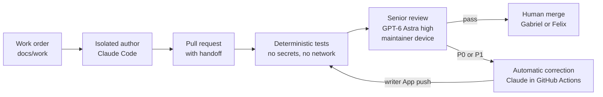

# Aicepeak

This repository holds two things: the product north star for Aicepeak ([AICEPEAK_NORDSTERN.md](AICEPEAK_NORDSTERN.md), German, unchanged) and the **AI software factory** that builds the product. The factory turns an approved work order into a reviewed pull request. An isolated AI author writes the change, deterministic tests and an independent GPT-6 Astra reviewer check it, a bounded automatic correction loop fixes blocking findings, and a human decides the merge.

Only this repository, its work orders and review evidence, and official vendor documentation are project sources. Old projects, private chats, Workbrain content and personal agent memories are not.

## Status on 2026-10-29

| Area | State |
|---|---|
| Factory | Installed on `main`; rulesets, environment secrets and both Apps verified active. The review-fix loop passed live on PR #20 and again on PR #13 (2026-10-29: Astra finding F-006, automatic Claude correction, re-review `pass`). Ready for factory and documentation work. |
| Full operational acceptance | Open: Felix's own reviewer device, two devices racing for one claim, a new head during a running review, a foreign App with the same check name, authenticated skill/MCP calls inside the author container. See [evidence](factory/evidence.md). |
| Product development | North star approved by Gabriel on 2026-10-29 ([decision](docs/decisions/0006-northstar-approval.md)); architecture decisions and implemented product checks remain open. `northstar_approved: true`, `product_checks_ready: false`: only `factory` and `smoke` work orders run. |
| Architecture | Non-binding draft proposal v0.4 (merged with PR #13): [specification sheet and target architecture](docs/architecture/AICEPEAK_SPEC_AND_ARCHITECTURE.md). Its AD-01..AD-12 bind only after adoption through decision records. |

The start-readiness review with measured times, friction and recommendations is in [factory/review-2026-10-29.md](factory/review-2026-10-29.md).

## How the factory works



1. **Work order.** `docs/work/<ID>.md` states goal, non-goals, acceptance criteria and the allowed paths. It is merged in its own PR first, because the factory reads tasks only from the protected base.
2. **Author.** Claude Code works in a fresh, isolated container with the four canonical skills `factory-start`, `factory-change`, `factory-review` and `factory-fix-review`, no personal configuration and only proxied provider access. `runners` allows only `claude`; the optional Codex author has only an API-key path and stays disabled for automatic corrections.
3. **Pull request.** `session.py submit` first runs a collision sweep (the candidate must contain current `main`; overlaps with other open PRs go into the PR body), then an advisory Astra preflight. It opens the PR with exactly one `factory-handoff` block and marks it ready only after a `pass`.
4. **Deterministic gate.** The trusted pipeline on `main` takes a snapshot bound to PR, head, base and policy, then runs syntax, contract, workflow, link and secret checks plus the regression suite without secrets or network. A head that does not contain current `main` fails, so a green check always describes the state a merge produces.
5. **Senior review.** GPT-6 Astra at effort `high` reviews the snapshot in a fresh, tool-less session on a maintainer device (`session.py watch`). GitHub assigns one owner per review; only the publisher App writes the required check.
6. **Correction.** P0/P1 findings on non-control paths start one automatic correction: Claude Sonnet 5.5 in GitHub Actions through Workload Identity Federation; the writer App pushes the verified patch, which starts fresh tests and a fresh review. Control paths (`.github/`, `factory/`, `tools/factory/`, `docs/work/`, README and others in `protected_paths`) are never auto-corrected.
7. **Merge.** With both required checks green and threads resolved, Gabriel or Felix decides and merges with `session.py merge`, one PR at a time. No second human approval is required; agents and bots never merge.

A typical PR needs 6 to 10 minutes from push to two green checks (tests 3 to 5, review 2 to 3), plus about 5 minutes per automatic correction, as long as a maintainer device runs the watcher.

## Roles

| Role | Who | May | May not |
|---|---|---|---|
| Maintainer | Gabriel (`Zerosteps1`), Felix (`truFelix-Zentru`, `ftrutschnig`) | Write work orders, open PRs, run the reviewer, give feedback, merge | Push to `main`; approve their own work through a second own account |
| Author | Claude Code in the isolated container | Change files inside the work order's allowed paths and deliver a patch | Push, merge, see GitHub or provider credentials |
| Senior reviewer | GPT-6 Astra `high` on a maintainer device | Read the snapshot and return structured findings | Use tools, edit, approve a merge |
| Publisher App | `aicepeak-publisher-zerosteps1` (5510081) | Publish the required checks and summaries | Change code |
| Writer App | `aicepeak-writer-zerosteps1` (5510093) | Push a verified correction to the PR branch | Change `main` or merge |

Both Felix accounts belong to the same person: an approval through the second account is not an independent human review. Felix has write access, is in CODEOWNERS and is a bypass actor of both rulesets; repository settings, rulesets, environments and App keys stay with the repository owner.

<a id="gemeinsamer-einstieg-für-gabriel-und-felix"></a>

## Prerequisites and one-time device setup (macOS)

Felix can follow this runbook on his Mac once Gabriel has completed the access handoff below. The README cannot grant account permissions or generate an owner-only App key. Use your own Terminal for the credential steps; never paste a secret into an agent session.

### 1. Access handoff — Gabriel and Felix, once

- **GitHub:** accept the repository invitation and choose either `truFelix-Zentru` or `ftrutschnig` as the active account. Both are configured maintainers; use your own identity.
- **ChatGPT:** Felix needs his own Business workspace seat, local Codex permission and permission to create access tokens. A workspace owner enables these if the token page is unavailable. Follow the [official access-token instructions](https://learn.chatgpt.com/docs/enterprise/access-tokens).
- **Publisher App:** Gabriel opens [the publisher App settings](https://github.com/settings/apps/aicepeak-publisher-zerosteps1), creates a separate key for Felix's device and transfers the PEM through an agreed secure secret-sharing channel. Record which device owns it so it can be revoked separately. GitHub repository write access alone does not grant App-key administration. Follow [GitHub's private-key instructions](https://docs.github.com/en/apps/creating-github-apps/authenticating-with-a-github-app/managing-private-keys-for-github-apps). Felix never needs the writer key.
- **Local author sessions:** agree which Anthropic Console workspace pays for API calls and grant access to its API key plus a Context7 API key. These are separate from the Claude subscription and the WIF credentials used by GitHub Actions. They are not needed for a reviewer-only Mac.

### 2. Install tools and sign in

Install [Homebrew](https://brew.sh/) if it is not already available. In a normal Terminal:

```sh
brew install python git gh node
npm install --prefix "$HOME/.local/share/aicepeak-factory-cli" @openai/codex@0.164.0
export PATH="$HOME/.local/share/aicepeak-factory-cli/node_modules/.bin:$PATH"
python3 --version
git --version
gh --version
codex --version
```

Expected: Python **3.11 or newer** and exactly **`codex-cli 0.164.0`**. Reapply the `export PATH` line in each Terminal used for factory commands. This separate installation does not replace a personal Codex installation. If the access-token UI requires a newer CLI, stop and request a reviewed factory version update; do not silently upgrade the pinned reviewer.

For isolated author sessions, install and start [Docker Desktop for your Mac's processor](https://docs.docker.com/desktop/setup/install/mac-install/), complete its first-launch setup and check `docker info`. Claude Code is installed inside the factory image; no host Claude installation is required.

```sh
gh auth login --hostname github.com --git-protocol https --web
gh auth setup-git
gh api user --jq .login
gh api repos/Zerosteps1/Aicepeak_V2.0.0 --jq '.permissions.push'
git clone https://github.com/Zerosteps1/Aicepeak_V2.0.0.git Aicepeak-factory
cd Aicepeak-factory
git switch main
python3 tools/factory/clients.py check --root .
python3 tools/factory/doctor.py --root . --runner claude
```

Expected GitHub output: your selected Felix login and `true`; a public clone alone does not prove write access. The [GitHub browser login](https://cli.github.com/manual/gh_auth_login) handles authentication without pasting a GitHub token into the factory. Adapter `check` must pass. **Doctor exit 2 is expected:** it always leaves live acceptance open and, at this stage, keys/image may also be missing. It also checks Docker, author keys and local verifier tools on reviewer-only devices. Read each named check instead of treating exit 2 as a failed installation. `actionlint` and `gitleaks` are only needed for full local verification; the Linux-only `factory/install_tools.py` is not a macOS installer.

Keep this clone as a clean control checkout on current `main`. Store patches, reports, PR descriptions and credentials outside all checkouts. `session.py` rejects ignored extra files too (including `.DS_Store`, `__pycache__` or `.venv`). Before use, inspect `git status --short --untracked-files=all --ignored`; do not pull or switch over somebody's uncommitted work. Make candidate changes in a separate checkout.

### 3. Configure and test the reviewer

In the correct Business workspace, open [Access tokens](https://chatgpt.com/admin/access-tokens), create a token for Felix's device with **Codex** scope and a finite expiration, and copy it once. This is a personal workspace access token, not a browser session token or a Platform API key. Store it using the password prompt; `-U` also supports rotation:

```sh
security add-generic-password -U -a "$USER" -s aicepeak-factory-codex-access-token -w
python3 tools/factory/local_review.py --smoke
```

Expected: `"status": "passed"`, `gpt-6-astra`, effort `high`. The smoke uses the personal Codex quota and does not test GitHub publication. On expiry, create a replacement, repeat the keychain command and smoke, then revoke the old token. A 404/forbidden token page requires the workspace owner's permission change; repeatedly logging into GitHub will not fix it.

Store Gabriel's publisher PEM separately. This **zsh** block asks for an absolute path and validates the file before changing the keychain entry:

```sh
read -r "FACTORY_PEM?Absolute path to Felix's publisher PEM: "
if [[ "$FACTORY_PEM" = /* && -s "$FACTORY_PEM" ]] && openssl rsa -in "$FACTORY_PEM" -check -noout; then
  security add-generic-password -U -a "$USER" -s aicepeak-factory-publisher-key \
    -w "$(base64 < "$FACTORY_PEM" | tr -d '\n')"
else
  printf 'No key stored: provide an existing, valid publisher PEM using an absolute path.\n'
fi
unset FACTORY_PEM
```

Never put tokens or PEM contents into chat, Git or PR text. An environment variable `CODEX_ACCESS_TOKEN` or `FACTORY_PUBLISHER_APP_PRIVATE_KEY` overrides the keychain; remove a stale override in your Terminal if rotation appears ineffective. Details: [reviewer credentials](factory/clients.md#senior-reviewer-maintainer-local).

### 4. Configure the isolated author (skip on reviewer-only devices)

Create or obtain an API key for the agreed [Anthropic Console](https://platform.claude.com/) workspace and an API key from the [Context7 dashboard](https://context7.com/dashboard). Enter them at hidden prompts in your own **zsh** Terminal; these lines contain no secret values in shell history:

```sh
read -rs "ANTHROPIC_API_KEY?Anthropic API key: "
printf '\n'
read -rs "CONTEXT7_API_KEY?Context7 API key: "
printf '\n'
export ANTHROPIC_API_KEY CONTEXT7_API_KEY
export FACTORY_DOCKER_HOST="$(docker context inspect --format '{{.Endpoints.docker.Host}}')"
docker build -f factory/Dockerfile -t aicepeak-factory-clients:codex-0.164.0-claude-2.1.311 factory
python3 tools/factory/clients.py smoke --root .
```

Expected: image build succeeds and container smoke reports `passed`. If `docker-credential-desktop` cannot be found, add the actual Docker app's `Contents/Resources/bin` directory to this Terminal's `PATH`, then repeat the build; keep credential-store settings intact. On Gabriel's Mac the app is named `Docker 2.app`; Felix must use his own installation path.

The container smoke does **not** prove authenticated skill or native MCP execution. From the control checkout, run `python3 tools/factory/clients.py launch --root . --runner claude` and request: “Use factory-start for docs/work/FACTORY-SMOKE.md. Read the approved order, make a generic Context7 documentation lookup and an OpenAI Docs lookup, and report both outcomes without changing files.” Verify actual tool outcomes in that interactive session. This consumes Anthropic API usage; the local launcher needs the two keys even though Actions uses WIF. After the session, remove the author keys from this Terminal with `unset ANTHROPIC_API_KEY CONTEXT7_API_KEY`.

### 5. Complete Felix's first real review

Repeat the doctor and inspect relevant checks. A reviewer needs the correct clean checkout, GitHub identity/access, pinned Codex, personal-token smoke and publisher key. An author additionally needs Docker/image, both API keys, boundary smoke and the authenticated skill/MCP probe. Doctor exit 2 still does not certify live acceptance.

Create a harmless smoke PR under the already approved [FACTORY-SMOKE](docs/work/FACTORY-SMOKE.md). Coordinate with Gabriel so **only Felix's device watches this first smoke**; otherwise Gabriel can win the review claim and two green checks would not test Felix's key. The following runs from the control checkout and uses a new sibling checkout; choose another unused directory if `Aicepeak-felix-smoke` already exists. Replace the Git author placeholders with your own name and verified GitHub email before committing. The fixture change alters indentation only, leaving all numeric and text values correct:

```sh
git pull --ff-only
git clone https://github.com/Zerosteps1/Aicepeak_V2.0.0.git ../Aicepeak-felix-smoke
cd ../Aicepeak-felix-smoke
git switch -c "smoke/felix-$(date +%Y%m%d-%H%M%S)"
git config --local user.name 'YOUR NAME'
git config --local user.email 'YOUR VERIFIED GITHUB EMAIL'
python3 - <<'PY'
import json
from pathlib import Path
path = Path('factory-smoke.json')
value = json.loads(path.read_text())
assert value['quantity'] * value['unit_price'] == value['total']
path.write_text(json.dumps(value, ensure_ascii=False, indent=4) + '\n')
PY
git diff -- factory-smoke.json
git add factory-smoke.json
git commit -m 'test(factory): verify Felix reviewer device with unchanged smoke values'
git push -u origin HEAD
cd ../Aicepeak-factory
printf '%s\n' 'Verify Felix reviewer device using the approved FACTORY-SMOKE fixture; formatting only.' > ../felix-smoke-pr.md
python3 tools/factory/session.py submit --candidate ../Aicepeak-felix-smoke \
  --task docs/work/FACTORY-SMOKE.md --runner claude \
  --title 'test(factory): Felix reviewer device smoke' --body-file ../felix-smoke-pr.md
```

`submit` starts an advisory preflight, opens the PR and runs its watcher. If `main` moved meanwhile, update the clean control checkout and merge the new `origin/main` into the candidate, commit any resolution, push, then retry; do not bypass freshness checks. If you resume an existing PR, use `python3 tools/factory/session.py watch --pr <number>` from the updated control checkout. Keep the Mac awake. Confirm both `factory/deterministic` and `factory/senior-review` from App **5510081** are successful for that PR's current head and current `main` policy (see [merge rules](#merge-rules)). The watcher can keep polling after success; Ctrl-C stops it once both final checks are green. This is the publication test for Felix's publisher key; a successful model smoke alone is insufficient. Record the head/base, run/check IDs and Felix's executed probes in a reviewed evidence update. Until then, his device remains unverified; Gabriel's working reviewer may review shared PRs.

Also inspect the final senior check receipt (`output.text` JSON) and confirm `claim.actor.login` is Felix's active account. If another maintainer won the claim, this run is not acceptance of Felix's device: coordinate again and create a fresh smoke PR or deliberate retry. The smoke fixture needs no merge. Product implementation still requires architecture decisions, implemented product checks and an approved product work order; the north-star approval alone does not remove that gate.


## Daily use, step by step

1. **Write a work order.** Copy [docs/work/TEMPLATE.md](docs/work/TEMPLATE.md), fill in goal, non-goals, acceptance criteria and allowed paths, set `status` to `approved` and merge it in its own PR (handoff task `docs/work/FACTORY-001.md` allows `docs/work/`). One work order per feature, not per commit.
2. **Implement.** From the clean control checkout on current `main`, start the isolated author with `python3 tools/factory/clients.py launch --root . --runner claude` and use the `factory-change` skill. The launcher copies the trusted checkout into a fresh container, applies the trusted control overlays and does not modify your checkout; it returns a patch artifact plus only a generic completion note, so keep the author's explanation from the interactive session. For a saved author report use the unattended `clients.py run` interface, which takes the candidate (`--root`) and the trusted base (`--policy-root`) separately ([clients](factory/clients.md#build-and-run)).
3. **Apply the patch to a candidate branch.** In a separate candidate checkout on a feature branch, inspect the patch and the author's explanation, apply only the changes the work order allows (`git apply`), commit and push. Do not run candidate scripts on your credential-bearing host: the trusted pipeline runs the tests in an isolated job without secrets or network. A local structural check uses only the control checkout's verifier: `python3 tools/factory/verify.py --root /path/to/candidate --trusted-root . --structure-only`. The container keeps control files (`.agents/`, native adapters, `AGENTS.md`, `CLAUDE.md`, `factory/`, `tools/factory/`) read-only; for those the author only proposes a change, and a maintainer applies it in an ordinary checkout, regenerates adapters and submits a manually managed PR ([protected factory changes](factory/clients.md#protected-factory-changes)).
4. **Check for collisions, then submit.** From the control checkout, `python3 tools/factory/session.py collisions --candidate /path/to/candidate --task docs/work/TASK.md` reports whether the candidate contains current `main`, which files a merge of `main` would conflict in, and for every other open PR the shared files or work order and the files a trial merge would conflict in (disjoint files alone do not prove a clean merge). It only reads both checkouts. If you code with your own Claude Code or Codex session, let it run this command before you submit. Resolve conflicts with `main` in the candidate (merge `main`, fix, commit, push); never adapt the candidate to an unmerged PR. `submit` repeats the sweep, refuses a candidate behind `main` before any model call and records the result in the PR body:

   ```sh
   python3 tools/factory/session.py submit --candidate /path/to/candidate \
     --task docs/work/TASK.md --runner claude \
     --title 'Concrete change' --body-file /path/to/pr-body.md
   ```

   `submit` reruns the advisory preflight, creates a draft, marks it ready only after `pass` and a fresh head/base check, and then watches the PR. If the preflight lacks context (for example an unchanged module the change relies on), add `--context <path>`.
5. **Review.** Every ready PR waits for the binding review until a maintainer device runs `python3 tools/factory/session.py watch --pr <n>`. Without a running watcher nothing reviews on a laptop.
6. **Act on findings.** P0/P1 block and start the automatic correction where allowed; otherwise the PR gets `needs-author-action` and you continue with `factory-fix-review`. P2 findings are hints.
7. **Give feedback.** Ordinary PR comments, reviews and inline comments by Gabriel or Felix start a fresh review that takes them into account. `session.py response --pr <n> --question '…' --post` answers questions with citations and changes nothing.
8. **Merge one PR at a time.** Update only the PR you merge next ("Update branch"), wait for its fresh checks and review, then run `session.py merge` (see [merge rules](#merge-rules)) and update the control checkout (`git pull --ff-only`). Leave the other open PRs until it is their turn: every update costs a fresh review, and every claimed review counts against the per-PR limit.

Review all waiting PRs on a set-up maintainer device (stop with Ctrl-C):

```sh
while true; do
  for pr in $(gh pr list --repo Zerosteps1/Aicepeak_V2.0.0 --label awaiting-senior-review --json number --jq '.[].number'); do
    python3 tools/factory/session.py watch --pr "$pr" --once
  done
  sleep 60
done
```

### Working in parallel

Gabriel, Felix and their agents can work on several PRs at once. Parallel PRs break each other when they were each tested alone but merged together, mostly through shared files such as test modules, registries or lockfiles. The factory keeps that visible and safe:

- **Before the PR:** `session.py collisions` (and `submit`) shows overlaps with other open PRs and a shared work order. Agree on the order instead of coding against unmerged changes; keep PRs small and away from shared hotspots where possible.
- **While open:** the gate fails any head that does not contain current `main`, so stale heads never look mergeable.
- **At merge time:** one merge at a time with `session.py merge`. Merges through it are serialized by a lock, so two maintainers can never merge against the same `main` at once. The PR merged second updates its branch, resolves its own conflicts with `main` (with `factory-fix-review` or your own session), and gets a fresh run and review before its merge.

## Status labels and limits

| Signal | Meaning |
|---|---|
| `awaiting-senior-review` | Deterministic checks passed; the binding Astra review has not run yet. A maintainer starts it with `session.py watch --pr <n>`. |
| `needs-author-action` | Tests or review block, a limit is exhausted, or a control path needs a human-driven fix. The PR comment names the next step and, for a failed author run, a classified launcher reason. |
| No label, two green checks | A human decides about the merge. |

Per PR (from [factory/config.json](factory/config.json)): at most 2 automatic correction rounds, 6 claimed reviews, USD 25 author budget (USD 12 per run), 40 changed files, about 800 KB of review material and a 15-minute timeout per run. Exhausted limits, conflicts and missing credentials always end in `needs-author-action`, never in a silent pass.

A stuck run is restarted deliberately, which revokes earlier results; GitHub's "Re-run jobs" is refused because it would reuse old reservations:

```sh
gh workflow run factory.yml --repo Zerosteps1/Aicepeak_V2.0.0 --ref main -f pr=123 -f retry=true
```

## Merge rules

- Normal case: both App-bound required checks `factory/deterministic` and `factory/senior-review` are green on the current head and all threads are resolved; then Gabriel or Felix merges from the clean control checkout on current `main`, with their own `gh` login:

  ```sh
  python3 tools/factory/session.py merge --pr <n> --dry-run   # verdict only
  python3 tools/factory/session.py merge --pr <n>
  ```

  The "updates by humans only" ruleset lets `main` change only through a maintainer's PR merge, so every merge uses the maintainer bypass, which also skips GitHub's check and up-to-date rules. `merge` therefore verifies them itself and refuses unless the PR is ready, its head contains current `main`, both checks from App 5510081 are `success` with an `external_id` (`repository:PR:head:policy:run:attempt`) bound to exactly this head and current `main`, handoff and human feedback are unchanged since that review, and no review thread is open. GitHub's merge pins only the head, never the base, so `merge` first takes the lock `refs/tags/factory-merge-lock` (GitHub creates a ref atomically and refuses an existing one), re-checks `main`, the PR, both checks and the threads while holding it, merges with `--admin --match-head-commit <head>`, releases the lock, compares the merge commit's parents with the verified `main` and head, and records the result as a PR comment. If GitHub gives no answer to the merge (timeout, abort), the lock stays, because GitHub may still merge; a held lock therefore means another merge is running or its outcome is unknown. Check the named PR (merged: verify `main`; certainly not merged: fine), then remove the lock with `gh api -X DELETE repos/Zerosteps1/Aicepeak_V2.0.0/git/refs/tags/factory-merge-lock`. If `main` moved, use "Update branch" and wait for the fresh checks and review.
- Stuck PR (no reviewer device, model failure, exhausted limits): a maintainer may merge deliberately through the ruleset bypass. This is outside the `session.py merge` guarantee: it takes no lock and does not re-validate against the `main` it lands on. Write the reason as a PR comment first; GitHub records every bypass. A bypassed PR has no independent review, so use this sparingly.
- Never: direct pushes to `main`, auto-merge, agent or bot merges, or changing protection rules to force a green result.

## Costs

| Item | Cost |
|---|---|
| Senior reviews and preflights | ChatGPT Business Codex quota of the maintainer running them; no API billing |
| Automatic corrections | Anthropic API usage in the Console workspace of the WIF federation, capped per run and per PR; check balance and auto-reload in the Console |
| Local isolated author sessions | Anthropic API usage through `ANTHROPIC_API_KEY` |
| GitHub Actions | Watch usage and the plan; the repository is currently public |

No additional review platform or memory database is used. There is no promise of free use.

## Repository map

| Path | Content |
|---|---|
| [AICEPEAK_NORDSTERN.md](AICEPEAK_NORDSTERN.md) | Canonical product goal (German); never copied |
| [AGENTS.md](AGENTS.md), [CLAUDE.md](CLAUDE.md), [CONTRIBUTING.md](CONTRIBUTING.md) | Shared agent rules and the contribution flow |
| [factory/policy.md](factory/policy.md), [factory/config.json](factory/config.json) | Binding policy, models, maintainers, limits, protected paths |
| [factory/evidence.md](factory/evidence.md), [factory/review-2026-10-29.md](factory/review-2026-10-29.md) | Real verification evidence and the start-readiness review |
| [factory/github.md](factory/github.md), [factory/clients.md](factory/clients.md) | GitHub operation, rulesets, isolated clients and the local reviewer |
| `.agents/`, `.claude/`, `.codex/` | Canonical skills and roles; generated native adapters (`clients.py sync`, checked by `clients.py check`) |
| `.github/` | Trusted pipeline, dispatcher, feedback ingress, CODEOWNERS, templates |
| `tools/factory/` | Factory tools and their regression tests |
| [docs/work/](docs/work/TEMPLATE.md) | Approved work orders |
| [docs/decisions/](docs/decisions/0005-maintainer-local-senior-review.md) | Decision records |
| [docs/architecture/](docs/architecture/AICEPEAK_SPEC_AND_ARCHITECTURE.md) | Non-binding architecture proposal and its validation |

Full local verification (needs `actionlint` and `gitleaks`):

```sh
python3 tools/factory/verify.py --root .
python3 -I -B -m unittest discover -s tools/factory/tests
```
