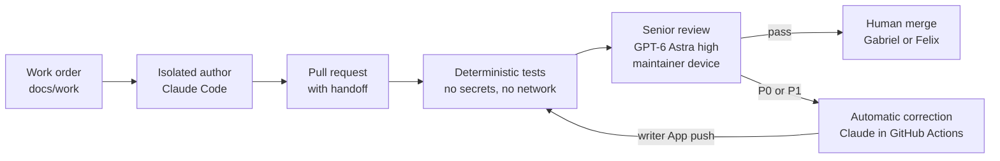

# Aicepeak

This repository holds two things: the product north star for Aicepeak ([AICEPEAK_NORDSTERN.md](AICEPEAK_NORDSTERN.md), German, unchanged) and the **AI software factory** that builds the product. The factory turns an approved work order into a reviewed pull request. An isolated AI author writes the change, deterministic tests and an independent GPT-6 Astra reviewer check it, a bounded automatic correction loop fixes blocking findings, and a human decides the merge.

Only this repository, its work orders and review evidence, and official vendor documentation are project sources. Old projects, private chats, Workbrain content and personal agent memories are not.

## Status on 2026-10-29

| Area | State |
|---|---|
| Factory | Installed on `main`; rulesets, environment secrets and both Apps verified active. The review-fix loop passed live on PR #20 and again on PR #13 (2026-10-29: Astra finding F-006, automatic Claude correction, re-review `pass`). Ready for factory and documentation work. |
| Full operational acceptance | Open: Felix's own reviewer device, two devices racing for one claim, a new head during a running review, a foreign App with the same check name, authenticated skill/MCP calls inside the author container. See [evidence](factory/evidence.md). |
| Product development | Blocked by design: `northstar_approved: false` and `product_checks_ready: false` in [factory/config.json](factory/config.json). Only `factory` and `smoke` work orders run. |
| Architecture | Non-binding draft proposal v0.4 (merged with PR #13): [specification sheet and target architecture](docs/architecture/AICEPEAK_SPEC_AND_ARCHITECTURE.md). Its AD-01..AD-12 bind only after adoption through decision records. |

The start-readiness review with measured times, friction and recommendations is in [factory/review-2026-10-29.md](factory/review-2026-10-29.md).

## How the factory works



1. **Work order.** `docs/work/<ID>.md` states goal, non-goals, acceptance criteria and the allowed paths. It is merged in its own PR first, because the factory reads tasks only from the protected base.
2. **Author.** Claude Code works in a fresh, isolated container with the four canonical skills `factory-start`, `factory-change`, `factory-review` and `factory-fix-review`, no personal configuration and only proxied provider access. `runners` allows only `claude`; the optional Codex author has only an API-key path and stays disabled for automatic corrections.
3. **Pull request.** `session.py submit` runs an advisory Astra preflight, opens the PR with exactly one `factory-handoff` block and marks it ready only after a `pass`.
4. **Deterministic gate.** The trusted pipeline on `main` takes a snapshot bound to PR, head, base and policy, then runs syntax, contract, workflow, link and secret checks plus the regression suite without secrets or network.
5. **Senior review.** GPT-6 Astra at effort `high` reviews the snapshot in a fresh, tool-less session on a maintainer device (`session.py watch`). GitHub assigns one owner per review; only the publisher App writes the required check.
6. **Correction.** P0/P1 findings on non-control paths start one automatic correction: Claude Sonnet 5.5 in GitHub Actions through Workload Identity Federation; the writer App pushes the verified patch, which starts fresh tests and a fresh review. Control paths (`.github/`, `factory/`, `tools/factory/`, `docs/work/`, README and others in `protected_paths`) are never auto-corrected.
7. **Merge.** With both required checks green and threads resolved, Gabriel or Felix decides. No second human approval is required; agents and bots never merge.

A typical PR needs 6 to 10 minutes from push to two green checks (tests 3 to 5, review 2 to 3), plus about 5 minutes per automatic correction, as long as a maintainer device runs the watcher.

## Roles

| Role | Who | May | May not |
|---|---|---|---|
| Maintainer | Gabriel (`Zerosteps1`), Felix (`truFelix-Zentru`, `ftrutschnig`) | Write work orders, open PRs, run the reviewer, give feedback, merge | Push to `main`; approve their own work through a second own account |
| Author | Claude Code in the isolated container | Change files inside the work order's allowed paths and deliver a patch | Push, merge, see GitHub or provider credentials |
| Senior reviewer | GPT-6 Astra `high` on a maintainer device | Read the snapshot and return structured findings | Use tools, edit, approve a merge |
| Publisher App | `aicepeak-publisher-zerosteps1` (5510081) | Publish the required checks and summaries | Change code |
| Writer App | `aicepeak-writer-zerosteps1` (5510093) | Push a verified correction to the PR branch | Change `main` or merge |

Both Felix accounts belong to the same person: an approval through the second account is not an independent human review. Felix has write access, is in CODEOWNERS and is a bypass actor of both rulesets; repository settings, rulesets, environments and App keys stay with the repository owner.

<a id="gemeinsamer-einstieg-für-gabriel-und-felix"></a>

## Prerequisites and one-time device setup

Needed: Python 3.11 or newer, Git, `gh` with your own login, Docker (only for isolated author sessions), Codex CLI exactly `0.164.0`, and a ChatGPT Business seat with Codex. Verifier versions and hashes are pinned in [factory/tools.lock.json](factory/tools.lock.json); `actionlint` and `gitleaks` are needed only for a full local `verify.py` run.

```sh
git clone https://github.com/Zerosteps1/Aicepeak_V2.0.0.git Aicepeak-factory
cd Aicepeak-factory
git switch main
python3 tools/factory/doctor.py --root . --runner claude
python3 tools/factory/clients.py check --root .
```

Keep this clone as a clean control checkout on `main`; do code work in a separate working copy or worktree. Never pull or switch branches over someone else's uncommitted changes. The doctor checks prerequisites only; a positive result is no live acceptance. Personal global configuration is not changed.

Store your own Codex token once per reviewer device and run the reviewer smoke:

```sh
security add-generic-password -a "$USER" -s aicepeak-factory-codex-access-token -w
python3 tools/factory/local_review.py --smoke
```

The smoke must report `"status": "passed"` with `gpt-6-astra` and effort `high`. No `OPENAI_API_KEY` is needed for reviews.

Maintainer devices that publish review results also need the publisher App key, ideally a new key per device generated on the App page. Store it base64-encoded from an absolute path (a wrong path creates an empty entry):

```sh
security add-generic-password -U -a "$USER" -s aicepeak-factory-publisher-key \
  -w "$(base64 < /absolute/path/key.pem | tr -d '\n')"
```

Never put tokens or PEM contents into chat, Git, PR text or a model shell, and never distribute the writer key. Details and token limits: [clients](factory/clients.md#senior-reviewer-maintainer-local).

Isolated author sessions additionally need the client image and, locally, `ANTHROPIC_API_KEY` and `CONTEXT7_API_KEY` in the launcher environment (Anthropic API usage, billed per use):

```sh
export FACTORY_DOCKER_HOST="$(docker context inspect --format '{{.Endpoints.docker.Host}}')"
docker build -f factory/Dockerfile -t aicepeak-factory-clients:codex-0.164.0-claude-2.1.311 factory
python3 tools/factory/clients.py smoke --root .
```

If Docker reports `docker-credential-desktop: executable file not found`, add the `Contents/Resources/bin` folder of the actual Docker app temporarily to `PATH` (on Gabriel's Mac it is `Docker 2.app`); do not delete credential-store settings.

## Daily use, step by step

1. **Write a work order.** Copy [docs/work/TEMPLATE.md](docs/work/TEMPLATE.md), fill in goal, non-goals, acceptance criteria and allowed paths, set `status` to `approved` and merge it in its own PR (handoff task `docs/work/FACTORY-001.md` allows `docs/work/`). One work order per feature, not per commit.
2. **Implement.** In a separate candidate checkout on a feature branch, start the isolated author with `python3 tools/factory/clients.py launch --root . --runner claude` and use the `factory-change` skill. `launch` does not modify your checkout: it returns a patch artifact and the author's report.
3. **Apply and verify the patch yourself.** Read the report, inspect the patch, apply only the changes the work order allows to the candidate branch (`git apply`), run the verification the work order names (at least `python3 tools/factory/verify.py --root .`), then commit and push. The container keeps control files (`.agents/`, native adapters, `AGENTS.md`, `CLAUDE.md`, `factory/`, `tools/factory/`) read-only; for those the author only proposes a change, and a maintainer applies it in an ordinary checkout, runs `clients.py sync` and `clients.py check` plus the test harness, and submits a manually managed PR ([protected factory changes](factory/clients.md#protected-factory-changes)).
4. **Submit.** From the control checkout:

   ```sh
   python3 tools/factory/session.py submit --candidate /path/to/candidate \
     --task docs/work/TASK.md --runner claude \
     --title 'Concrete change' --body-file /path/to/pr-body.md
   ```

   `submit` reruns the advisory preflight, creates a draft, marks it ready only after `pass` and a fresh head/base check, and then watches the PR. If the preflight lacks context (for example an unchanged module the change relies on), add `--context <path>`.
5. **Review.** Every ready PR waits for the binding review until a maintainer device runs `python3 tools/factory/session.py watch --pr <n>`. Without a running watcher nothing reviews on a laptop.
6. **Act on findings.** P0/P1 block and start the automatic correction where allowed; otherwise the PR gets `needs-author-action` and you continue with `factory-fix-review`. P2 findings are hints.
7. **Give feedback.** Ordinary PR comments, reviews and inline comments by Gabriel or Felix start a fresh review that takes them into account. `session.py response --pr <n> --question '…' --post` answers questions with citations and changes nothing.
8. **Merge.** See [merge rules](#merge-rules). After every merge, update the control checkout (`git pull --ff-only`) and bring open PRs up to date with "Update branch"; their fresh run follows automatically.

Review all waiting PRs on a set-up maintainer device (stop with Ctrl-C):

```sh
while true; do
  for pr in $(gh pr list --repo Zerosteps1/Aicepeak_V2.0.0 --label awaiting-senior-review --json number --jq '.[].number'); do
    python3 tools/factory/session.py watch --pr "$pr" --once
  done
  sleep 60
done
```

## Status labels and limits

| Signal | Meaning |
|---|---|
| `awaiting-senior-review` | Deterministic checks passed; the binding Astra review has not run yet. A maintainer starts it with `session.py watch --pr <n>`. |
| `needs-author-action` | Tests or review block, a limit is exhausted, or a control path needs a human-driven fix. The PR comment names the next step and, for a failed author run, a classified launcher reason. |
| No label, two green checks | A human decides about the merge. |

Per PR (from [factory/config.json](factory/config.json)): at most 2 automatic correction rounds, 6 claimed reviews, USD 25 author budget (USD 12 per run), 40 changed files, about 800 KB of review material and a 15-minute timeout per run. Exhausted limits, conflicts and missing credentials always end in `needs-author-action`, never in a silent pass.

A stuck run is restarted deliberately, which revokes earlier results; GitHub's "Re-run jobs" is refused because it would reuse old reservations:

```sh
gh workflow run factory.yml --repo Zerosteps1/Aicepeak_V2.0.0 --ref main -f pr=123 -f retry=true
```

## Merge rules

- Normal case: both App-bound required checks `factory/deterministic` and `factory/senior-review` are green and all threads are resolved; then Gabriel or Felix merges. The "updates by humans only" ruleset lets `main` change only through a maintainer's PR merge, so on the command line the merge is `gh pr merge <n> --merge --admin`. That flag also skips the check rule, so use it only after confirming both checks are green.
- Stuck PR (no reviewer device, model failure, exhausted limits): a maintainer may merge deliberately through the ruleset bypass. Write the reason as a PR comment first; GitHub records every bypass. A bypassed PR has no independent review, so use this sparingly.
- Never: direct pushes to `main`, auto-merge, agent or bot merges, or changing protection rules to force a green result.

## Costs

| Item | Cost |
|---|---|
| Senior reviews and preflights | ChatGPT Business Codex quota of the maintainer running them; no API billing |
| Automatic corrections | Anthropic API usage in the Console workspace of the WIF federation, capped per run and per PR; check balance and auto-reload in the Console |
| Local isolated author sessions | Anthropic API usage through `ANTHROPIC_API_KEY` |
| GitHub Actions | Watch usage and the plan; the repository is currently public |

No additional review platform or memory database is used. There is no promise of free use.

## Repository map

| Path | Content |
|---|---|
| [AICEPEAK_NORDSTERN.md](AICEPEAK_NORDSTERN.md) | Canonical product goal (German); never copied |
| [AGENTS.md](AGENTS.md), [CLAUDE.md](CLAUDE.md), [CONTRIBUTING.md](CONTRIBUTING.md) | Shared agent rules and the contribution flow |
| [factory/policy.md](factory/policy.md), [factory/config.json](factory/config.json) | Binding policy, models, maintainers, limits, protected paths |
| [factory/evidence.md](factory/evidence.md), [factory/review-2026-10-29.md](factory/review-2026-10-29.md) | Real verification evidence and the start-readiness review |
| [factory/github.md](factory/github.md), [factory/clients.md](factory/clients.md) | GitHub operation, rulesets, isolated clients and the local reviewer |
| `.agents/`, `.claude/`, `.codex/` | Canonical skills and roles; generated native adapters (`clients.py sync`, checked by `clients.py check`) |
| `.github/` | Trusted pipeline, dispatcher, feedback ingress, CODEOWNERS, templates |
| `tools/factory/` | Factory tools and their regression tests |
| [docs/work/](docs/work/TEMPLATE.md) | Approved work orders |
| [docs/decisions/](docs/decisions/0005-maintainer-local-senior-review.md) | Decision records |
| [docs/architecture/](docs/architecture/AICEPEAK_SPEC_AND_ARCHITECTURE.md) | Non-binding architecture proposal and its validation |

Full local verification (needs `actionlint` and `gitleaks`):

```sh
python3 tools/factory/verify.py --root .
python3 -I -B -m unittest discover -s tools/factory/tests
```
