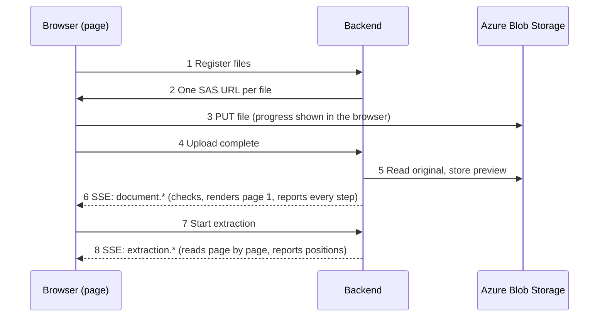

<!-- GENERATED HANDOFF -->
<!-- Source: Claude Doc "Aicepeak Document Upload · Handoff" (https://claude.ai/artifact/J6caVQpuQ81wUt7wavSs9w), as of 2026-11-18 -->
# Aicepeak Document Upload · Handoff

## Overview

The "Neues Projekt" (new project) page takes documents, has the backend check them, and then extracts the positions. It ships as plain HTML, CSS and JS with no build step in `design/document-upload/`, next to the login. It is built from the frame "Neues Projekt · Ablauf · interaktiv" on the Aicepeak App canvas (page A1).

The UI copy stays German, as in the designs. Quoted German words in this handoff are UI labels.

| File | Contents |
| --- | --- |
| `index.html` | Markup for both steps, templates for a sheet, a document line and a position row |
| `styles.css` | Page layout and a few page tokens; everything else comes from `../tokens.css` and `../components.css` |
| `app.js` | State, rendering, upload, SSE handling, mock API |
| `assets/sample-first-page.jpg` | Sample first-page preview, used by the mock only |

To run it, open `index.html` in a browser. Without parameters it runs the mock, and "Beispieldokumente laden" fills the drop tray. Parameters: `?theme=light|dark`, `?mock=0` for the real backend, `?project=<id>` for the project.

The page builds on the existing design tokens. Colours, glass, type, spacing and radii come from `tokens.css`; the menu bar, navigation, buttons and dot use the `pg-` classes. `styles.css` only adds `--np-*` tokens. Most of them point at system tokens (panel = `--glass-card`, segments = `--signal`/`--line`); five values are new (see Light and dark).

## Flow and states

A project goes through two steps on one page: add and check documents, then extract. Page state lives as attributes on `#app`: `data-screen` (`upload` | `extract`), `data-empty` (`true` while the drop tray is empty), `data-extraction` (`idle` | `running` | `done` | `failed`) and `data-mock`.

| State | What you see | How to move on |
| --- | --- | --- |
| Empty | The drop tray is one large drop zone with a hint; "Weiter" is locked | Drop or choose files |
| Documents in the tray | Compact drop zone, one sheet per document below it | Wait until all are checked |
| Checked | Every sheet shows a result; "Weiter zur Extraktion" unlocks once at least one document is usable | "Weiter zur Extraktion" |
| Extraction running | One line per usable document, page counter, positions, "Zuletzt übernommen" (latest positions) | Wait (the user may leave the page) |
| Done | All lines full, a check mark instead of the pulse, "Weiter zu den Positionen" unlocked | Go to the positions |

"Abbrechen" (cancel) calls `cancel` in any state and returns to the empty drop tray, or to `CONFIG.cancelUrl` if set.

Each document has its own status (`data-state` on its sheet):

1. `uploading`: upload to Blob Storage in progress, "Wird hochgeladen · 42 %", sheet faded.
2. `queued`: uploaded, waiting to be checked, "Wartet", sheet faded.
3. `checking`: the backend is reading it, scan line running, "Wird gelesen · Seite 6/9".
4. `usable`: financial report found; black stamp with the statements found (e.g. "GuV · Bilanz"), "Geprüft".
5. `not_financial`: no financial report; orange stamp "Kein Finanzbericht", "Nicht verwendbar", link "Entfernen" (remove).
6. `failed`: upload or check failed; error text and "Entfernen". Can happen after any step.

Unusable documents block nothing. They stay in the tray, are skipped during extraction, and are named as not used in the extraction panel's header.

## Where the data comes from

Files go straight from the browser into Azure Blob Storage; the backend issues a short-lived SAS URL per file. Checking and extraction run in the backend. Everything that happens there comes back as Server-Sent Events. The page never estimates progress on its own.

The browser only sends metadata to the backend; the file itself goes directly into Blob Storage with the SAS URL. Everything after that, the backend reports through the stream (dashed).

**Upload, step by step**

1. Files are dropped or chosen. The page filters by extension (PDF, DOC, DOCX, XLS, XLSX) and size (50 MB) and names rejected files in the hint at the bottom right.
2. `POST /api/projects/{projectId}/documents` with `{ files: [{ name, size, contentType }] }` returns `{ documents: [{ documentId, uploadUrl, blobName }] }` in the same order. `uploadUrl` is a SAS URL with write access to that one blob only.
3. The browser uploads with `PUT uploadUrl`, sending `x-ms-blob-type: BlockBlob` and the file's content type. It uses XHR instead of fetch so upload progress can be shown in percent.
4. `POST /api/projects/{projectId}/documents/{documentId}/complete` reports the finished upload, which queues the document for checking.

Suggested blob layout in the container: `projects/{projectId}/documents/{documentId}/original.{ext}` for the file and `…/preview.webp` for the preview. The storage account needs a CORS rule that allows `PUT` from the app domain.

**Other endpoints**

| Call | When | Response |
| --- | --- | --- |
| `GET /api/projects/{projectId}` | On load and after every stream reconnect | Project, all documents with status, pages, preview URL, extraction state |
| `DELETE /api/projects/{projectId}/documents/{documentId}` | "Entfernen" on a sheet | 204 |
| `POST /api/projects/{projectId}/extraction` | "Weiter zur Extraktion" | 202, then events |
| `POST /api/projects/{projectId}/cancel` | "Abbrechen" | 204 |
| `GET /api/projects/{projectId}/events` | For as long as the page is open | SSE stream (below) |

The stream uses `EventSource` with `withCredentials`. Since the backend also serves the frontend, the session cookie authenticates the stream; `EventSource` cannot send an Authorization header.

**Stream events** (name in the SSE `event` field, payload as JSON in `data`)

| Event | Payload | Meaning |
| --- | --- | --- |
| `document.checking` | `documentId, page, pages, unit` | Checking started or reached `page`. `unit` is `S.` (pages) or `Bl.` (spreadsheet sheets) |
| `document.preview` | `documentId, previewUrl` | The first page has been rendered (see Document preview) |
| `document.checked` | `documentId, result, statements[]` | `result`: `usable` or `not_financial`. `statements`: `income_statement`, `balance_sheet`, `cash_flow`, `plan` |
| `document.failed` | `documentId, code, message` | `message` is shown on the sheet |
| `extraction.started` | `documentId, pages` | Reading of this document begins |
| `extraction.page` | `documentId, pagesRead, positions` | A page has been read. `positions` = project total so far |
| `extraction.position` | `documentId, page, name, value, period, source` | One extracted position for the latest-positions table. `value` is already formatted (e.g. `−6 900`) |
| `extraction.finished` | `positions` | All pages read |
| `extraction.failed` | `code, message` | Extraction stopped |

Several documents may be checked or read at the same time; the page keeps state per `documentId`. Events for a removed document are ignored.

## What triggers animations and states

Every movement on the page is tied to an event, an upload callback or a click. When nothing is happening, the page is still.

| Trigger | What changes | Animation |
| --- | --- | --- |
| Page load | `GET` project, stream opens; empty tray or existing sheets | Title rises in (0.5 s) |
| File dropped or chosen | Sheet appears with status `uploading`, tray turns compact | Sheet rises in (0.5 s); the signal band glides under the grown panel (0.6 s) |
| XHR progress | Percent in the status | none |
| Upload complete | Status `queued`, "Wartet" | none; the sheet stays faded (72 %) |
| `document.checking` | Status `checking`, page counter | Scan line sweeps the sheet (1.2 s back and forth), dot pulses (1.6 s), the unread part sits under a veil |
| `document.preview` | Preview replaces the drawn hairlines | Preview fades in (0.4 s) |
| `document.checked` | Stamp and result; hint and button at the bottom update | Scan and pulse stop; unusable sheets stay at 80 % |
| "Weiter zur Extraktion" | Step 2, one line per usable document, all pending | Title rises in; the band glides under the new panel |
| `extraction.started` | The document's first segment becomes "being read" | A glow runs through that segment (1.2 s, linear) |
| `extraction.page` | Segment turns blue, the next one becomes "being read", counters rise | Segment colour fades over (0.3 s); the glow moves on |
| `extraction.position` | New row at the top of the latest-positions table, three at most | Row rises in; the newest row's marker is blue |
| `extraction.finished` | Check mark instead of the pulse, "Weiter zu den Positionen" unlocked | Glows stop |
| "Abbrechen" | Back to the empty tray | Title rises in |

Documents with more than 150 pages (`CONFIG.stripAbovePages`) get one continuous strip instead of segments. It fills like a progress bar, and the glow runs through the part not yet read (2.4 s). This rule comes from the design-system extraction frame.

With `prefers-reduced-motion`, scan, pulse and glows stand still (the glow rests at 25 % of its segment) and transitions are off. States stay readable through colour and text.

Important for the glass: never animate `transform`, `opacity` or `filter` on an element that contains a glass panel. The panel then loses its blur over the signal band. That is why only titles, sheets and rows rise in, never `main` or the panel.

## Document preview: the first page

The image on each sheet is a preview of the first page of that exact document. It is not an icon or a category graphic. In the design and the mock all four sheets show the same cover ("Financial Forecasting Tool") because only that one sample page was available. In the real app every sheet shows its own first page.

- **Rendering:** in the backend, as soon as checking starts. PDF: render page 1. DOC/DOCX: convert to PDF first, then page 1. XLS/XLSX: render the first sheet as a page, the way it would print.
- **Format:** WebP or PNG, about 640 px wide (a sheet is about 330 px wide in the tray, so double density). Stored as its own blob next to the original.
- **Delivery:** `document.preview` with `previewUrl`, a SAS URL with read access to exactly this blob, valid for a few hours. After a reload it comes again with `GET /api/projects/{projectId}`.
- **Display:** at A4 proportions (210 : 297), cropped from the top (`object-fit: cover; object-position: top`). Landscape pages and spreadsheets show their top part.
- **Until the preview arrives:** drawn hairlines on paper as a placeholder. The preview fades in over it (0.4 s) once the image has loaded, not when the event arrives.
- **No image possible** (e.g. a password-protected PDF): don't send `document.preview`. The placeholder stays; the result comes with `document.checked` or `document.failed`.
- **Accessibility:** the preview is decorative (`alt=""`); the sheet's name and status are in the list item's `aria-label`.

## Light and dark

The theme is set as `data-theme` on `<html>`, as `tokens.css` expects. The default follows the system setting; `?theme=light|dark` forces one. The page follows system changes live.

All colours come from the design system. Where the page needs its own roles, the `--np-*` tokens point at system tokens. Only these values are new:

| Token | Light | Dark | Used for |
| --- | --- | --- | --- |
| `--np-drop-line` | `rgba(22,22,22,0.28)` | `rgba(255,255,255,0.24)` | Dashed outline of the drop zone |
| `--np-status` | `rgba(250,250,248,0.82)` | `rgba(30,30,28,0.84)` | Status strip on the preview |
| `--np-wash` | `rgba(250,250,248,0.62)` | `rgba(21,21,20,0.6)` | Veil over the unread part while checking |
| `--np-lines` | `rgba(255,255,255,0.45)` | `rgba(255,255,255,0.04)` | Surface behind the lines |
| `--np-seg-now` | `--line-soft` | `#4a4844` | Segment being read; `--line-soft` is too close to the panel in dark |

Taken from the system: panel = `--glass-card` with `--glass-card-blur` and `--shadow-card`; drop zone = `--glass-control` (hover `--glass-hover`); "checked" stamp = `--selection`/`--on-selection`; "Kein Finanzbericht" stamp = `--review`/`--review-fill`/`--review-ink`; segments = `--signal` (read) and `--line` (pending); band and accents = `--signal`.

These five values could move into the design system if other pages need them (for example the status strip on images).

## From mock to the real backend

The page only talks to the `api` object. `createMockApi()` and `httpApi` in `app.js` have the same methods and produce the same events. The mock plays them with timers; `httpApi` calls the endpoints from "Where the data comes from".

| Method | Endpoint |
| --- | --- |
| `getState(projectId)` | `GET /api/projects/{projectId}` |
| `registerDocuments(projectId, files)` | `POST …/documents` |
| `uploadToBlob(uploadUrl, file, onProgress)` | `PUT` to the SAS URL |
| `completeUpload(projectId, documentId)` | `POST …/documents/{documentId}/complete` |
| `removeDocument(projectId, documentId)` | `DELETE …/documents/{documentId}` |
| `startExtraction(projectId)` | `POST …/extraction` |
| `cancel(projectId)` | `POST …/cancel` |
| `subscribe(projectId, onEvent, onReconnect)` | `GET …/events` (SSE) |

To switch over:

- [ ] Set `CONFIG.useMock` to `false` (or use `?mock=0`) and check `CONFIG.apiBase`.
- [ ] Read `projectId` from the route instead of `?project=`; point `CONFIG.positionsUrl` and `CONFIG.cancelUrl` at the real routes.
- [ ] `GET /api/projects/{projectId}` returns `documents[]` with `documentId, name, size, unit, status, pages, statements, previewUrl, pagesRead` and `extraction { status, positions, documents[{ documentId, pagesRead, reading }] }`. `resync()` rebuilds the page from it after load and after every reconnect.
- [ ] CORS rule on the Blob Storage account for `PUT` from the app domain.
- [ ] The "Beispieldokumente laden" link only shows with `data-mock="true"`; it disappears on its own in production.
- [ ] `assets/sample-first-page.jpg` is only used by the mock and can be dropped from the production build.

In the browser console, `AicepeakNewProject` is available (`loadSamples()`, `addFiles()`, `cancel()`, `CONFIG`, `state`). Mock timings are in `CONFIG.mockTiming`: 0.9 s upload, 2.4 s check per document, 0.4 s per page.

## Open questions

- [ ] Where is the project created? The page expects an existing project (`projectId`, name in the eyebrow "Neues Projekt · Alpine Paper").
- [ ] What happens to the blobs on cancel: delete them right away, or let a lifecycle rule remove them after a few days?
- [ ] Check documents in parallel or one after another? The page handles both; the design shows one after another.
- [ ] May documents be added after extraction has started? The page doesn't allow it right now, because step 1 is no longer visible.
- [ ] Upload errors only offer "Entfernen". Should there be a retry?
- [ ] Limits: 50 MB per file and five file types come from the design. The backend should enforce the same limits.
- [ ] The assistant is collapsed and has no function yet, as in the design. The expanding version exists in `design/login/`.
- [ ] The sample preview is a confidential cover ("Streng vertraulich"). Replace it with a neutral image before the repo goes public.
