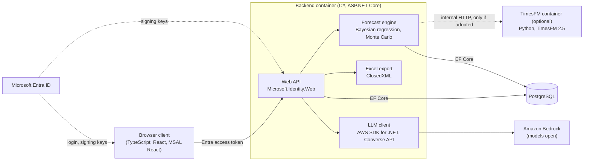

# Aicepeak – Architecture

Status: 2026-11-09. This document describes the stack decided in [ADR-0010](../decisions/0010-product-stack.md). Product requirements come only from the [north star](../../AICEPEAK_NORDSTERN.md). Items marked **open** or **optional** are not decided and must not be filled in by an implementation.

## Components

| Component | Technology | Responsibility |
|---|---|---|
| Browser client | TypeScript, React, MSAL React (`@azure/msal-react`) | User interface; signs users in with Microsoft Entra ID and calls only the backend API |
| Backend | C# on .NET 10, ASP.NET Core, EF Core (Dapper for hand-tuned queries) | Web API, Entra token validation, business logic, data access, LLM calls, forecast engine (Bayesian regression per line item, Monte Carlo simulation, probability intervals), Excel export |
| Database | PostgreSQL through EF Core's Npgsql provider; major version chosen with the hosting | Projects, data, assumptions with validity periods (range types), time series in ordinary tables, forecast runs and their stored inputs and outputs |
| Microsoft Entra ID | External identity provider | User login (single sign-on); issues the access tokens the backend validates |
| Amazon Bedrock | External LLM provider; models **open** | Called only by the backend, with the AWS SDK for .NET v4 (`AWSSDK.BedrockRuntime`, Converse API) |
| TimesFM service | **Optional:** intended as an alternative or addition per line item, not yet adopted. If adopted: Python, official `timesfm` package, TimesFM 2.5 | One internal endpoint: history in; mean and 10th to 90th percentiles per period out. No business logic, no user credentials |

## Login

1. The React client signs the user in with Microsoft Entra ID through MSAL React (authorization code flow with PKCE) and requests an access token for the Aicepeak API.
2. The backend validates every token with Microsoft.Identity.Web and authorizes with Entra app roles or scopes.
3. The backend identifies the user by the token's `tid` (tenant ID) and `oid` (object ID) claims and stores them as ordinary columns, so login does not depend on the database engine.
4. If a TimesFM service is adopted, it holds no user credentials and is reachable only from the backend.

Open: whether customers log in from their own Entra tenants (multi-tenant app registration) or from a single tenant (ADR-0010, decision 4).

## Forecast run

1. The backend loads the confirmed data, assumptions and settings of a project, including the run's random seed.
2. Each line item is forecast individually with Bayesian regression (closed-form conjugate model with Math.NET Numerics; Infer.NET only where a model needs it) and/or TimesFM.
3. Only if TimesFM is adopted: for line items that use it, the backend sends the history to the TimesFM service and stores the returned mean and percentiles with the run.
4. The Monte Carlo simulation draws from these distributions and aggregates the results.
5. Probability intervals are percentiles of the Monte Carlo results.
6. The run stores its inputs, any TimesFM outputs, the seed and the results, so a rerun reproduces it without calling TimesFM again.
7. Backtesting checks how often actuals fall inside the intervals, whatever the method.

Open: which line items use Bayesian regression, TimesFM or both (ADR-0010, decisions 6 and 8); if TimesFM is adopted, how periods and line items move together in the simulation and how intervals wider than the 10th to 90th percentiles are justified (decision 9).

## Reproducibility rules

- Same inputs, settings and seed give byte-identical results with any number of threads; a test enforces this.
- One fixed, seedable generator algorithm; never `System.Random`. Every path or batch gets a seed derived from the run's seed; results are combined in a fixed order.
- Interval limits come from the Monte Carlo results, not from Math.NET's `StudentT.InvCDF`.
- Math.NET Numerics is pinned. If TimesFM is adopted, its package versions are pinned too, and tests compare its output with stored known-good results.

## Boundaries

- Only the backend calls Amazon Bedrock; the browser client calls only the backend API.
- The TimesFM service, if adopted, contains no business logic, holds no user credentials and is reachable only from the backend.
- Excel export runs in the backend with ClosedXML; EPPlus is not used because commercial use needs a paid licence. Moving the export to Python remains allowed.
- PostgreSQL has no built-in automatic history of row changes. Whether data edits need an audit trail is open; if they do, it is built with triggers (decision 11).

## Checks still to build

Product work orders stay blocked until these exist (`product_checks_ready: false`):

- .NET build and tests, including tests against a real PostgreSQL database.
- TypeScript build and tests for the browser client.
- The Monte Carlo reproducibility test.
- If TimesFM is adopted: lint, type check and tests for its container, including the known-good output comparison.
