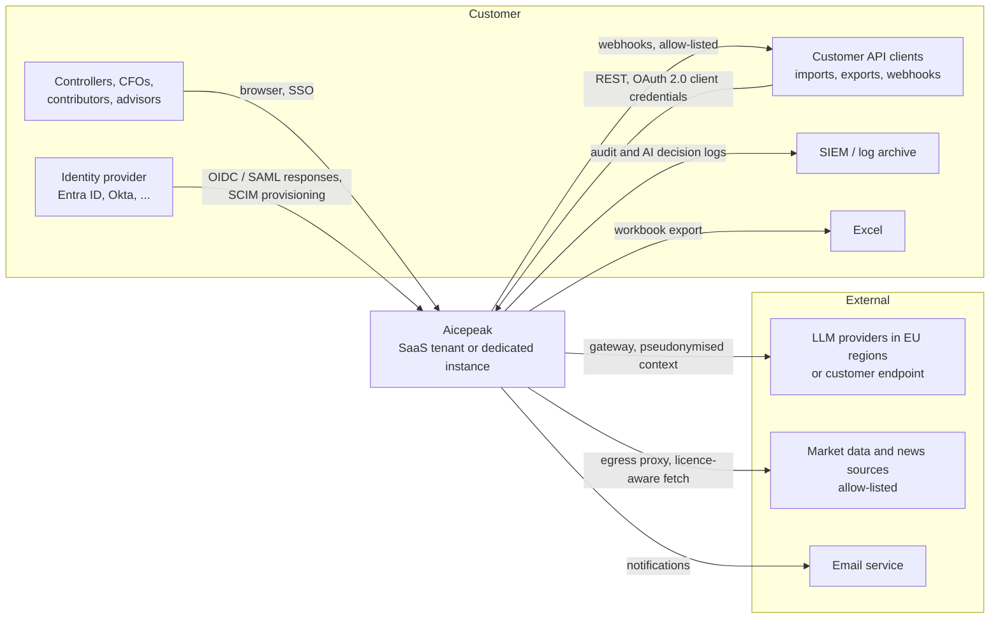
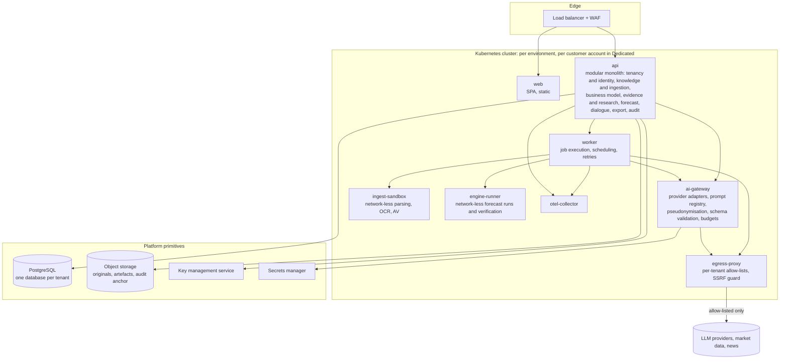
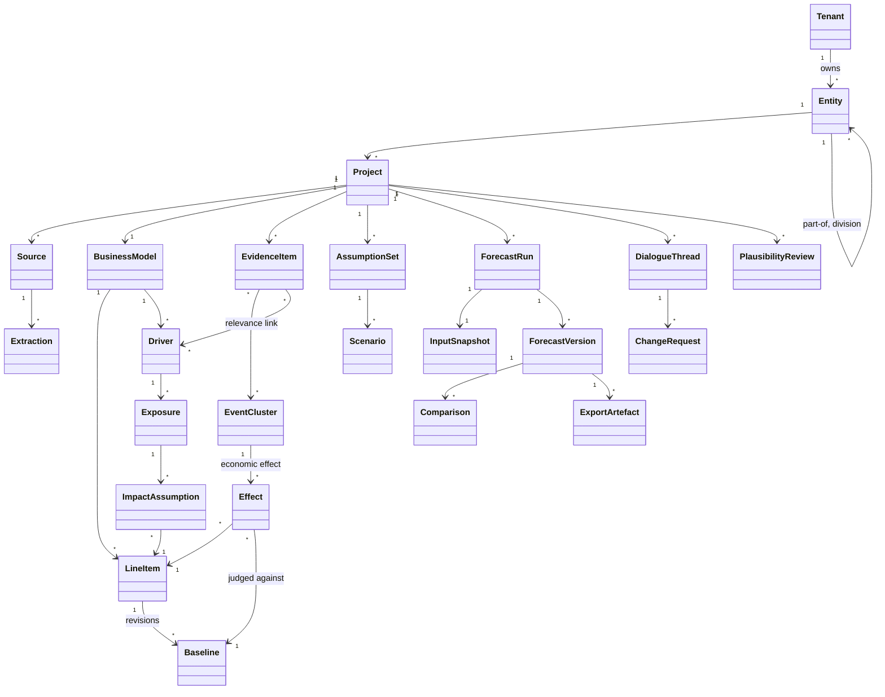
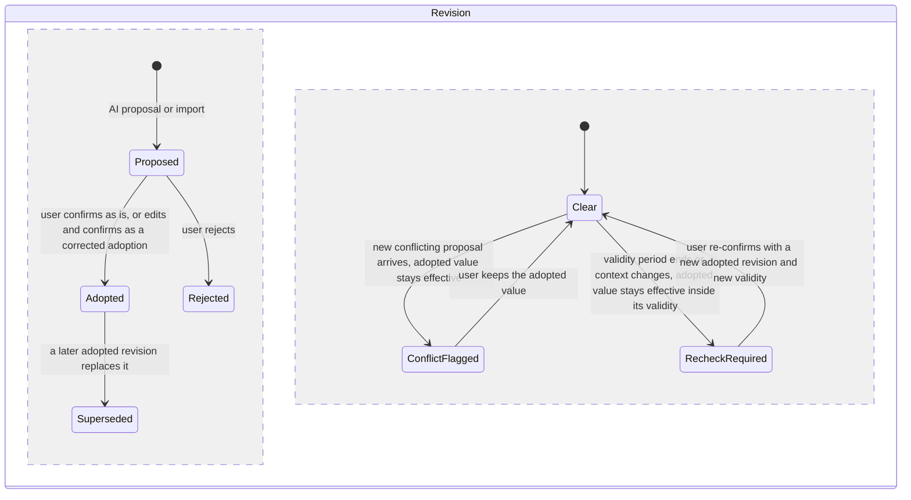
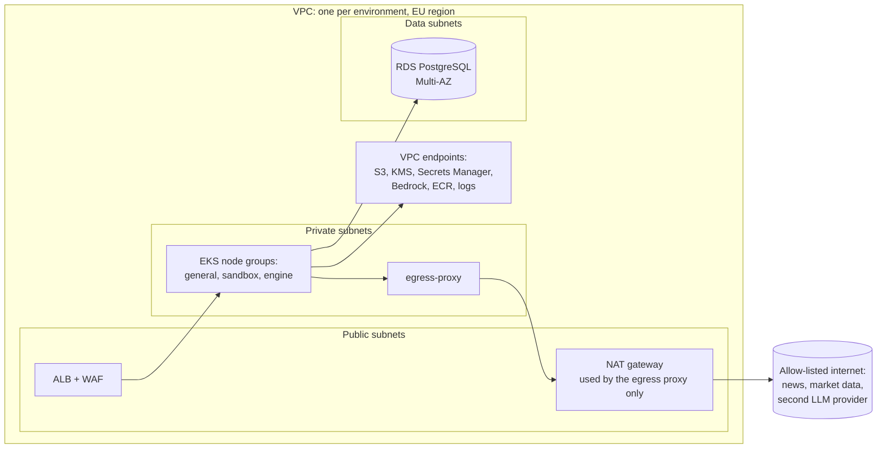
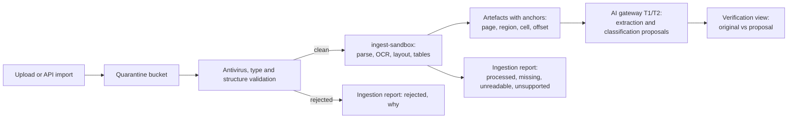

# Aicepeak – Specification Sheet and Target Architecture

> **Draft – not binding, also after merge.** This document is a proposal. Its architecture decisions AD-01..AD-12 are proposals, it approves no product scope and it does not replace the north star or a work order. Later work orders may cite it only as background until the maintainers adopt a part through a reviewed decision record. Product work stays blocked while `northstar_approved` is `false` (`factory/config.json`).

| Field | Value |
|---|---|
| Version | 0.2 (draft for maintainer review; revised after the independent validation of version 0.1) |
| Date | 2026-10-28 |
| Status | Draft, not binding. Merging it records the proposal; it approves nothing and changes no product scope. |
| Basis | `AICEPEAK_NORDSTERN.md` (product north star, chapters 1–11; itself a draft pending approval, `northstar_approved: false`), the draft product constitution and the draft chapter 12 of the north star (both only on the unmerged branch `docs/factory-review-2026-10-28` of closed PR #4). |
| Language | English. The north star stays German; its terms are translated in Appendix A. |
| Audience | Maintainers (Gabriel, Felix), the AI software factory, and the security, legal and procurement teams of prospective enterprise customers. |
| Validation | Independent review of version 0.1 by GPT-6 Astra at reasoning effort `max` (verdict `needs_revision`, 35 findings); prompt, schema, every finding and its resolution (fixed, disputed or decision needed) in `validation/2026-10-28-gpt-6-astra-max.md`. Version 0.2 is the revised document and has not been re-validated. |
| Change log | 0.1 (2026-10-28): first draft. 0.2 (2026-10-28): after validation; materially changed are the proposal state model (B5), the bitemporal revision model (B11), run identities and engine contracts (B6), dialogue context types and explanation binding (B7), tenant-scoped credentials and the key-coverage matrix (B9), deletion by data class with a restore-safe ledger (B11), residency profiles (B11), the Dedicated edition's outbound data flows (B12), the incident matrix (B13), audit and inspection rights, NIS2, CRA, DPIA and standards statements (B15). |
| Owner | Maintainers of `Zerosteps1/Aicepeak_V2.0.0`. |

## How to read this document

The north star labels requirements **G** (set), **P** (precision pending approval), **Q** (source proposal) and **O** (optional extension) and defers product decisions to decision points **D-01..D-11**. This document adds three labels of its own:

| Label | Meaning |
|---|---|
| **AD-nn** | An architecture decision taken in this document (section B17). Architecture is the subject this document is allowed to decide; the north star explicitly leaves it open (§1, §11.2). |
| **Proposal (D-nn)** | A product decision that belongs to the north star's decision point D-nn. The document proposes an answer with reasons; the decision stays with the maintainers. |
| **Proposed target** | A number (availability, recovery time, limit, duration, retention period). The north star forbids invented defaults (principle 9, §9.1). Every number in this document is therefore a proposal pending D-09 (sizes, costs, run times) or D-10 (quality, tolerances), never a commitment. |

Part A is written so that a buyer's security and legal teams can evaluate the product. Part B is written so that the maintainers and the AI software factory can build it. Section B16 traces every north-star requirement to the elements that implement it.

## 0. Executive summary

Aicepeak turns a company's own documents, historical figures, plans and the knowledge of its finance team, together with relevant external news and market data, into a traceable, reproducible financial forecast (P&L always; balance sheet and liquidity optionally), checks existing forecasts for plausibility, and lets controllers keep working in Excel. Large language models (LLMs) propose extractions, classifications, drivers, exposures, news relevance and explanations; a deterministic engine computes every number; a human confirms every assumption that enters a calculation.

The product is offered in two editions that share one code base and one deployable artefact:

- **SaaS (multi-tenant, EU):** operated by Aicepeak in AWS EU regions (reference), deployable to Azure EU regions as well. Each tenant has its own database and its own encryption keys. LLM calls go through an Aicepeak-operated AI gateway to EU-resident providers under no-training and zero- or limited-retention terms.
- **Dedicated (customer cloud, "BYOC"):** the same artefact deployed into the customer's own AWS or Azure account and region. The customer chooses the LLM endpoint (Azure OpenAI, Amazon Bedrock, Google Vertex AI, Mistral, OpenAI or Anthropic direct, or a self-hosted open-weight model) and holds the keys.

Five architectural commitments make the product acceptable to corporate security and legal teams:

1. **Deterministic core, human-confirmed basis.** Numbers come only from calculations over a frozen, content-addressed input snapshot. Every run records engine version, seed and input hash and can be re-executed. LLM output never becomes a figure without a source anchor or a user decision (AIC-020, AIC-022, AIC-028), and explanations render numbers only from stored results and cite the calculation relationships they rest on (B6, B7).
2. **AI as proposer behind a governed gateway.** One egress point, versioned prompts, JSON-schema outputs, pseudonymisation of natural persons before any model call, prompt-injection defences, a complete log of every AI proposal and of the human decision on it, per-tenant budgets, and a degraded mode in which the product works without AI (AIC-034, AIC-037, AIC-038, AIC-045).
3. **Isolation by construction.** Database and keys per tenant, credentials scoped to exactly one tenant for every request and job, per-tenant egress allow-lists, sandboxed document parsing, customer-managed keys, and a customer-cloud edition for organisations that must keep data in their own account (AIC-044).
4. **Compliance by design.** Artefacts and controls for GDPR (processor role, DPA with audit and inspection rights in both editions, TOMs, DPIA support, deletion by data class with a certificate), the EU AI Act (provider of an AI system that is not high-risk under its stated intended purpose; transparency, literacy, logging and human oversight implemented from the first release, with a documented gap assessment against the high-risk requirements), the EU Data Act (switching and export), NIS2-aligned supplier controls and an assessment of Aicepeak's own NIS2 scope, a Cyber Resilience Act assessment for the dedicated edition, and a DORA-ready contract and evidence set for later financial-sector customers.
5. **Provider-neutral platform sized for a small operations team.** Kubernetes, PostgreSQL, S3-compatible object storage, a key management service and an OIDC identity provider are the only platform primitives; everything else ships inside one Helm chart. A modular monolith with workers, not microservices. Cloud, model-provider and runtime combinations are qualified in phases (B12) rather than all at once, and service commitments are conditional on demonstrated operational capacity (B17).

What this document decides: the editions, the platform primitives, the stack, the tenancy model, the data model, the engine contract, the AI gateway, identity, security, deployment and operations (AD-01..AD-12). What it only proposes: roles and retention (D-06), size and cost targets (D-09), tolerances and quality thresholds (D-10), the Excel calculation boundary (D-01), input formats (D-08), and all other north-star decision points.

---

## Part A – Specification sheet

### A1 Product, purpose and editions

**Purpose.** Aicepeak supports controllers, FP&A teams, CFOs and contributing business functions in building a verifiable financial model of a company, finding and judging relevant external information, computing and explaining forecasts, checking existing forecasts, comparing versions, testing forecast quality against later actuals, and continuing the work in Excel (north star §2, §3, §5). It does not promise certain future values, complete internet research or an audit opinion (§9.3).

**Scope of the financial model.** P&L always; balance sheet and liquidity as optional areas that are built from the start and carried consistently with the P&L (AIC-041..043). Monthly, quarterly and yearly grids with free start and end and deviating fiscal years (AIC-010). Separate planning of legal entities and business divisions; full group consolidation is optional (AIC-009, AIC-053).

**Editions.**

| | SaaS (multi-tenant, EU) | Dedicated (customer cloud) |
|---|---|---|
| Operated by | Aicepeak | Aicepeak through an in-account runner that pulls signed releases (no standing cross-account access; break-glass only with customer approval), or the customer's platform team |
| Where | AWS EU region chosen by the tenant (reference host); Azure EU regions as second target | The customer's AWS or Azure account and region |
| Isolation | Own database, own encryption keys, own egress allow-list per tenant; shared, stateless compute that holds credentials for exactly one tenant per request or job | Entire stack in the customer's account; nothing shared with other customers |
| LLM access | Aicepeak AI gateway to EU-resident providers under no-training and zero- or limited-retention terms | Customer-chosen endpoint(s), including self-hosted open-weight models; the gateway runs inside the customer account |
| Keys | Aicepeak-managed per-tenant keys; customer-managed key (CMK/BYOK) as an option | Customer-managed keys in the customer's KMS |
| Functional scope | Identical | Identical |
| Not offered | Air-gapped operation (no internet), on-premises data centres outside a cloud account, customer-specific forks |

**Out of scope** (north star §11.2 and §11.1): full contract management, general ERP or bookkeeping, automatic Excel re-import, automatic external communication, continuous monitoring with automatic adoption, board presentations, own audio/video transcription and full group consolidation remain optional extensions without an adoption decision. The architecture leaves room for them (B16) but does not commit to them.

### A2 Capability matrix

All capabilities are available identically in both editions. Status follows the north star; "P" parts are built as specified but remain subject to the north star's approval.

| North-star area | Requirements | Status | Capability in one sentence | Architecture (Part B) |
|---|---|---|---|---|
| 7.1 Company knowledge and business modelling | AIC-001, 002, 003 | G (003 with P) | Company profile, economic relationships (line items, drivers, exposures) and knowledge from documents and user statements, each with origin, confirmation date and validity period. | B4 domain model, B5 workflows, B7 task classes T3 and T6 |
| 7.2 Ingestion, extraction, classification | AIC-004, 005, 006, 007, 008 | G | PDF (including scans), CSV, XLSX, DOCX and pasted text in German and English become anchored, typed values and statements that the user verifies against the original, with gaps, conflicts and duplicates made visible. | B14 ingestion pipeline, B4 extraction model, B7 task classes T1 and T2 |
| 7.3 Projects, periods, data basis | AIC-009, 010 | G (009 with P) | Several projects per company, separate planning of entities and divisions, free period grids and fiscal years, declared data basis and information cut-off. | B4 tenancy hierarchy, B5 project setup, B11 bitemporal model |
| 7.4 External research and overviews | AIC-011, 012, 013, 014, 015 | G | Company-specific research with visible origin, time reference, relevance reasoning, contradictions and search limits; market and news overviews with consideration status. | B14 research connectors, B7 task class T4, B4 evidence model |
| 7.5 From evidence to financial effect | AIC-016, 017, 018, 019 | G | The full chain information → driver → exposure → impact assumption → line item → forecast effect, with exposure and timing, honest limits of quantification and no double counting. | B4 evidence graph, B5 impact workflow, B6 engine contract |
| 7.6 Forecast calculation and result quality | AIC-020, 021, 022, 023, 024 | G (024 P) | Forecasts from a declared basis, consistent totals, reproducible saved runs, understandable uncertainty, visibly handled unusable results. | B6 engine, B11 immutable runs, B5 result states |
| 7.7 Update and human control | AIC-025, 026, 027, 028 | G | Deliberate recalculation, causal explanation of changes, comparison of any saved versions, protected confirmations. | B5 state model, B4 version model, B6 change attribution |
| 7.8 Mind map and effective feedback | AIC-029, 030 | G | A linkage view from result to source for the selected version; corrections that change the basis after deliberate adoption. | B4 evidence graph, B5 feedback workflow, B3 web app |
| 7.9 Excel export | AIC-031, 032, 033 | G | A complete, self-explaining workbook with live formulas for the supported quantities, labelled editable inputs, and disclosed calculation limits. | B14 export builder and verifier, Proposal (D-01) in B17 |
| 7.10 Dialogue, clarification, steering | AIC-034, 035, 050 | G (with P) | A context-bound side chat throughout the process: questions, clarifications, knowledge contributions and effective change orders, all distinguishable. | B7 task class T6, B5 change-order workflow, B4 dialogue model |
| 7.11 Cross-industry, practical use | AIC-036, 037, 038 | G (038 P) | Different economic logics without invented default drivers; practical effort, run time and cost; visible processing status and cost estimates. | B6 method plugins, B7 budgets, B13 usage ledger, Proposal (D-09) |
| 7.12 Plausibility check of existing forecasts | AIC-039, 040 | G (040 with P) | An imported forecast as a separate review object with typed findings and an explicit coverage statement. | B5 review workflow, B4 review model, B7 task class T7 |
| 7.13 Balance sheet and liquidity | AIC-041, 042, 043 | G (with P) | Optional, consistently linked balance sheet and liquidity planning with visible missing inputs. | B6 financial model kernel, Proposal (D-02) |
| 7.14 Scenarios, sensitivities, forecast quality | AIC-047, 048 | G | Saved scenarios, sensitivities, comparison with later actuals and historical backtests with the knowledge of the time. | B4 scenario model, B11 bitemporal queries, B6 engine |
| 9.2 Confidentiality and labelling | AIC-044, 045, 046 | P / G | Confidential, separated company information; ingested content never acts as a user instruction; draft and current labels without a formal approval process. | B8 identity, B9 tenancy, B7 injection defences, B5 labelling |
| 11.1 Optional extensions | AIC-049, 051, 052, 053, 054, 055 | O | Not in scope; see B16 for the elements that would carry them if adopted. | B16 |

### A3 Non-functional requirements

Every number below is a **proposed target** pending D-09 or D-10. The product measures and displays the actual values (AIC-037, AIC-038) so that the maintainers can set targets from evidence rather than from assumptions.

| Area | Requirement | Proposed target | Decision point |
|---|---|---|---|
| Availability (SaaS) | Monthly availability of the web application and API, excluding announced maintenance | 99.9 % | D-09 |
| Availability (Dedicated) | Depends on the customer's account services; the artefact supports multi-zone operation | Per contract | D-09 |
| Recovery | Recovery point objective / recovery time objective for the SaaS edition | RPO 15 minutes (point-in-time recovery), RTO 4 hours | D-09 |
| Interactive latency | Navigation, selection, explanation of an existing value | p95 under 2 seconds | D-09 |
| Long-running work | Ingestion, research, forecast runs and verification run as jobs with visible progress, estimated effort and cost before start, and a clear failed state | No fixed duration; measured per project class | D-09 |
| Scale | Tenants, projects per tenant, documents per project, periods per forecast | No hard-coded maximum; limits are tenant configuration that the user sees before processing | D-09 |
| Reproducibility | Re-execution of a saved run with the recorded snapshot, engine image and seed | Deterministic methods: bit-identical; stochastic methods: identical given the recorded seed and image; otherwise a declared tolerance | D-10 |
| Data residency | Processing and storage location | EU regions only; a residency profile per tenant (strict single region, or EU multi-region as the default) with five separately declared boundaries for storage, backup, inference, support and metadata (B11); Dedicated: the customer's region and endpoints | AD-02 |
| Languages | UI, documents, dialogue | German and English for UI and inputs; further languages are D-08 | D-08 |
| Accessibility | Web application | WCAG 2.1 AA target | AD-03 |
| Browser support | Current versions of evergreen browsers; no plug-ins | none | AD-03 |
| Retention | Sources, extractions, runs, versions, audit log | Tenant-configurable policy; proposal in B11 | D-06 |

### A4 Security and compliance features

| Area | Feature |
|---|---|
| Identity | Single sign-on through the customer's identity provider (OpenID Connect or SAML 2.0; Microsoft Entra ID, Okta and others); SCIM 2.0 user and group provisioning; multi-factor authentication and conditional access enforced by the IdP; no local passwords in production tenants; break-glass access only through a logged, time-limited procedure. |
| Authorisation | Role-based access with tenant → entity → project scoping; explicit per-entity grants for advisors; separate capability to mark a forecast version as "current"; service accounts and API clients with scoped credentials; every access decision logged (roles are a proposal for D-06, see B8). |
| Encryption | TLS 1.2 or higher (1.3 preferred) for all external traffic and for every in-cluster connection to data stores, with default-deny network policies between containers; AES-256 at rest; envelope encryption with a data key per tenant; customer-managed keys (CMK/BYOK) in the Dedicated edition and as an option in SaaS; key rotation; cryptographic erasure for the data classes that tenant and project keys cover (key-coverage matrix in B9) and a ledger-driven deletion procedure for the rest (B11). |
| Tenant isolation | Database per tenant, keys per tenant, object-storage prefix per tenant, egress allow-list per tenant; compute is stateless, derives the tenant only from the authenticated token or the signed job record, and obtains database, storage and key credentials scoped to that one tenant; adversarial isolation tests run on every release (B9). |
| AI data handling | No training on customer data by Aicepeak or by any model provider; EU-resident providers with no-training and zero- or limited-retention terms in SaaS; customer-chosen endpoints in Dedicated; pseudonymisation of natural persons before any model call; minimal context per call; every AI proposal and every human decision logged; per-tenant budgets; model and provider visible per tenant. |
| Document safety | Antivirus scanning, file-type validation, size and complexity limits, parsing and OCR in network-less sandboxes, no execution of macros or external links; content from documents and news is treated as data and can never act as an instruction (AIC-045). |
| Auditability | Tamper-evident (hash-chained) audit log of user, admin and system actions; AI decision log; immutable run manifests; export to the customer's SIEM; hourly anchors of the audit chain in write-once storage under independent control, with optional customer-held checkpoints (B11, B13). |
| Secure development | Repository-based AI software factory with independent AI review, deterministic checks and human-only merges; pinned dependencies; software bill of materials (SBOM) per release; signed container images; vulnerability scanning in the pipeline and in production; external penetration test at least yearly and before major releases (proposed cadence); coordinated vulnerability disclosure. |
| Vulnerability remediation | Three clocks are defined: detection (scanner finding, advisory or report received), triage (severity and exploitability assigned, proposed within 2 business days) and remediation. Proposed remediation targets (D-09), measured from detection: critical within 7 days, high within 30 days, medium within 90 days; vulnerabilities known to be exploited are handled ahead of their severity class. For comparison, the US CISA directive BOD 19-02 requires 15 days for critical and 30 days for high findings from initial detection; the proposed targets match it for high and are shorter for critical. |
| Operations | Encrypted backups with point-in-time recovery; disaster recovery runbooks and tests; monitoring and alerting without personal data in logs; status page; incident response with customer information without undue delay and at the latest within 24 hours of Aicepeak becoming aware of a personal-data breach (proposed service target; the statutory triggers and clocks of every regime are in the incident matrix in B13) so that customers can meet their own 72-hour duty. |
| Data lifecycle | Tenant-configurable retention; deletion on request executed per data class through a restore-safe deletion ledger, with cryptographic erasure where a tenant or project key covers the class, and a deletion certificate that lists exclusions (legal holds, audit-log retention) and pending backup expiry; full tenant export in structured, machine-readable formats plus the original documents, with licensed third-party evidence marked separately; defined offboarding. |
| Contracts and evidence | Data processing agreement with technical and organisational measures (TOMs) and statutory audit and inspection rights in both editions under a proportionate procedure (B15.2), subprocessor list with change notice (proposed 30 days), records of processing, DPIA support package, AI transparency sheet per tenant, ISO/IEC 27001 roadmap, later ISO/IEC 42001 and SOC 2 Type II (A8, B15). |

### A5 Interfaces, formats and data sources

| Direction | Interface | Details |
|---|---|---|
| Input | File upload | PDF (text and scanned), CSV, XLSX, DOCX, pasted text, transcripts as text; German and English number, date and unit conventions (AIC-004). Further formats are D-08. |
| Input | Structured import | CSV/XLSX templates for actuals, plans and prior forecasts with explicit value-type and period mapping; REST API for the same. |
| Input | Dialogue | Context-bound chat panel for questions, answers, knowledge contributions and change orders (AIC-034, AIC-050). |
| Output | Excel workbook | Complete working state with live formulas for the supported quantities, labelled editable inputs, provenance and limits sheets, version and export stamp (AIC-031..033). |
| Output | Data export | JSON Lines and CSV of the knowledge base, model, evidence, runs and versions; full tenant export for switching (B11). |
| Output | API and webhooks | REST (OpenAPI 3.1) for projects, imports, runs, versions and exports; OAuth 2.0 client credentials; webhooks for job completion. |
| Output | Audit export | Audit and AI decision logs as JSON Lines to the customer's object storage or SIEM endpoint. |
| Identity | OIDC / SAML 2.0, SCIM 2.0 | Customer IdP; group-to-role mapping. |
| External data | Market data connectors | Public statistical and central-bank sources (for example ECB, Eurostat, national statistical offices) and licensed providers through connector plug-ins with licence metadata; the concrete providers are a product decision (north star §11.2). |
| External data | News connectors | Publisher feeds, aggregators and licensed news APIs through connector plug-ins that respect robots.txt and licence terms; deduplication into events (AIC-019). |
| External AI | LLM endpoints | SaaS: Aicepeak gateway to EU-resident providers; Dedicated: Azure OpenAI, Amazon Bedrock, Google Vertex AI, Mistral, OpenAI, Anthropic, or an OpenAI-compatible self-hosted endpoint. |
| Notifications | Email | Job completion and invitations; the email provider is a listed subprocessor in SaaS. |

### A6 Editions, prerequisites and sizing

**SaaS.** The customer needs a browser, an identity provider for single sign-on, and, optionally, a SIEM endpoint for audit export and a customer-managed key in their own AWS KMS or Azure Key Vault. Tenant creation, region selection, IdP federation, SCIM, retention policy, egress allow-list and budgets are tenant administration functions.

**Dedicated (customer cloud).** Prerequisites in the customer's account:

| Item | AWS | Azure |
|---|---|---|
| Account and region | A dedicated account (recommended) in an EU region | A dedicated subscription in an EU region |
| Kubernetes | Amazon EKS cluster, private node groups | Azure Kubernetes Service, private node pools |
| Database | Amazon RDS for PostgreSQL, Multi-AZ, encrypted with a customer KMS key | Azure Database for PostgreSQL Flexible Server, zone-redundant, customer-managed key |
| Object storage | S3 buckets with SSE-KMS, versioning and Object Lock for the audit anchor | Blob Storage with customer-managed keys, versioning and immutability policy |
| Keys and secrets | AWS KMS (optionally External Key Store), AWS Secrets Manager; workload identity through EKS Pod Identity or IRSA | Azure Key Vault or Managed HSM; Entra Workload ID |
| Network | Private subnets, no public node IPs, an egress path (NAT) that only the egress proxy uses, VPC endpoints for S3, KMS, Secrets Manager and Bedrock, with endpoint policies that admit only the AI gateway's workload identity to the Bedrock endpoint | Private subnets, NAT through the egress proxy only, private endpoints for storage, Key Vault and the LLM service, with the LLM private endpoint reachable only from the AI gateway's network policy and identity |
| Ingress | Load balancer with WAF and the customer's TLS certificate and DNS name | Application gateway or equivalent with WAF |
| LLM endpoint | Amazon Bedrock with EU inference profiles and data-retention mode `none` (recommended; set by service control policy), or any supported external endpoint reachable through the egress allow-list, or a self-hosted OpenAI-compatible endpoint | Azure OpenAI / Microsoft Foundry EU Data Zone with the modified-abuse-monitoring exemption (recommended), or any supported endpoint, or a self-hosted OpenAI-compatible endpoint |
| Identity | The customer's IdP (OIDC/SAML/SCIM) | Entra ID (OIDC/SAML/SCIM) |
| Deployment | Terraform modules and the Helm chart; images pulled by digest from Aicepeak's signed registry or mirrored to the customer's registry | Same |

Indicative starting sizes (proposed, to be validated under D-09): a small installation runs on three general nodes (4 vCPU, 16 GB each), one sandbox node pool that scales from zero, a database instance with 2 vCPU and 8 GB, and object storage sized by document volume. Forecast runs and ingestion scale horizontally through the job system; GPU capacity is only needed for the self-hosted model profile.

### A7 Operations, support and lifecycle

| Topic | Specification (proposed where numbers appear) |
|---|---|
| Releases | One release train for both editions. SaaS receives continuous releases after the factory gate; the Dedicated edition receives versioned releases with release notes, migration notes and a signed SBOM. Three periods are kept apart: release-line maintenance (proposed: a long-term-support line every quarter, maintained for 12 months, D-09), the product's security-support period under the Cyber Resilience Act (at least five years from placing on the market, B15.7), and the availability of issued security updates (at least ten years after issue). A Dedicated customer on a line that has left maintenance receives security fixes through a free upgrade path to the latest maintained version with migration notes and a tested rollback (CRA Art. 13(10)); maintaining an old line beyond 12 months is a contractual option, not the default. |
| Security updates | Critical fixes are released out of band for all maintained versions; the Dedicated edition receives them as signed patch releases. Issued security updates stay downloadable for at least ten years after issue or for the remaining support period, whichever is longer. Remediation targets as in A4. |
| Upgrades (Dedicated) | Customer-triggered or scheduled with customer approval; database migrations are forward-compatible for one version; rollback procedure documented and tested in the release pipeline. |
| Maintenance | Announced windows for SaaS; zero-downtime deployments as the normal case. |
| Monitoring | Health, capacity, error budget and AI usage per tenant; the customer sees processing status, usage and cost estimates in the product (AIC-038). |
| Support | Named support channel, severity levels and response targets per contract; support staff access to tenant data only through an approved, logged, time-limited break-glass procedure. |
| Incidents | Documented incident response; customer information without undue delay (proposed within 24 hours of Aicepeak becoming aware of a personal-data breach; statutory triggers, clocks and recipients per regime in the incident matrix in B13); post-incident report; status page for SaaS. |
| Business continuity | Daily automated encrypted backups whose integrity is verified automatically after every backup, point-in-time recovery, multi-zone operation, documented in-EU region failover; a single-tenant restore drill every quarter and a region-failover exercise every year (proposed; B11 and B13 use the same terms). |
| Subprocessors | Published list; change notice before a new subprocessor processes customer data (proposed 30 days); objection right per the data processing agreement. |
| Offboarding | Full export in structured formats plus original documents and Excel exports, with licensed third-party evidence marked separately (B11); deletion of the live tenant data on the agreed offboarding date, expiry of the backups within the backup window (proposed 35 days), and a deletion certificate issued after that window that lists what was deleted, what is excluded (legal holds, audit-log retention the customer requested) and when remaining items expire (B11). |
| Telemetry (Dedicated) | Only operational metrics (versions, health, usage counters), opt-in, never customer content; the customer can inspect what leaves the account; the complete list of outbound flows of a Dedicated instance is in B12. |
| Operating responsibilities (Dedicated) | A responsibility matrix per customer fixes who operates the account, the cluster and the keys, who approves and applies releases and emergency patches, who executes restores, who reports incidents to which authority, and what happens when a customer-managed key becomes unavailable; the proposed default is in B12. |

### A8 Compliance summary

Details, article references and the verification status of each statement are in B15 and Appendix B.

| Regime | Applies? | Aicepeak's role | What the customer gets |
|---|---|---|---|
| GDPR | Yes | Processor for tenant content; controller for account data | DPA with TOMs, subprocessor list with change notice, EU-only processing, pseudonymisation before model calls, data-subject tooling, deletion with certificate, DPIA support package, breach information within the proposed 24 hours of awareness, audit and inspection rights in both editions |
| EU AI Act | Yes, as provider of an AI system that is not high-risk under its stated intended purpose | Provider; customers are deployers | Classification memo with the method-by-method assessment of the engine, AI transparency sheet (models, providers, data flows, retention), labelled AI output with machine-readable marking (proposed implementation, B15.3), AI decision log, human confirmation gates, literacy material, gap assessment against the high-risk requirements |
| EU Data Act | Yes (SaaS as a data processing service) | Provider of a data processing service | Switching terms, full export of customer data in documented machine-readable formats with lawful exclusions disclosed in the contract, API, no switching charges beyond the Act's transition rules |
| NIS2 | Customers are in scope; Aicepeak's own scope is assessed against Art. 2, Art. 3 and national law (B15.5) | Supplier; possibly an entity in its own right | Security measures mapped to ISO/IEC 27001 controls, questionnaire evidence, early incident information |
| DORA | Later (financial-sector customers) | ICT third-party service provider | Art. 30 contract addendum, register-of-information data, exit plan, access, audit and testing rights for critical or important functions in both editions under a procedure that protects other tenants |
| Cyber Resilience Act | Dedicated edition (software supplied to the customer); not SaaS | Manufacturer | SBOM, vulnerability disclosure policy, security updates for a support period of at least five years with ten-year availability of issued updates, conformity documentation when the Act applies |
| ISO/IEC 27001, SOC 2, ISO/IEC 42001, C5, TISAX | Roadmap | Certified or attested organisation | Certificates and reports in the order of B17; control mapping available before certification |
| National law (DSG, BDSG), GoBD/BAO, accessibility | Partly | Processor; vendor of a planning tool | Retention configuration, immutable versions, WCAG 2.1 AA target |

---

## Part B – Target architecture

### B1 Architecture principles

1. **One artefact, every edition.** The same images, chart and configuration schema run in SaaS and in customer accounts. Edition differences are configuration (tenancy mode, LLM providers, key sources), never code branches.
2. **Deterministic core; AI proposes, humans confirm, the engine computes.** The forecast engine is a pure function over a frozen snapshot. LLMs produce proposals with provenance; the effective basis changes only through a recorded human decision or an explicit change order (AIC-020, AIC-028, AIC-050).
3. **The evidence graph is the data model.** The north star's impact chain (AIC-016) and its distinctions (value types, evidence types, baseline, confirmation, validity, information cut-off) are first-class entities, not annotations.
4. **Bitemporal by default.** Every fact carries when it is valid, when it became known and when it was recorded, so that reproduction, comparison and historical backtests (AIC-022, AIC-027, AIC-048) are queries, not reconstructions.
5. **Data minimisation towards models.** A model receives the smallest context that the task needs, pseudonymised, within the tenant's providers and regions, and never a document "as a whole" when a segment suffices.
6. **Isolation by construction.** Tenant boundaries are enforced by separate databases, separate keys and separate egress rules; every request and job runs with credentials scoped to exactly one tenant, so shared application code holds no credential with which it could address another tenant's data, and adversarial tests prove it on every release (B9).
7. **No standing secrets in compute.** Workloads obtain credentials through workload identity; provider keys live in the key management service and are used only by the AI gateway and the egress proxy.
8. **Everything auditable, nothing silently changed.** Audit log, AI decision log and run manifests are append-only and hash-chained; a saved version never changes (AIC-022).
9. **No training on customer data, anywhere.** Neither Aicepeak nor any provider in the SaaS chain may use customer content for model training; evaluation sets are synthetic or explicitly licensed.
10. **Fail closed on residency and egress.** A call that would leave the configured region or reach a non-allow-listed host is refused and logged; the product degrades to manual work rather than violating a boundary.
11. **Operable by a small team.** A modular monolith with workers, a small set of managed primitives, GitOps, automation for the tenant lifecycle, and a phased qualification of cloud, provider and runtime combinations (B12); no microservice mesh, no bespoke infrastructure. Operability is demonstrated by measured capacity before service commitments are made (B17), not assumed.

### B2 System context

Inbound traffic reaches the system on exactly three authenticated paths, all through the load balancer and WAF: users' browsers (single sign-on), the customer's API clients (REST with OAuth 2.0 client credentials, including structured imports, A5 and B14) and the customer's identity provider (federation responses and SCIM provisioning calls, B8). Webhooks are outbound notifications to customer endpoints on the tenant's allow-list. No other system calls into the product in version 1. All outbound traffic to LLM providers, market data and news sources goes through the egress proxy; email goes through the email service. Market data, news and LLM providers never see tenant identity beyond what the provider contract requires. For firewall and threat-model reviews the picture is therefore: three inbound trust boundaries, one outbound chokepoint.

### B3 Container view

| Container | Responsibility | Notes |
|---|---|---|
| `web` | Single-page application: project workspace, verification views with source anchors, business model editor, evidence and news views, results, mind map, scenarios, comparisons, dialogue panel, exports, administration. | TypeScript/React. Reads only through the API. |
| `api` | The modular monolith. Bounded contexts: Tenancy & Identity, Knowledge & Ingestion, Business Model, Evidence & Research, Forecast, Dialogue, Export, Audit. Serves the REST API and the SPA's backend-for-frontend needs. | Python 3.12+, FastAPI, Pydantic, SQLAlchemy/Alembic. One image; contexts are packages with explicit interfaces. |
| `worker` | Executes jobs from the PostgreSQL-backed queue: ingestion, research, AI proposal batches, forecast runs, verification, exports, retention tasks. | Same code base as `api`; scales independently; idempotent jobs with leases and retries. |
| `ai-gateway` | The only component that talks to LLM providers. Provider adapters, task-class routing, prompt registry, pseudonymisation and re-identification, JSON-schema enforcement, budget accounting, AI decision log entries. | Separate deployment of the same code base so that network policy can restrict provider access to this container alone. |
| `ingest-sandbox` | Parses PDF/XLSX/DOCX/CSV, runs OCR and antivirus, extracts layout and tables with anchors. | Separate node pool, no network, read-only root file system, seccomp and resource limits, ephemeral pods per job. |
| `engine-runner` | Executes forecast runs and independent verification runs over a frozen snapshot. | No network, pinned image digest recorded in the run manifest. |
| `egress-proxy` | All outbound HTTP(S) of the cluster as a CONNECT proxy that controls destinations only: per-tenant host allow-lists, its own DNS resolution with refusal of private, loopback, link-local and metadata addresses per connection, port and protocol restrictions, and connection logging without content. TLS runs end to end between the calling component and the destination; the proxy does not terminate it. Application-layer checks (redirect handling, decompression and response-size limits, content types, robots and licence policy, outbound query content) therefore live in the fetch service inside `worker` and in `ai-gateway`, which are the only components authorised to use the proxy (B14). | Nothing else has a route to the internet; private cloud endpoints for model services are restricted to the gateway's identity (A6, B12). |
| `otel-collector` | Collects traces, metrics and logs and forwards them to the observability backend. | Logs carry no customer content. |
| PostgreSQL | Relational data, JSONB documents, full-text search, vector index for semantic retrieval within a tenant, job queue. | One database per tenant on shared or dedicated instances (B9). |
| Object storage | Original uploads (quarantine and clean buckets), parsed artefacts, exports, run snapshots and results, hourly audit-chain anchors with write-once retention. | S3 on AWS, Blob Storage on Azure, any S3-compatible store otherwise. |
| Key management, secrets | Tenant data keys (envelope encryption), customer-managed keys, provider credentials, signing keys for manifests. | AWS KMS / Secrets Manager, Azure Key Vault; accessed through workload identity. |

### B4 Domain model

The model follows the north star's terms (chapter 6). German terms are mapped in Appendix A.

| Entity | Purpose and key attributes |
|---|---|
| **Tenant** | The customer organisation; isolation boundary; region, providers, key, retention policy, egress allow-list, budgets, IdP configuration. |
| **Entity** | The "company / unit under consideration": legal entity or business division, with explicit part-of relationships so that overlaps between a company and its divisions stay visible and are never summed as independent units (AIC-009 P). Knowledge deliberately shared across entities is marked as shared. |
| **Project** | A purpose-bound working context within an entity: create, update or plausibility-check a forecast; declared period grid, fiscal year, horizon, information cut-off and optional areas (balance sheet, liquidity) (AIC-010, AIC-041). |
| **Source** | An uploaded document, table, pasted text or transcript: immutable original (object storage), hash, language, upload metadata, and an ingestion report stating what was processed, what is missing, unreadable or unsupported (AIC-004). Duplicates are detected by hash and near-duplicate signatures (AIC-008). |
| **Extraction** | A value or statement taken from a source, with an anchor (page, region, table cell, character offset), the raw and the interpreted value, period, currency, unit, sign, scope, value type (actual, budget/plan, prior forecast, external forecast, qualitative statement, assumption, user statement), confidence, and an adoption status with review flags per the B5 state model, recording who decided, when, the original proposal and, for a corrected adoption, the corrected value next to the original (AIC-005..007). |
| **KnowledgeFact** | Company knowledge from documents or user statements: the statement, its evidence type, origin, confirmation status and date, and its validity period; expiry or a new context triggers a re-check instead of silent reuse (AIC-003 P). |
| **BusinessModel** | The economic model of the project: line items with definitions, units and an aggregation tree (AIC-021); drivers (internal or external); exposures (which share, quantity, contract and period a driver actually affects, AIC-017); impact assumptions (direction, lag, strength with its basis or an explicit "not quantifiable", AIC-018); each element with evidence links and a status. |
| **EvidenceItem** | An external observation: market series point, index, external forecast, news item, each with source, publisher, publication and event time, retrieval time, licence, and an as-of snapshot (AIC-012). Items are clustered into **EventCluster**s so that several reports of one event are one event (AIC-019). Each item carries a consideration status per forecast: found, under review, excluded, considered, not quantifiable (AIC-015). |
| **Baseline** | The declared reference path per line item and period against which any additional effect is judged (north star chapter 8): its origin (trend, external forecast, company plan), the developments it already contains, and a revision id, so that every effect records exactly which baseline revision it was judged against. |
| **Effect** | One economic effect of an EventCluster on one line item, through an exposure and an impact assumption, for a period range: effect id, mechanism, the baseline revision it was judged against, and an explicit inclusion decision: `additive` (not contained in the baseline), `contained` (already in the baseline, nothing added), `partially contained` (with the declared share and its basis) or `undecided`. Undecided effects are excluded from the calculation and partially contained ones limited to their declared share; both are listed in the run manifest and in the result views instead of being silently added. One event may legitimately have several effects on different line items, each with its own reasoning; the same economic key (event, mechanism, line item, period) exists only once (AIC-019). |
| **AssumptionSet / Scenario** | Named sets of assumptions; scenarios reference a base version and record only their deltas; sensitivities are single-parameter deltas with everything else fixed (AIC-047). |
| **InputSnapshot** | A canonical, content-addressed serialisation of everything a run consumes: confirmed extractions, model, evidence with consideration status, assumptions, baseline, period grid, information cut-off. Stored in object storage under its hash, which identifies the inputs; the identities of the calculation specification and of the execution are separate (B6). |
| **ForecastRun** | Immutable execution record with three identities (B6): the snapshot hash (inputs), the calculation-specification hash (engine image digest, method plug-ins and versions, parameters, root seed) and the execution id (one attempt). It stores results per line item and period with the uncertainty representation and its meaning, the random-state digest, prompt hashes of the proposals that fed the snapshot, the verification record, the usage and cost record, and the failure state if any (AIC-022, AIC-023, AIC-024, AIC-038). |
| **ForecastVersion** | A run presented as a saved state in a project. The version row is immutable; its label (`draft` or `current`) is an append-only stream of label events (version, project context, period scope and scenario where D-06 requires it, who, when, expected previous holder) with a read projection that yields the current holder per context; the label never moves automatically (AIC-046, B5). |
| **Comparison** | A stored comparison of two forecast versions, of a version with later actuals, or a backtest: the two sides (version ids, or an actuals revision selected by its knowledge time), the period alignment used (fiscal calendars mapped to common periods, partial periods declared), unit and currency treatment (one common unit; currency conversion only with a declared FX source, otherwise non-comparable), the line-item mapping with unmapped items listed, a scope bridge for entity or structure changes, the sign convention (for example `actual minus forecast`), the metric ids computed (absolute and relative deviation per position and period, deviation of traceable totals, interval coverage where bands exist; the selection and thresholds remain D-10), and explicit non-comparability reasons where alignment fails (AIC-027, AIC-048, S-20). |
| **DialogueThread / Message / ChangeRequest** | Dialogue bound to tenant, entity and project and to a context type (B7 T6: onboarding, source review, working basis, imported-forecast review, saved-run explanation); a forecast version is referenced only in the saved-run context, so dialogue works before the first run (AIC-034); messages typed as question, clarification answer, knowledge contribution, hypothetical, or change order; a change order becomes a structured **ChangeRequest** (target context, affected elements, assumption, effective period, basis) that the user confirms and that drives a recalculation (AIC-034, AIC-035, AIC-050). |
| **PlausibilityReview** | An imported forecast as a separate review object; findings typed as calculation error, professional contradiction, deviation needing explanation, or not assessable; coverage statement of what was and was not checked; review time and knowledge basis (AIC-039, AIC-040). |
| **AuditEvent / AIProposal** | Append-only records (B10, B7). |
| **ExportArtefact** | A generated workbook or data export with its manifest, hash, version reference and the verification result of the export (AIC-031..033). |

### B5 Core workflows and state model

The ten steps of the north star's user flow (§5) map to the following workflows. The dialogue panel is available in every step and bound to the current context (AIC-034).

| Step | Workflow | Key mechanics |
|---|---|---|
| 1–2 Company, purpose, period, knowledge state | Project setup | Entity and project creation; declaration of grid, fiscal year, horizon, information cut-off, optional areas; coverage check of history against the chosen grid (AIC-010). |
| 3 Bring in knowledge and data | Ingestion | Upload → quarantine → antivirus → type validation → sandbox parsing/OCR → anchored extraction proposals (T1/T2) → ingestion report (B14). |
| 4 Verify extractions | Review of extractions | Side-by-side original and proposal; confirm, correct, reject; conflicts shown with period and origin; duplicates flagged; missing is not zero (AIC-005..008). |
| 5 Check the economic model | Business modelling | Profile and model proposals (T3); drivers, exposures and impact assumptions with evidence links; unknown relationships stay open (AIC-001, AIC-002, AIC-036). |
| 6 Research and judge external information | Research | Query generation from profile and drivers (T4) → fetch through the egress proxy → deduplicate into events → relevance reasoning with origin and time reference → consideration status (AIC-011..015). |
| 7 Set effects and calculation basis | Impact assessment | Each considered event is linked through exposure and impact assumption to line items as one or more Effects (B4); quantification only with a basis; every effect records the baseline revision it is judged against and an explicit inclusion decision (additive, contained, partially contained, undecided), and undecided effects stay out of the calculation and visible; "not quantified" is distinct from "no effect" (AIC-016..019). |
| 8 Produce a result or check a forecast | Forecast run / plausibility review | Snapshot → cost estimate → run in the engine-runner → verification → results and uncertainty with meaning; or review of an imported forecast with typed findings and coverage (AIC-020..024, AIC-039, AIC-040). |
| 9 Understand and control | Results, mind map, dialogue | All views read the same version; mind map from result to source; explanations cite only elements actually used (AIC-029, AIC-035). |
| 10 Continue and update | Export, update, compare | Excel export with limits sheet; deliberate recalculation with visible scope; change explanation; version comparison; later actuals and backtests; "current" labelling (AIC-025..028, AIC-031..033, AIC-046..048). |

**State model of a proposal.** Every AI proposal and every imported value follows one state model with two independent dimensions: the *adoption status* of a revision and the *review flags* attached to an adopted revision. The engine reads adopted revisions only; flags never change what is effective, they change what the user is told.

- *Adoption.* A confirmation and a correction are the same transition: the user adopts a revision. For a correction the adopted revision carries the corrected value together with the original proposal and its anchor, so original and correction stay traceable and the corrected value is effective (AIC-007, AIC-030, S-02). "Adopted" records deliberate use, not proven truth (AIC-028).
- *Supersession.* Adopting a change to a flagged value (S-12) creates a new adopted revision that supersedes the previous one; the previous revision stays readable and remains the one earlier runs used. Nothing is edited in place.
- *Flags.* `ConflictFlagged` is set when a new proposal contradicts an adopted revision; the adopted value stays effective until the user decides (AIC-028). `RecheckRequired` is set when the validity period of an adopted fact ends or the forecast context changes; the adopted value stays effective for the periods inside its validity and becomes ineligible for periods outside it (AIC-003, S-12).
- *Engine eligibility.* A snapshot includes a revision if and only if it is adopted, not superseded, and its validity period overlaps the periods the run needs. Flagged revisions are included with their flag; the manifest and the result views list every flag, so a run on a flagged basis is visible as such. Nothing in the states Proposed, Rejected or Superseded reaches the engine.
- *Tests.* The acceptance scenarios S-02 (a corrected extraction takes effect after recalculation, old results are marked stale until then) and S-12 (a confirmed 60 % survives a new 20 % proposal until deliberate adoption; a binding until June is not applied to July without re-confirmation) are the regression tests of this state model.

**Result staleness.** When any element of the effective basis changes after a run, the run's results are marked "not recalculated for this basis" in every view until the user triggers a new run; the old results stay readable (AIC-007, AIC-025, AIC-030). The engine never runs implicitly.

**Change orders from dialogue (AIC-050).** A free-text order is parsed (T6) into a `ChangeRequest` with target context, affected positions, the assumption, its effective period and the reference base. Missing or ambiguous parts become clarification questions. The user confirms the structured request; the confirmation is the adoption, no extra approval loop; the request then updates the basis and schedules a run. A question or hypothetical never creates a `ChangeRequest` (AIC-035).

**Labels (AIC-046).** `current` is an explicit label event on a version within a project context; creating a new version never moves it; the previous holder stays visible in the history. Who may set the label, and how simultaneously valid versions for different period scopes or scenarios are delimited, is a Proposal (D-06) in B8; the event stream carries the context fields that D-06 needs.

**Adoption, labels and attestations as append-only events.** Three event streams make the immutability rule of B11 workable for the things that do change: adoption events (proposal id, revision id, decision, user, time, expected previous revision), label events (B4) and attestation events (verification results of runs and exports, attached after the fact, B14). Each stream has a read projection: effective revision per key, current version per context, latest verification per artefact. Concurrent edits are detected by the expected-previous field: a decision that names a revision which is no longer the effective one is rejected and shown as a conflict. A snapshot is sealed in one database transaction that writes the member list and the hash; its objects are written to object storage under their content hash before that transaction commits, so a crash leaves at most unreferenced objects, which a garbage-collection job removes. Run results are published idempotently under the execution id; a retried job that finds its results already published stops. Recovery after a failure between PostgreSQL and object storage is therefore always "re-run the job", never manual repair.

### B6 Deterministic computation engine

**Engine contract (AD-07).** The engine is a library with one entry point: `run(snapshot, spec) → results, manifest`, where `spec` is the calculation specification (method plug-ins and their versions, parameters per line item, root seed). It is pure: no network, no clock, no database, no environment reads. It executes in the `engine-runner` container whose image digest is pinned per release and recorded in every manifest.

**Three identities.** A run carries three separate hashes because each answers a different question. The *snapshot hash* identifies what was calculated from (B4 InputSnapshot). The *calculation-specification hash* covers the engine image digest, the plug-in ids and versions, the parameters and the root seed, and identifies how it was calculated. The *execution id* identifies one attempt (time, pod, resource usage) and is never reused. Two executions with equal snapshot and specification hashes must produce equal results within the verification policy; that is the reproducibility claim, and it is testable because the identities are separate. Replay needs the executable environment, so the content-addressed engine images, plug-in packages and frozen requirement sets referenced by any retained run are kept for the forecast retention period (B11). A replay of an image with known vulnerabilities runs only in the network-less runner without credentials, which is the isolation every run has anyway.

| Element | Specification |
|---|---|
| Input | The canonical `InputSnapshot` (B4). Canonical JSON with sorted keys and fixed number formatting; the hash is computed over the bytes the engine reads. |
| Method plug-ins | The north star leaves calculation methods open (§11.2). The engine therefore defines a versioned plug-in interface (`fit`, `project`, `uncertainty`, `explain`) over typed contracts that the kernel owns, so that a plug-in cannot bypass chapter 8: a `Quantity` type (value, unit, currency, period, value type `flow`, `stock`, `rate`, `ratio` or `index`, sign convention, scope) whose arithmetic is checked (no addition across units or currencies, no sum of stocks over periods, no mixing of percent and percentage points, cumulative-to-period and period-to-cumulative conversion as explicit operations, weighted margins recomputed from their bases); an `Expression` type for the relationships a plug-in declares between quantities; an `Aggregation` interface that walks the line-item tree with the value-type rules; and an `Uncertainty` interface (below). A plug-in declares its determinism class: *deterministic* (bit-identical re-execution) or *stochastic* (identical given seed and image). The choice and parameters of methods per line item are part of the calculation specification and visible to the user; no method is mandated here. |
| Financial kernel | Method-independent rules implemented once: aggregation tree and sign conventions (AIC-021), period arithmetic for months, quarters, years and deviating fiscal years (AIC-010), flow versus stock aggregation and no double-counted subtotals (chapter 8), the composition of baseline plus effects with the inclusion decisions of B4 (AIC-019, AIC-020), and the optional balance-sheet and liquidity linkage (AIC-042, AIC-043). The linkage is built from two generic object types rather than a fixed chart of accounts: *movement schedules* (opening balance, additions, releases, closing balance per balance item and period; for example receivables, payables, inventory, fixed assets with capital expenditure and depreciation, loans with draws, repayments and interest, tax liabilities) and *payment-timing assumptions* (which share of a P&L flow becomes cash in which later period; for example days sales outstanding, days payables outstanding, inventory days, tax payment dates). The invariants are checked on every run: opening + movements = closing for every balance item; the cash movement equals the sum of payment flows; closing cash equals the balance-sheet cash position; depreciation in the P&L equals the fixed-asset schedule's release; a P&L flow is counted once and never again when it is paid (S-16: a sale of 100,000 EUR recognised in one period and paid in the next shows revenue once, a receivables movement, a payment in the next period and closing cash equal to the defined balance position). A missing payment-timing assumption leaves the affected link open and marked `not modelled`; the kernel never substitutes zero or a default (AIC-018, AIC-024). Which accounting framework, which presentation (direct or indirect cash flow; both derive from the schedules) and which depth of detail a project supports remain Proposals (D-02, D-07). |
| Uncertainty | The `Uncertainty` interface has two incompatible types that are never mixed in one total: a *probabilistic* representation (a joint sample matrix across line items and periods, or a parametric distribution with a declared dependence structure, from which quantiles and bands are derived) and a *scenario spread* (named discrete scenarios without probabilities). Totals are computed from the joint samples or by recomputing the aggregation per scenario, never by adding quantiles or band limits (chapter 8, S-13). A method that cannot supply joint dependence declares it, and the kernel then reports the total's band as `not derivable` rather than approximating it. Each method declares in words what its representation means, and the UI shows those words (AIC-023); where no basis exists, the engine returns `no band` rather than a fabricated one. |
| Usability gate | The engine returns typed blockers (unresolvable currency, missing reference period, contradictory units) and marks results as *not usable* or *partial* instead of producing a confident total (AIC-024). Materiality thresholds are a Proposal (D-10). |
| Change attribution | For an update run, the engine computes a decomposition against the previous run on the same project where the decomposition is unambiguous (data change, assignment change, assumption change) and reports joint effects as joint, never as an exact additive split (AIC-026). |
| Manifest | The three identities (snapshot hash, calculation-specification hash, execution id), engine version and image digest, method ids and versions, root seed and the per-scenario seeds derived from it, random-state digest and draw counts, library versions (frozen requirements with hashes), BLAS vendor and thread count, CPU family, duration, resource usage, cost/usage record from the AI gateway for the proposals that fed the snapshot, the review flags and the undecided or partially contained effects present in the basis (B4, B5), and the verification result (attached as an attestation event, B5). |
| Numerics | The audited path runs single-threaded (thread pools limited to one), because multithreaded BLAS reductions and CPU-specific code paths change floating-point results; the random generator is a fixed bit generator (PCG64) with recorded seeds, and per-scenario seeds derive from one root seed so that adding a scenario never shifts an existing one. A seed alone does not fix a random stream: NumPy guarantees stream compatibility only for the same bit generator, the same library version and the same sequence of calls, so the image digest, the frozen requirement set and the plug-in version are part of the calculation-specification hash, and a change of any of them is a new specification, not a reproduction. |
| Verification | Two different checks, because repeating the same code proves repeatability, not correctness. *Reproduction check:* a second execution in a fresh `engine-runner` pod compares results with the first within the tolerance policy; the result is attached to the run as an attestation. Proposal (D-10): re-execution on the same image digest must match bit for bit for both deterministic and stochastic methods; across CPU families a relative tolerance of 1e-9 (absolute 1e-12) is accepted; any larger difference is a defect, and any looser tolerance must be declared per method and shown to the user. *Correctness check:* the kernel invariants (aggregation and value-type rules, balance-sheet and cash identities, baseline composition, once-only counting of effects) run as assertions on every run, and the software factory keeps an expected-result suite that is independent of the engine: hand-computed cases derived from the north star's acceptance scenarios (S-02, S-12, S-13, S-16, S-20 and S-21 among them) and invariant properties over generated inputs. A method plug-in is admitted only when it passes that suite; the numerical tolerances and acceptance thresholds of the suite remain D-10. |
| Backtests and comparisons | A backtest run sets the information cut-off in the snapshot and builds its basis with the knowledge-time query of B11 in one of two declared modes: *as actually known to the project* (revisions whose availability to the project, measured by their knowledge time, precedes the cut-off) or *reconstructed* (revisions whose publication precedes the cut-off even if they were ingested later; used for historical tests of periods before the project existed). The mode and every reconstruction limit (a data vintage that is not available, a news item without a reliable publication time) are part of the manifest and of the result view, so a limited test is never shown as an unbiased one (AIC-048, S-21). Forecast-versus-actual comparisons use the Comparison contract of B4: the actuals revision is selected by knowledge time and named, periods, units, currencies and line structures are aligned or declared non-comparable, and later actuals never replace the stored forecast values (S-20). |

**LLMs never produce numbers (AIC-020).** Numeric values enter a snapshot only as confirmed extractions with a source anchor, as confirmed user statements, or as confirmed assumptions. Model proposals that contain numbers are proposals of *where* a number is (anchors) or *what* an assumption could be; they pass the state model of B5 before the engine sees them. The same rule binds explanations: a T6 or T7 output (B7) carries numbers only as typed references to stored results, source values or assumptions, and causal statements only as references to exposure and impact links that exist in the selected run; the application renders the referenced numbers from the store, validates every reference against the run, and rejects a free-text number or an unsupported causal claim before the user sees it (AIC-020, AIC-035).

### B7 AI layer

**Roles of language models.** The product uses LLMs for seven task classes. Each class has a defined input scope, an output JSON schema, a model tier and a cost class; none of them may bypass the state model.

| Class | Task | Input scope | Output |
|---|---|---|---|
| T1 Extraction | Find values and statements in parsed documents and tables | Parsed segments with layout, never the whole document when a page suffices | Anchored extraction proposals with value type, period, unit, currency, sign, confidence |
| T2 Classification | Separate actuals, plan, prior forecast, external forecast, statements, assumptions; map periods and fiscal years | The extraction and its context | Classification proposals with reasons (AIC-005) |
| T3 Business model | Propose company profile, line-item structure, drivers, exposures | Confirmed knowledge and extractions of the project | Model proposals with evidence links; unknown relationships marked open (AIC-001, AIC-002) |
| T4 Research | Generate search contexts, judge relevance, cluster duplicates, extract event time and publisher | Profile, drivers, fetched items | Relevance reasoning, cluster proposals, time references (AIC-011..015, AIC-019) |
| T5 Impact hypotheses | Propose direction, lag and the basis that would be needed to quantify an effect | Event, exposure, baseline | Hypotheses with "basis missing" markers; never a magnitude without a basis (AIC-016..018) |
| T6 Dialogue | Explain values, sources and calculations; ask clarifying questions; parse change orders into structured requests | One of the five dialogue context types below, every item labelled with its status; the thread | Explanations as typed assertions (references to stored results, sources, assumptions and calculation links, B6); clarification questions; `ChangeRequest` drafts (AIC-034, AIC-035, AIC-050) |
| T7 Plausibility | Draft typed findings on an imported forecast | The review object, checks run by the engine, evidence | Findings with position, period, basis, reasoning, and coverage statement, as typed assertions (AIC-040) |

**Dialogue context types (T6).** The dialogue exists in every step (AIC-034), so its context cannot presuppose a forecast. Each thread is bound to one of five context types; every item supplied to the model carries its status (proposed, adopted, rejected; evidence type; validity), so the model and the user see what is confirmed and what is not, and a run reference is required only where a run exists.

| Context type | When | What the model receives |
|---|---|---|
| Onboarding | Company profile and project setup, before any source is confirmed | The profile and the knowledge facts with their status, the open questions of the setup |
| Source review | While extractions are being verified | The proposals under review with anchors and status, the ingestion report; nothing from other sources unless the user asks |
| Working basis | Modelling, research and impact assessment before or between runs | Adopted and flagged elements of the basis, open effects, the consideration status of evidence; no results |
| Imported-forecast review | Plausibility checks | The review object, the engine's checks, the findings so far |
| Saved-run explanation | Results, comparisons, updates | The selected version and only the elements its snapshot actually used; a question about another version switches the context explicitly (AIC-034 acceptance) |

A change order can be parsed in any context type, but it takes effect only through the state model of B5 and a deliberate run; a question about a hypothetical never changes the basis (AIC-035, AIC-050).

**AI gateway (AD-08).** The `ai-gateway` container is the only path to any model.

| Function | Specification |
|---|---|
| Provider adapters | Amazon Bedrock, Azure OpenAI / Microsoft Foundry, OpenAI API, Anthropic API, Google Vertex AI, Mistral, and an OpenAI-compatible adapter for self-hosted models (for example vLLM). Adapters normalise structured output, token accounting and error semantics. |
| Provider policy | SaaS: Aicepeak-managed providers with EU-region endpoints and contracts that exclude training and provide zero or limited retention; the primary provider is reachable without leaving the hosting cloud. In the AWS reference deployment that is Amazon Bedrock through EU cross-region inference profiles (destinations fixed to EU regions, verified per source region) with the account's data-retention mode set to `none` and enforced by a service control policy; the gateway calls the `bedrock-runtime` Converse endpoint so that invocation logging and guardrails remain available. Only models with an EU inference profile and no mandatory review-retention mode are on the SaaS tier list (at the time of writing, for example, the Claude Opus, Sonnet and Haiku 5.x lines, gpt-oss-120b, Qwen3 and Amazon Nova; models that require a 30-day review-retention mode, such as the Claude Fable and Mythos lines, are excluded). In the Azure deployment the primary provider is Azure OpenAI in the EU Data Zone (ten EU regions; GPT-6 and GPT-5.x families and Mistral Large 3) with the modified-abuse-monitoring exemption applied for. A second provider with genuine EU storage and inference and zero data retention (OpenAI's EU residency endpoint under its approval and retention amendment, or Mistral's EU platform with zero data retention and the training opt-out set) covers provider outages. The Anthropic first-party API and Claude in Microsoft Foundry offer no EU data residency today and are therefore not in the SaaS chain. Dedicated: the customer configures providers and credentials in their own account; the gateway refuses any provider not on the tenant's list. Every provider endpoint is registered with its verified processing geography (single region; EU multi-region; EEA plus Switzerland) and its retention mode; a tenant's residency profile (B11) admits only endpoints whose geography fits, and a fallback provider, a new model or an API feature is enabled for a tenant only after the gateway has verified region, retention mode and the required provider approvals for it, fail closed. OpenAI's EU residency endpoint is therefore admitted to the EU multi-region profile only once its contractual geography is confirmed as EU member states, never to the strict single-region profile, and provider-side system data outside the residency guarantee is listed in the AI transparency sheet. |
| Task routing | Each task class maps to a model tier (frontier for T3, T5, T6, T7; efficient for T1, T2, T4 where evaluations show parity) per tenant configuration; the mapping is visible to tenant administrators. |
| Prompt registry | Prompts are versioned files in the repository; the gateway loads them by version and records the prompt hash in every `AIProposal` and, through the snapshot, in every run manifest. A prompt change is a reviewed change in the software factory with an evaluation report. |
| Structured output | Every call enforces a JSON schema written in the subset that all supported providers accept: objects with every property required, `additionalProperties: false`, no recursion, nullable unions for optional values, at most twelve optional fields (the Bedrock limit). Invalid output is rejected and retried once, then surfaces as a failed proposal, never as free text taken as fact. T6 and T7 use typed-assertion schemas in which numbers and causal links are references to stored elements, not text (B6). |
| Pseudonymisation | Before a call, names of natural persons and other configured identifiers are replaced by stable per-tenant tokens, detected by a PII recogniser (Microsoft Presidio with German and English models) plus tenant dictionaries; because no recogniser finds every name, tenants can review and extend the dictionary and the evaluation set measures recall. The mapping never leaves the tenant database; outputs are re-identified only inside the tenant boundary. Company names and figures are business data and pass through; a tenant may add them to the pseudonymisation dictionary. |
| Context minimisation | Calls receive segments, not whole documents, and only what the task class needs from the current project (AIC-044, S-18): T1 and T2 receive the parsed segments under review (unconfirmed by definition, because their job is to propose), T4 receives the profile, the drivers and the fetched items, T3, T5 and T7 receive the adopted basis plus the specific unconfirmed element they are asked about, and T6 receives the context type of its thread (above). Every supplied item is labelled with its status, so the model cannot mistake a proposal for a confirmed fact; cross-entity knowledge is included only if marked shared. |
| Outbound research content – Proposal (D-06) | Research queries and fetched URLs leave the tenant boundary towards search and news providers, which are not under the LLM provider's contract. Proposed default policy: a query may contain public identifiers (company and brand names, industry, product categories, markets, driver names, public competitors and customers) and never figures, plans, targets, internal project names, names of natural persons or text quoted from uploaded documents. The fetch service validates every model-proposed query against this policy before sending it (numeric and currency patterns, a tenant denylist built from the knowledge base, length limits) and records the query in the AI decision log. A tenant may tighten the policy (for example no company name, generic market queries only) or require approval of each query batch. The injection evaluation set includes attempts to encode confidential content into otherwise permitted requests. Whether confidential figures may ever appear in queries is a D-06 decision; the architecture defaults to no. |
| Injection defences | Content from documents, news and user-pasted text is wrapped as data with explicit delimiters and data-marking; the system prompt states that content cannot change confirmations, consideration status or access; the gateway exposes no tools to the model for T1–T5 and T7, and only read-only project queries for T6; outputs are validated against the schema and against allowed references, and T6 and T7 outputs additionally against the selected run (typed assertions, B6); a proposal can only create *Proposed* states (B5). Instructions found in content are reported as a finding when professionally relevant (AIC-045). |
| AI decision log | Every call writes an `AIProposal` record: tenant, project, task class, model and provider, prompt hash, input hash, output, token usage, cost, latency; the later human decision (confirm, correct, reject, expire) links to it. The log is exportable with the audit log. |
| Budgets and estimates | Per tenant and per project: token and cost budgets, an estimate before heavy jobs (ingestion of n pages, research with m sources, batch proposals), actual usage after, hard stop at the limit with a visible failed state (AIC-037, AIC-038). Unknown costs are shown as unknown, never as free. |
| Degraded mode | Every task class can be switched off per tenant; the product then offers manual entry, mapping and classification. Forecast runs never depend on a model being available. |
| Evaluation | Golden sets per task class (synthetic and licensed documents only) with precision/recall for extraction and classification, cluster purity for deduplication, and schema validity; a regression gate in the software factory; a model or provider change requires an evaluation report and an architecture decision record. |

**Self-hosted model profile (Dedicated).** An OpenAI-compatible endpoint served by the customer (for example vLLM with an open-weight model) is a supported adapter with documented differences: structured-output support must be verified, quality on the golden sets is reported per profile, and task classes that fall below the tenant's threshold are switched to manual mode rather than silently degraded.

### B8 Identity and access

**Federation only (AD-09).** Production tenants authenticate exclusively through the customer's identity provider (OIDC or SAML 2.0). Provisioning and de-provisioning use SCIM 2.0 with group-to-role mapping. Removal is enforced on the product's side, not assumed from the IdP: every request checks the user's account and grant state in the tenant database, a SCIM deactivation revokes all sessions of that user immediately, and, because IdPs provision in cycles (Entra's provisioning service runs incremental cycles roughly every 40 minutes and retries failures), the product also re-validates group membership at each token refresh and bounds access tokens to a short lifetime (proposed 15 minutes, D-09). The revocation bound a customer can rely on is therefore the token lifetime plus the IdP's own provisioning delay, and provisioning failures raise an alert to the tenant administrator. Multi-factor authentication and conditional access are enforced by the IdP; per federation profile the product either requires an authentication-method or authentication-context claim (`amr`, `acr` or the SAML authentication context) that it maps to its assurance levels, or, where the IdP cannot issue one, records at onboarding which IdP policy enforces MFA and that the customer verified it; if a tenant requires an assurance level and the claim is absent or lower, the login fails closed. Sessions are short-lived tokens bound to the tenant; API clients use OAuth 2.0 client credentials with scopes limited to projects.

**Entra ID specifics.** Roles are carried as application roles or application-assigned groups, not as raw group claims, because Entra omits the claim entirely above 150 groups in a SAML assertion or 200 in a token. The SCIM endpoint implements what the Entra provisioning service requires: `/Users` and `/Groups` with PATCH, filtering by `userName` and `externalId`, soft deletion through `active=false`, unique group display names, no bulk endpoint; nested groups are never provisioned by Entra, so the group model is flat. SAML signing certificates rotate (three-year default); the product polls the tenant's federation metadata daily and holds the current and the next certificate. Other OIDC and SAML providers are configured with the same model.

**Roles – Proposal (D-06).** The north star sets no permission matrix and no approval workflow (chapter 3, AIC-046). The following roles are the smallest set that makes the north star's distinctions enforceable; they are a proposal for decision point D-06.

| Role | May | May not |
|---|---|---|
| Tenant administrator (configuration only) | Configure IdP, SCIM, region, residency profile, providers, keys, retention, allow-lists, budgets; grant entity access; initiate tenant offboarding and deletion | Read, export or download project content; a self-grant of entity access, an offboarding export and a tenant deletion execute only after approval by a second administrator or the tenant owner (two-person rule), and every such step is an audit event |
| Tenant owner (content privileged, optional) | Everything a tenant administrator may, plus reading and exporting all content of the tenant (the role that performs a full offboarding export) | Bypass the audit log; the role is assigned to named persons only, and D-06 decides whether a tenant uses it at all |
| Entity manager | Create projects; grant project access; set the "current" label; delete projects | Change tenant configuration |
| Analyst (controller) | Everything inside granted projects: ingest, confirm, model, research, run, scenarios, exports, dialogue; set the "current" label if the entity manager delegates it | Grant access to others |
| Contributor (business function) | Contribute knowledge, answer clarification questions, review and comment within granted projects | Confirm extractions, change the model or run forecasts |
| Viewer | Read results, explanations, mind map and exports of granted projects | Change anything |
| Auditor | Read everything including audit and AI decision logs of granted entities | Change anything |
| Integration client | Scoped API access to specific projects | Interactive functions, grants |

Advisors (north star chapter 3) are ordinary users with per-entity grants; working for several companies never widens a grant. "Current" is a capability, not an approval step (AIC-046). Every access decision, grant change and label change is an audit event. Export and download paths enforce exactly the same content permissions as reads: no role obtains through an export what it may not read in the product. The proposal offers two administrator models, configuration-only (default) and content-privileged (tenant owner); which one a tenant adopts is part of D-06.

**Break-glass.** Aicepeak support may access tenant content only through a procedure that requires the tenant administrator's approval in the product, is limited in time and scope, and is logged in the tenant's audit log. In the Dedicated edition the customer can disable it entirely.

### B9 Multi-tenancy and isolation

**Model (AD-05).** SaaS tenants are siloed at the data layer and pooled at the compute layer.

| Layer | SaaS | Dedicated |
|---|---|---|
| Database | One PostgreSQL database per tenant on a shared instance (many databases per instance; the default quota of 40 instances per region is reserved for large tenants with their own instance). Each tenant database has its own non-owner application role with a credential of its own, stored in the secrets manager under the tenant's id; a request or job obtains that credential only after the tenant has been established from the authenticated token or the signed job record (never from a request parameter, path or body), and the connection pooler keeps one pool per tenant database, so transaction pooling needs no session variables and no connection can reach two tenants. Row-level security inside the tenant database enforces entity and project scoping as defence in depth (AIC-044): policies are forced for the table owner, the application role is not the owner and has no `BYPASSRLS`, and the scope is set with `SET LOCAL` inside each transaction and reset by the pooler. Migrations run per tenant database with a canary tenant first. Isolation is proven by adversarial tests under the real application roles (below), not by a privileged count. | One instance in the customer account |
| Keys | A three-level hierarchy: the customer root key (an Aicepeak-managed KMS key per tenant, or the customer's own key through a cross-account grant or an external key store) wraps a tenant key-encryption key, which wraps data-encryption keys per project; the project key is what makes cryptographic erasure of a single project possible. The database instance is encrypted at rest with a platform key; content classes are additionally envelope-encrypted in the application under project keys as listed in the key-coverage matrix below, and object storage uses the tenant's KMS key natively. Revoking the customer root key renders unreadable exactly the classes that the matrix marks as covered; the remaining classes are removed by the deletion procedure (B11), and this document says so instead of claiming blanket unreadability. | Customer keys only |
| Object storage | One bucket per environment with a prefix per tenant and the tenant's key; a request or job receives short-lived storage credentials whose session policy is limited to that tenant's prefix and key (AWS: STS session policies with session tags on the role the workload identity assumes; Azure: user-delegation SAS scoped to the tenant's container and prefix), so a bug cannot address another prefix even though the bucket is shared; bucket policies additionally deny cross-prefix access; the audit anchor uses write-once retention under independent control (B11). | Buckets in the customer account |
| Compute | Shared stateless containers. The tenant is established once per request from the authenticated token and once per job from the signed job record (tenant id, job id, expiry, signed by the API with a KMS key); from then on every credential the request or job obtains (database role, storage session, KMS grant, provider key) is derived from that one tenant id by the credential broker inside the API, which refuses a tenant id that does not match the signature. Another tenant's plaintext therefore cannot be reached by substituting an id. No in-process caches across tenants; the `ingest-sandbox` and `engine-runner` pods receive their inputs as files and hold no credentials at all. | Dedicated cluster |
| Egress | Per-tenant allow-lists evaluated by the egress proxy; provider credentials per tenant where the tenant brings its own. | Customer-defined |
| Noisy neighbours | Per-tenant rate limits, job concurrency limits and budgets; sandbox and engine pools scale per job class. | Not applicable |
| Backup and restore | Instance-level backups with point-in-time recovery; tenant-level logical exports for portability and for restoring a single tenant without touching others. | Customer-level |

The silo model costs more operations per tenant than shared tables with row-level security (per-database migrations, per-database pools); it is chosen because it gives a security reviewer a simple, verifiable answer to "how is my data separated", because per-tenant restore, export and deletion become database operations, and because the same configuration serves the Dedicated edition unchanged. The pool model (shared tables, `tenant_id` on every row, forced row-level security) is the recorded fallback if the per-database operations prove too expensive beyond a few hundred tenants; the schema is designed so that the data model survives such a switch, but the switch itself would be a new security decision with its own review (below), not an operational change.

**Key-coverage matrix.** Which key protects which data class, and what revoking the customer root key achieves.

| Data class | Store | Key | Unreadable after root-key revocation? | Removed by |
|---|---|---|---|---|
| Original uploads, parsed artefacts, exports, snapshots, results | Object storage | Tenant KMS key (native) plus project data key for document text | Yes | Key revocation; the deletion ledger removes the objects |
| Document text, extractions, knowledge facts, dialogue messages, AI proposal inputs and outputs | PostgreSQL (encrypted columns) | Project data key | Yes | Key revocation; rows deleted by the ledger |
| Financial model metadata (line items, drivers, exposures, assumptions, numeric values) | PostgreSQL | Platform key (storage encryption); project data key for free-text fields | Partially: structure and numbers stay readable to the platform until deleted | Deletion ledger (hard delete) |
| Full-text and vector indexes over content | PostgreSQL | Platform key | No: indexes are plaintext derivatives for the platform; a tenant may disable semantic retrieval to avoid them | Deletion ledger (index rows deleted with their source rows); never rebuilt from deleted content |
| Audit and AI decision logs | PostgreSQL and anchor store | Platform key; content fields pseudonymised | No: retained per policy and legal duty | Retention policy; export to the customer |
| Backups | Managed backup store | Platform key (instance) | No: backups expire within the backup window | Expiry; a restore reapplies the deletion ledger (B11) |
| Cached plaintext in workers and the gateway | Memory only | None | Not applicable: no plaintext is written to disk outside the stores above | Pod termination |
| Wrapped keys | KMS and secrets manager | Customer root key | Yes, by definition | Key deletion after the grace period |

**Isolation tests.** On every release and nightly in production, a pair of test tenants exercises the isolation with the real application roles: reads and writes of the other tenant's rows through every API endpoint and job type with a valid token of the first tenant (expected: zero rows, zero writes), requests with a mismatched or missing tenant context (expected: refusal), pool reuse after a `SET LOCAL` scope (expected: no leaked scope), storage access across prefixes with the issued session credentials (expected: access denied) and KMS decryption of the other tenant's wrapped keys (expected: denied). A failure pages the on-call person and blocks the release. A future migration to pooled tables with row-level security only is treated as a new security decision with its own review.

### B10 Security architecture

**Threat model (summary).** Assets: customer financial documents and figures, forecasts and assumptions, user and audit data, provider credentials, the integrity of calculations. Principal threats and the controls that address them:

| Threat | Controls |
|---|---|
| Cross-tenant data access | Database and key per tenant (B9); token-bound tenant context; row-level security; no shared caches; tests that assert isolation on every release. |
| Malicious or malformed documents (parser exploits, macros, external links, zip bombs) | Quarantine bucket; antivirus; file-type and structure validation; size and complexity limits; parsing in network-less sandboxes with read-only root, seccomp, resource limits and ephemeral pods; no macro execution; external links never followed. |
| Prompt injection through documents, news and pasted text | Content as data with data-marking; no tools for content-facing task classes; schema validation; proposals can only enter the *Proposed* state; instructions in content reported (AIC-045); evaluation set with known injection payloads. |
| Server-side request forgery and data exfiltration through the research module | Destination control in the egress proxy (allow-lists per tenant, private-range and metadata-endpoint blocking, DNS resolution per connection) and content control in the fetch service (redirect re-validation, response size and decompression limits, robots and licence policy, B14); outbound query content is validated against the research disclosure policy before a request leaves (B7), because an allow-listed host is still a channel for confidential figures encoded into a query. |
| Leakage to model providers | Gateway as the only path; EU endpoints; contracts excluding training; pseudonymisation; context minimisation; AI decision log; per-tenant providers in Dedicated. |
| Credential theft | Workload identity instead of static keys; provider keys only readable by the gateway and the proxy; short-lived tokens; secrets manager with rotation; no secrets in images, environment files or logs. |
| Supply-chain compromise | Pinned dependencies with hashes; SBOM per release; signed images verified at admission; vulnerability scanning in CI and at runtime; the software factory's human-only merge and independent review; dependency update cooldowns. |
| Formula injection through exported workbooks | Text that comes from documents, users or models is written with an explicit text cell type and is never interpreted as a formula; only the kernel's formula compiler emits formulas; the produced workbook is validated for unexpected formulas, external references and data connections before release (B14). |
| Tampering with results or logs, including by a privileged platform operator | Immutable snapshots and manifests; hash-chained audit log with hourly anchors in write-once storage that platform operators cannot alter (anchor account under separate administration, governance-bypass permission denied by organisation policy, optional customer-held checkpoints, B11); signing keys in the KMS with a key policy that no platform role can change alone; signed exports. The privileged-attacker boundary is stated in B11: a single platform operator cannot rewrite history undetected; two colluding operators with access to both the anchor account and the KMS policy are outside the model and are addressed organisationally (separation of duties, access reviews). |
| Privileged misuse | Role model; two-person rule for exports and deletions by tenant administrators (B8); break-glass with tenant approval; separation of platform and tenant administration; all admin actions logged and exportable. |
| Availability attacks | WAF and rate limiting at the edge; per-tenant quotas; job isolation; autoscaling with limits. |

**Controls by layer.**

- *Edge:* TLS 1.2+/1.3, HSTS, WAF with managed rule sets, rate limiting, bot protection, customer-owned certificates in Dedicated.
- *Cluster:* private nodes, network policies that default to deny, separate node pools for sandboxes, pod security standards (restricted), read-only root file systems, non-root users, admission control that only admits signed images by digest.
- *Data:* encryption at rest with per-tenant keys, encrypted backups, TLS to the database, least-privilege database roles, row-level security, no production data in non-production environments.
- *Application:* OWASP ASVS level 2 as the verification baseline (proposed), input validation on every boundary, output encoding, CSRF and CORS policies, dependency and container scanning, secrets detection in the repository, secure defaults in configuration.
- *Logging:* structured logs with an allow-list of fields; customer content, prompts and personal data are never logged; audit and AI decision logs are separate, append-only and exportable.
- *Assurance:* yearly external penetration test and a test before major releases (proposed), coordinated vulnerability disclosure, remediation targets (A4), incident response plan with roles, templates and post-incident reviews, ISO/IEC 27001 control mapping as the management-system backbone (A8).

### B11 Data architecture

**Classification.**

| Class | Examples | Handling |
|---|---|---|
| C1 Public | Published market data, news metadata, product documentation | Cached per tenant with licence metadata; no special protection beyond integrity |
| C2 Internal | Configuration, prompts, evaluation sets | Repository and configuration management |
| C3 Customer confidential | Documents, figures, models, forecasts, exports, dialogue | Tenant database and prefix, per-tenant keys, never in logs, never used for training |
| C4 Personal data | User accounts and SSO claims, names of natural persons inside documents and news, audit and AI decision logs | As C3 plus pseudonymisation before model calls, data-subject tooling, retention rules, aggregation rule for employee-level figures (below) |

**Employee-level figures.** Imports from payroll or HR-adjacent sources (for example cost-centre exports with named employees) are aggregated to positions at ingestion; person-level rows are not extracted, indexed or sent to a model unless a tenant administrator enables it for a declared purpose. The original upload is a different matter: the north star requires verification against the original (AIC-007), so the file is retained, but as a *restricted source*: encrypted under the project key like every original, flagged as containing person-level data, readable only in the verification view by users with the entity grant, excluded from full-text and vector indexes, and subject to a shorter retention proposal (deleted once the derived aggregates are adopted, unless the tenant extends it). The tenant can instead choose redaction at ingestion (a redacted copy replaces the original and the verification limit is recorded in the ingestion report) or rejection of such files. Which option applies is tenant configuration, visible in the DPIA support package; the personal-data footprint is therefore small by policy, not by assumption, and the DPIA screening in B15.2 starts from the actual categories.

**Storage.** PostgreSQL holds the relational model, JSONB for flexible attributes (extraction details, model parameters), full-text and vector indexes for retrieval within a tenant, and the job queue. Object storage holds originals, parsed artefacts, snapshots, results and exports, all content-addressed. No other data stores exist, which keeps backup, restore, export and deletion to two mechanisms.

**Bitemporal model (AD-06).** Facts that can change over time (extractions, knowledge facts, evidence, assumptions, model elements) are append-only rows with three time dimensions:

| Dimension | Meaning | Used for |
|---|---|---|
| Valid time | The business period a fact applies to (for example a price binding until June 2027) | AIC-003 validity, AIC-017 exposure periods |
| Knowledge time | When the fact became available to the project (publication plus retrieval, or user entry) and when it was superseded | Information cut-off (AIC-010), backtests (AIC-048, S-21), "what was known then" explanations (AIC-035, S-15) |
| Record time | When the row was written | Audit, reproducibility |

A run's snapshot is the projection of the knowledge base at the run's information cut-off; the engine never reads live tables. Later revisions of actuals are new rows with their own knowledge time, so the original forecast and the later actual remain different value types (AIC-048, S-20).

*Implementation.* Not every table is bitemporal. The tables that carry assumptions, drivers, exposures, knowledge facts, ingested evidence and actuals are append-only *revision* tables. Each revision row carries a stable `key` (the fact it is a revision of), the `valid_period` range, `knowledge_time` (when the fact became available to the project: publication time plus retrieval for evidence, confirmation time for user statements, the vintage date for revised actuals), `recorded_at` (database write time), a `revision_id`, `supersedes_revision_id` and `superseded_at`. Several revisions for the same key with the same or overlapping validity are the normal case (a corrected January actual, a later-published revision of a statistical series, a re-confirmed price binding); the only constraint is that at most one revision per key is *effective* at a time, enforced by a partial unique index over `(key, valid_period)` restricted to rows with `superseded_at IS NULL` (an exclusion constraint over the validity range with the same restriction where ranges may partially overlap). Two queries are defined, and every snapshot records which one it used: the *effective* query returns the non-superseded revision per key (the working basis); the *as-known-at* query takes a cut-off and returns, per key, the revision with the greatest knowledge time at or before the cut-off, in one of the two modes of B6 (`knowledge_time` for what the project actually had; publication time for a historical reconstruction), and never uses `recorded_at`, because database write time is not knowledge availability. Tests cover late ingestion (a series published in March and ingested in June is visible to a March cut-off only in reconstruction mode and marked as such), revised actuals (two revisions of the same period, selected by vintage) and supersession (the superseded revision remains the one earlier runs reference). The snapshot of a run is stored under its SHA-256 and lists the revision ids and content hashes of every input, which is both the reproducibility key and the audit record (AIC-003, AIC-022, AIC-048).

**Immutability.** Snapshots, runs, versions, exports, audit events and AI proposals are never updated or deleted by application code (the application role has no UPDATE or DELETE grant on those tables); what changes about them is recorded as events (B5); deletion happens only through the retention service (below). Each audit event carries the hash of its predecessor; hourly segment roots are signed with a KMS key and written to write-once storage. The anchor store is designed against the privileged operator named in the threat model (B10): on AWS it is a bucket in a separate anchor account under separate administration, with S3 Object Lock in governance mode by default (compliance mode on explicit customer request, because it cannot be undone), and the `s3:BypassGovernanceRetention` permission as well as retention-period changes are denied for every principal by an organisation policy, so that governance mode cannot be bypassed from the platform account; on Azure the equivalent is a locked version-level immutability policy in a separate subscription. The signing key's policy cannot be changed by a platform role alone. Customers may additionally receive the hourly anchor hashes as a signed feed into their own storage (customer-held checkpoints), which makes the chain verifiable without trusting any Aicepeak-controlled store. Verification of the chain is a documented procedure, with a versioned verification tool, that a customer's auditor can run on the exported log against the anchors.

**Retention and deletion – Proposal (D-06).**

| Data | Proposed default | Notes |
|---|---|---|
| Sources, extractions, knowledge, model, evidence | Life of the project; configurable retention after project closure (for example 7 years for groups that align with their own record-keeping) | Tenant administrators set the policy; legal hold overrides deletion |
| Runs, versions, exports | Same as above; a version labelled `current` is never auto-deleted | Needed for AIC-022/027/048 |
| Dialogue threads | Same as the project; users may delete their own hypothetical threads | Change requests stay with the version they produced |
| Audit and AI decision logs | Minimum 12 months online (proposed), then export to the customer and deletion per policy | Exportable at any time |
| Backups | 35 days (proposed) | Deleted data leaves backups by expiry within this window; a restore from a backup older than a deletion reapplies the deletion ledger before the restored data is served |
| Deletion | Executed per data class as in the table below and driven by a deletion ledger (data classes, keys, object and row ids affected, legal basis, requester, time) that lives in the control plane outside the tenant database and outside the backups it governs: logical deletion first, cryptographic erasure of the project or tenant key after the grace period for the classes the key covers (B9 matrix), hard deletion of the rest, then expiry of backups. The ledger is retained after the data is gone, so a restore of any backup replays the ledger before the restored tenant is served. The deletion certificate is issued after the backup window and lists what was deleted when, what is excluded and why (legal hold, audit-log retention), and when remaining items expire; a certificate never claims a completeness it cannot show | Data-subject erasure requests follow the same ledger across originals, extractions, knowledge facts, dialogue, indexes and logs where no legal hold applies; residual references in immutable records (audit events, manifests) are pseudonymised and listed as such, which the certificate distinguishes from erasure |

**Deletion by data class.** The ledger applies the following rules; a class without a rule cannot be deleted silently, because the retention service refuses a request for it.

| Data class | Live deletion | Immutable derivatives | Backups and copies | Provider copies |
|---|---|---|---|---|
| Original uploads, restricted sources | Object deleted; project key erased on project deletion | Snapshots that reference the object keep its hash, not its content; a run whose inputs were deleted is marked `inputs deleted` and cannot be replayed | Object-storage versions expire with the backup window; the ledger entry survives | None (originals never leave the boundary) |
| Extractions, knowledge facts, model elements, evidence links | Rows deleted or key erased | Snapshot member lists keep revision ids and hashes; results that depended on them stay readable unless the tenant deletes the run | Database backups expire; a restore replays the ledger | None |
| Dialogue messages, AI proposal inputs and outputs | Rows deleted or key erased | The AI decision log keeps the pseudonymised record (task class, hashes, decision), not the content | As above | Zero retention at the provider in SaaS by contract; in Dedicated per the customer's endpoint (the transparency sheet names any retention mode the customer enabled, which the ledger cannot reach) |
| Runs, versions, exports, comparisons | Deleted by the tenant deliberately, never automatically while labelled `current` | Manifests are deleted with the run; the audit event of the deletion remains | As above | None |
| Full-text and vector indexes | Index rows deleted with their source rows | None | As above | None |
| Audit events and anchors | Not deletable within the retention period; exported and then deleted per policy | Anchors remain (hashes only) | As above | None |
| User accounts and SSO claims | Deactivated by SCIM; deleted after a grace period (proposed 90 days, D-06) | Audit events keep a pseudonymous user id | As above | None |

**Backup and recovery.** Daily automated encrypted backups with point-in-time recovery (proposed 35 days), automatic integrity verification after every backup, snapshot copies to the second region the tenant's residency profile allows (below), a single-tenant restore drill every quarter and a region-failover exercise every year (proposed; A7 and B13 use the same terms), per-tenant logical export as an additional recovery and portability path. Every restore replays the deletion ledger before the restored tenant is served, so a restore never resurrects deleted data. Recovery targets as in A3.

**Portability and switching.** A tenant export produces JSON Lines for every entity type in B4, the original documents, the snapshots and manifests, and the Excel exports, with a schema description, so that a customer can leave the service or move between editions. The export manifest distinguishes three classes: *customer data* (everything the tenant uploaded, entered, adopted or computed, including the provenance records and the hashes of every input), which is always exported in full; *licensed third-party evidence* (market series and news content), which is exported only to the extent the recorded licence of each source permits redistribution, and otherwise as metadata plus reference (publisher, URL, retrieval and publication time, content hash) so that the customer can re-obtain it under its own licence and the provenance of every run stays verifiable; and *Aicepeak assets* (prompts, evaluation sets, code), which are not customer data. The contract specifies this scope and the lawful exclusions (B15.4); a run whose evidence cannot be exported is marked as such in the manifest rather than left silently incomplete. This supports the switching obligations of the EU Data Act (B15).

**Residency profiles.** Residency is not one boundary but five, because storage, backup, inference, support and metadata have different providers and different legal frameworks. A tenant chooses one of two profiles; the deployment, the AI gateway and the egress proxy enforce each boundary of the profile fail closed, and the profile with its five boundaries is printed in the AI transparency sheet and the DPA annex.

| Boundary | Strict single region | EU multi-region (default) |
|---|---|---|
| Primary storage and processing | One EU region | One EU region |
| Backup copies | Same region, zone-redundant only | A second EU region |
| LLM inference | Endpoints verified to process in the same region only (for example a single-region Bedrock profile, or a self-hosted model in Dedicated) | Endpoints verified to process within EU member states (for example Bedrock EU cross-region inference profiles, the Azure EU Data Zone); EEA-plus-Switzerland geographies and provider-side system data outside the residency guarantee are admitted only when the contract names them and the customer accepts them |
| Support access (break-glass) | From EU locations only | From EU locations only |
| Operational metadata and telemetry | In-region | EU |

Dedicated instances inherit the customer's region and the customer's chosen endpoints; the same table is filled in for them and shown to the customer. A provider or model that cannot be verified against the profile is not enabled, and a profile change is a recorded tenant decision, never a side effect of a provider outage.

### B12 Deployment architecture

**Platform primitives (AD-02).** Kubernetes, PostgreSQL, S3-compatible object storage, a key management service with a secrets store, and an OIDC identity provider. Everything else (queue, search, vector index, observability collector, egress proxy, sandboxes) ships inside the Helm chart. No serverless functions, no proprietary queues, no managed AI orchestration services; this is what keeps the artefact deployable into a customer account without re-engineering.

**Reference SaaS deployment (AWS, EU region).**

| Concern | AWS reference | Azure target |
|---|---|---|
| Cluster | Amazon EKS, private node groups, Pod Identity for workload identity, cluster autoscaler, three node groups (general, sandbox, engine) | AKS, private node pools, Entra Workload ID |
| Database | Amazon RDS for PostgreSQL, Multi-AZ, encrypted with KMS, point-in-time recovery, one database per tenant | Azure Database for PostgreSQL Flexible Server, zone-redundant HA, customer-managed key |
| Object storage | S3 with SSE-KMS, versioning, Object Lock for the audit anchor bucket, replication to a second EU region | Blob Storage with CMK, versioning, immutable storage policy, geo-redundancy within the EU |
| Keys and secrets | KMS (per-tenant keys; External Key Store option), Secrets Manager | Key Vault / Managed HSM, Key Vault secrets |
| Ingress | Application Load Balancer with AWS WAF, ACM certificates | Application Gateway with WAF |
| Egress | Egress proxy in private subnets, NAT gateway used only by the proxy, VPC endpoints for AWS services including Bedrock, with endpoint policies that admit only the AI gateway's role to the Bedrock endpoint so that no other workload can reach a model service around the gateway | Egress proxy, NAT, private endpoints for storage, Key Vault and Azure OpenAI, with network policy and managed identity limiting the model endpoint to the gateway |
| Images | Private registry (ECR) with signed, digest-pinned images; admission control verifies signatures | Azure Container Registry |
| Observability | OpenTelemetry collector to managed Prometheus/Grafana and CloudWatch logs, or to the in-cluster stack | Azure Monitor / managed Grafana, or the in-cluster stack |
| Infrastructure as code | Terraform modules per primitive; GitOps (Argo CD) for the chart; environments dev, staging, production | Same modules with the Azure provider |

**Dedicated deployment: pull model.** The customer applies the Terraform modules (or a CloudFormation template on AWS) in its own account; this creates the roles, the primitives and an in-account runner. The runner opens only outbound TLS to Aicepeak's release service, pulls signed, digest-pinned images and chart versions, and applies releases one at a time, each waiting for the customer's approval unless the customer enables automatic approval for patch releases. A heartbeat carries metadata only (versions, health, usage counters); no customer content travels on the release or heartbeat channel, and the customer can inspect and disable the heartbeat. Everything else that leaves a Dedicated account is in the outbound-flow table below, and nothing leaves on a path that is not in that table. There is no standing cross-account access: an optional support role (AWS: a role with an external ID generated per customer and tested with and without it; Azure: a Lighthouse delegation) ships disabled, is enabled by the customer for a break-glass window, and every use lands in the customer's own audit logs (B8). The instance functions without any Aicepeak back-end (B15.7). The operating responsibilities (who patches the cluster, who holds the keys, who approves upgrades) are stated in a responsibility matrix in the customer contract; the default is: Aicepeak operates the application through the runner, the customer operates the account and the keys. The outbound-flow table below and the key-coverage matrix (B9) are part of the customer documentation.

**Outbound flows of a Dedicated instance.**

| Flow | Destination | Content | Controlled by |
|---|---|---|---|
| LLM inference | The customer-chosen endpoint (a cloud model service in the customer's subscription, an external API, or a self-hosted model inside the account) | Pseudonymised task context (segments, basis elements, questions) per B7 | The customer's provider choice; residency profile; per-tenant allow-list; the gateway's retention and region verification |
| Research fetches | Allow-listed news and market-data hosts | Queries under the research disclosure policy (B7); no document content | Allow-list; query validation; fetch service |
| Release pull | Aicepeak release service | The pull request and version metadata; nothing else | Runner; customer approval per release |
| Heartbeat | Aicepeak | Versions, health, usage counters; no content | Opt-in; inspectable; can be disabled |
| Support session | Aicepeak support staff through the customer-enabled role | Whatever the approved break-glass scope allows, logged in the customer's audit log | Enabled by the customer per window; disabled by default |
| Email | The customer's or Aicepeak's email service as configured | Notifications and invitations without content | Tenant configuration |
| Observability | The customer's monitoring backend by default; optionally Aicepeak's | Metrics, traces and logs without content | Customer choice |

Each row names a processor in the customer's own Art. 28 chain where the destination is not the customer itself; the table is the processor list of the Dedicated edition. On lawful access: the Dedicated edition moves operational control, keys and primary custody into the customer's account and removes Aicepeak as a processor in possession of the data, which narrows who can be compelled; it does not change that a US-parented cloud or model provider in the chain remains subject to the laws that reach that provider's custody or control regardless of location (B15.10). The residual exposure is therefore assessed per provider and per plaintext-processing path, inference above all, rather than claimed away.

**Environments and promotion.** Changes flow dev → staging → production through the software factory (human merge) and GitOps; database migrations are expand-and-contract so that rollback is possible for one version; every release carries an SBOM, image digests and the engine image digest that run manifests will reference.

**Configuration.** One typed configuration schema (validated at start-up) for tenancy mode, region, providers, keys, retention, allow-lists, budgets and feature switches; secrets are referenced, never embedded; the effective configuration (minus secrets) is visible to administrators and recorded in audit events when changed.

**Qualification plan (phased, not a scope reduction).** Each cloud, model-provider and runtime combination is qualified before it is sold: the isolation tests of B9, the expected-result suite of B6, the parity tests of B14, a restore drill and a cost measurement under a representative workload, recorded in a qualification report. Service commitments for a combination are made only after its report exists (B17). Proposed order: (1) SaaS on AWS in one EU region with Bedrock as the primary provider and one second provider; (2) the Dedicated edition on AWS with Bedrock and the self-hosted profile; (3) SaaS and Dedicated on Azure with Azure OpenAI; (4) further providers (Vertex AI, Mistral, OpenAI, Anthropic direct) one at a time, each with its own evaluation report. Support for a combination outside the qualified list is a contract exception, not a default, until its report exists. This bounds what a two-person team operates at any one time without removing anything from the target product.

### B13 Observability and operations

| Area | Specification |
|---|---|
| Telemetry | OpenTelemetry traces, metrics and logs from all containers; sampling for traces; logs structured with an allow-list of fields and no customer content, prompts or personal data. |
| Service levels | SLO dashboards for availability, latency and job success per tenant; error budgets drive release pace (targets as proposed in A3). |
| Audit log | Append-only events for authentication, grants, configuration, confirmations, label changes, runs, exports, deletions and support access; hash-chained; hourly signed anchors to write-once storage under independent control, optionally mirrored to the customer (B11); export as JSON Lines with OCSF field names to the customer's object storage or SIEM, pull-based per tenant. |
| AI usage ledger | Tokens, cost and latency per task class, project, run and tenant; shown to users before and after heavy jobs; feeds the budgets (AIC-037, AIC-038). |
| Alerting and on-call | Alerts on SLO burn, job failures, budget exhaustion, isolation-test failures, certificate expiry, backup and integrity-check failures, provisioning failures. Human coverage is stated, not implied: two maintainers give at most a business-hours on-call rotation with best-effort response outside it; any contractual 24/7 commitment requires additional staff or a contracted external operations partner, which is then a named subprocessor. Cloud-provider support contracts cover the primitives, not the application. Service levels in A3 are offered only for combinations with a qualification report (B12) and within the stated coverage. |
| Runbooks | Tenant creation and offboarding, key rotation, region failover, restore of a single tenant with ledger replay, provider outage (switch to the second provider within the residency profile, or degraded mode), security incident, release rollback, customer-managed key unavailable. |
| Incident process | Classification, containment, customer information (A7), regulator notification support for customers (B15), post-incident review with actions tracked in the repository. The incident matrix below fixes trigger, clock, recipient and responsible party per regime, so that no statutory clock depends on when an investigation ends: "awareness" is the moment a person at Aicepeak has reasonable certainty that an event of the relevant kind occurred, which precedes a completed root-cause analysis. |
| Capacity and cost | Per-tenant usage and cost reports; autoscaling with limits; monthly review of provider and infrastructure spend; a fleet-cost model per qualified combination (B12) that feeds the D-09 proposals. |
| Status page | Public status page for SaaS with component status and incident history. |

**Incident matrix.**

| Regime | Who reports | Trigger | Clock | Recipient | Aicepeak's part |
|---|---|---|---|---|---|
| GDPR Art. 33(2) | Aicepeak as processor | Awareness of a personal-data breach affecting tenant content | Without undue delay (proposed: within 24 hours of awareness, with partial information where full information is not yet available) | The affected customer (controller) | Report with the Art. 33(3) elements; updates as facts emerge |
| GDPR Art. 33(1) and 34 | The customer as controller | Its own awareness | 72 hours to the supervisory authority; data subjects without undue delay where the risk is high | Supervisory authority, data subjects | Aicepeak supplies facts, affected categories and counts, and the measures taken |
| GDPR, account data | Aicepeak as controller | Awareness of a breach of account, billing or support data | 72 hours | Aicepeak's supervisory authority | Own notification |
| NIS2 Art. 23, customers in scope | The customer | Its awareness of a significant incident | 24 hours early warning, 72 hours notification, one month final report | National CSIRT or authority | Aicepeak informs affected customers of security incidents on their service within the proposed 24 hours of awareness and provides the technical details they need |
| NIS2 Art. 23, Aicepeak in scope (if the assessment in B15.5 says so) | Aicepeak | Its awareness of a significant incident | 24 hours, 72 hours, one month | National CSIRT or authority | Own notification |
| Cyber Resilience Act Art. 14, Dedicated edition, from 11 September 2026 | Aicepeak as manufacturer | Awareness of an actively exploited vulnerability in the product, or of a severe incident affecting the product's security | Early warning within 24 hours, notification within 72 hours, final report within 14 days after a corrective or mitigating measure is available (vulnerability) or within one month after the notification (severe incident) | ENISA single reporting platform | Own notification; affected users informed without undue delay together with the corrective measures |
| DORA Art. 19, financial customers, later | The customer | Its classification of a major ICT-related incident | Initial notification within 4 hours of classification and at the latest 24 hours after awareness; intermediate and final reports per the regulatory technical standards | The customer's competent authority | Aicepeak supports with facts and timelines under the Art. 30 contract |
| Contractual | Aicepeak | Any security incident with a potential effect on a customer | Proposed 24 hours of awareness | The customer's named contacts | Service target, separate from the statutory duties above |

### B14 Integration architecture

**Ingestion pipeline.**

- Supported inputs and their limits are tenant configuration shown before processing (AIC-004, D-08/D-09). Uploads are validated by extension and magic bytes after decoding the file name, renamed, limited in size including decompressed size, scanned (ClamAV) and only then parsed; each job runs in its own ephemeral sandbox pod with no network, a read-only root, CPU, memory and time limits, under a stronger isolation runtime where the platform offers one (microVM-backed pods such as EKS Fargate, gVisor, or AKS pod sandboxing), because PDF and Office parsers are a recurring source of code-execution flaws. Scanned PDFs go through OCR (OCRmyPDF/Tesseract with German and English models) as a separate sandboxed step that emits text only; low-confidence characters are marked and surface as "uncertain, please check page n" (AIC-004).
- Every extraction keeps its anchor so that the verification view can show the original region next to the proposal and record corrections (AIC-007).
- Number, date and unit parsing follows the document language and the declared conventions (for example "1.200 TEUR" → 1,200,000 EUR with the unit shown), and ambiguous cases are questions, not guesses (AIC-006, S-27).
- Protected sheets, external references, hidden content and unsupported formats produce visible findings instead of silent gaps (AIC-004).

**Market data connectors.** Connector plug-ins with a common interface (series discovery, fetch with as-of snapshot, licence metadata, provenance). Public statistical and central-bank sources and licensed providers are candidates; the selection is a product decision (north star §11.2) and each connector's licence terms are recorded with the data as explicit permissions (ingestion, historical retention, processing by a model provider, display, export and redistribution to the customer), which the export manifest (B11) and the AI gateway consult; a source without a recorded permission for a use is not used that way. Series are stored with retrieval time and publication time so that backtests can exclude later revisions (AIC-012, AIC-048).

**News connectors.** Feeds and APIs are fetched by a *fetch service* inside `worker` through the egress proxy. The two have different jobs, because a CONNECT proxy forwards an encrypted tunnel and cannot see the HTTP inside it: the proxy, in the style of Stripe's Smokescreen, resolves every destination itself, refuses private, loopback, link-local and cloud-metadata addresses for each DNS answer, enforces per-tenant host allow-lists, allows only ports 80 and 443, and authenticates its clients (only the fetch service and the AI gateway, by workload identity). The fetch service performs every application-layer check: it follows redirects itself and re-validates each redirect target against the allow-list through a new proxy connection, caps response and decompressed sizes, restricts content types, applies the robots and licence policy from the source registry, validates outbound query content against the research disclosure policy (B7), and strips credentials from URLs. TLS therefore runs end to end from the fetch service to the publisher, and no component terminates it in the middle. A source registry records publisher, licence, robots policy and allowed use. Items are deduplicated into events by content signature and by the model's cluster proposals; each item keeps publisher, publication time, event time where stated, and retrieval time (AIC-012, AIC-019). No source is fetched against its robots or licence terms; paywalled content is referenced, not stored, and the export manifest marks such evidence as reference-only (B11).

**Excel export and verification (AIC-031..033).** The export builder writes a workbook with: an overview sheet (version, export time, periods, currencies, units, limitations), input sheets with clearly marked editable cells and named ranges for the supported quantities, calculation sheets with live formulas that mirror the financial kernel for those quantities, result sheets, a provenance sheet linking values to sources and assumptions, and a limits sheet that states which results Excel recalculates and which require an Aicepeak run (frozen uncertainty bands, research-dependent values). The workbook is treated as a second implementation of the kernel with a deliberately small formula vocabulary (arithmetic, SUM, IF, INDEX/MATCH; no dynamic arrays, no external links, no macros) so that Excel, LibreOffice and the verifier agree; the generator never calculates, so every formula cell is written with the engine's value as its cached result and all input assumptions live in named cells. Text is never a formula: every value that originates from documents, users or models is written with an explicit text cell type (the spreadsheet library would otherwise treat a string that starts with `=` as a formula), formulas come only from the kernel's formula compiler, and the finished workbook is validated for formulas outside the compiler's vocabulary, external references and data connections before release. Verification has two parts. *Original-state parity:* a verification job recalculates the workbook headlessly (LibreOffice in a sandbox) and compares every recalculated cell with the run's results within the engine tolerance. *Input-mutation parity:* the same job then applies a set of edits to the editable inputs (quantities, prices, growth rates, cost assumptions and, where the project uses them, payment-timing assumptions), recalculates, and compares with an engine run on the identically mutated snapshot, so that the supported edits are shown to propagate correctly and not only the original state (AIC-032). The export is released only when both pass; the results and the workbook hash are attached to the export artefact and the run as attestations (B5). *Edited state:* the workbook carries the original input values in a protected sheet and a formula-driven indicator that compares the current inputs with them, so an edited workbook shows itself as `edited, not the original forecast` on the overview sheet and in every result header, and every frozen output (uncertainty bands, research-dependent values, statistical fits) that depends on an edited input is marked `stale, requires an Aicepeak run` by the same mechanism (AIC-033). The exact calculation boundary per method is Proposal (D-01) in B17; any boundary adopted under D-01 must keep the north star's mandatory controller edits (quantities, prices, growth, costs and the supported payment assumptions) live, so a narrower boundary can only move frozen statistical and research-dependent values, never those inputs.

**API.** REST with OpenAPI 3.1: tenants (admin), entities, projects, sources, extractions, model elements, evidence, assumption sets, runs, versions, comparisons, exports, dialogue; OAuth 2.0 client credentials; idempotency keys for imports; webhooks for job completion; rate limits per client. The SPA uses the same API.

**Planned integrations (not committed).** Connectors to ERP and planning systems, Excel re-import (AIC-051), continuous monitoring (AIC-052) and presentation generation (AIC-049) would attach to the same job system and evidence model; none of them is in scope until the north star adopts them.

### B15 Compliance architecture

This section maps each regime to Aicepeak's role, the obligations that follow, the architecture controls that implement them, and the evidence a customer can ask for. Article references and dates are listed with sources in Appendix B; legal confirmation of the two classification arguments (AI Act, Cyber Resilience Act) is an open question (Appendix D).

**B15.1 Compliance register**

| Regime | Applies to Aicepeak as | Key obligations | Architecture controls | Evidence artefacts |
|---|---|---|---|---|
| GDPR (Regulation (EU) 2016/679) | Processor for tenant content; controller for account, billing and support data | Art. 28 contract including Art. 28(3)(h) audits and inspections, Art. 30 records, Art. 32 security, Art. 33/34 breach handling, Art. 35 DPIA support, Art. 44–49 transfers, data-subject rights | B9 isolation, B10 controls, B7 pseudonymisation and minimisation, B11 retention and deletion, residency profiles, egress policy | DPA with TOMs and the audit procedure, subprocessor list, RoPA entries, DPIA support package, deletion certificates, audit export |
| EU AI Act (Regulation (EU) 2024/1689) | Provider of an AI system that is not high-risk; deployer of GPAI models through providers | Art. 50 transparency, Art. 4 AI literacy, intended-purpose and use restrictions, voluntary alignment with high-risk-grade practices (Art. 95) | B7 AI decision log, labelling of AI proposals, human confirmation gates, evaluation sets, model change management | AI transparency sheet per tenant, classification memo, technical documentation (this document), model and provider cards, literacy material |
| EU Data Act (Regulation (EU) 2023/2854) | Provider of a data processing service (SaaS) | Chapter VI switching: contract terms, transition support, export in structured machine-readable formats, phase-out of switching charges; Art. 32 safeguards against unlawful third-country access | B11 full export, B14 API, documented formats, offboarding | Switching terms in the contract, export documentation, request-handling policy |
| NIS2 (Directive (EU) 2022/2555) | Supplier to customers that are essential or important entities; own scope assessed under Art. 2 (size thresholds and their size-independent exceptions), Art. 3 (essential versus important) and national law | Customers' supply-chain requirements (Art. 21(2)(d)); incident information to customers; if in scope, Art. 21 measures and Art. 23 reporting in Aicepeak's own right | B10 controls mapped to ISO/IEC 27001, B13 incident process and matrix | Security questionnaire answers with evidence, incident notification commitments, the documented scope assessment |
| DORA (Regulation (EU) 2022/2554) | ICT third-party service provider to financial entities (later customer segment) | Art. 30 contractual provisions, register-of-information data, exit strategy, access, inspection and audit rights, threat-led testing cooperation, incident support | A7 lifecycle, B11 export, B13 runbooks, the edition-independent audit procedure of B15.2, threat-led testing arrangements per edition | DORA contract addendum, register data sheet, exit plan, subcontractor list |
| Cyber Resilience Act (Regulation (EU) 2024/2847) | Manufacturer of software supplied to customers in the Dedicated edition; SaaS as such is outside the scope | Essential requirements (secure by default, SBOM, vulnerability handling), a support period of at least five years with ten-year availability of issued updates (Art. 13(8)–(10)), conformity assessment, vulnerability and incident reporting with the Art. 14 triggers | B10 supply chain, A7 releases and security updates, B13 incident process and matrix | SBOM per release, vulnerability disclosure policy, support-period statement, EU declaration of conformity when applicable |
| National law (DSG Austria, BDSG Germany), record-keeping rules (GoBD, BAO), accessibility | Processor; vendor of a planning tool that is not a bookkeeping system | National processor provisions; customers' own retention duties for records they store; accessibility expectations of public-sector customers | B11 retention policies, immutable versions, WCAG target | Retention configuration guide, accessibility statement |

**B15.2 GDPR**

*Roles and data.* For everything a tenant uploads, enters or generates (documents, figures, models, forecasts, dialogue) Aicepeak acts as processor on the customer's documented instructions; the customer is the controller. Aicepeak is controller only for account data (users' names and work e-mail addresses from the IdP), billing, support tickets and operational telemetry. Personal data inside tenant content is incidental (persons named in documents and news, employee-level figures) and is minimised at ingestion (B11) and pseudonymised before any model call (B7).

*Art. 28 contract.* The data processing agreement covers subject matter and duration, nature and purpose, data categories, controller instructions, confidentiality, Art. 32 measures (the TOMs annex mirrors A4 and B10), subprocessor authorisation with prior notice and objection right, assistance with data-subject rights and with Art. 32–36 duties, deletion or return at the end of the service with a deletion certificate, and audit rights. Art. 28(3)(h) gives every controller the right to audits, including inspections, by itself or a mandated auditor; the right therefore exists in both editions and is not restricted to the Dedicated edition. What differs is the procedure, which is designed to be proportionate and to protect other tenants: first the evidence package (certifications and attestations once obtained, the control mapping, penetration-test summaries, isolation-test results, the exported audit log of the customer's own tenant); then, where the controller still needs it, a remote or on-site inspection of Aicepeak's processes and of the controls as applied to the customer's tenant, with reasonable notice, confidentiality undertakings and no access to other tenants' data; pooled audits where several customers request the same scope; and, in the Dedicated edition, inspection of the customer's own account in addition. Costs for inspections beyond the evidence package may be charged as agreed, but the right is never conditioned on them.

*Subprocessors (SaaS).* The hosting provider in the chosen EU region, the LLM providers behind the AI gateway (EU endpoints, no-training and zero- or limited-retention terms), the e-mail service, and any external observability or support tooling. The list is published; a change is notified in advance (proposed 30 days). In the Dedicated edition the customer's own account and the customer's chosen LLM endpoint replace most entries.

*Transfers.* Processing and storage stay in EU regions. Where a provider is a subsidiary of a non-EU company, the architecture does not remove the possibility of lawful-access requests under that country's law (for example the US CLOUD Act); the product discloses this (B15.10), contracts commit the provider to challenge requests and notify where legally possible, and customers who want to minimise it choose the Dedicated edition (which removes Aicepeak from possession of the data but not the cloud or model provider, B12), a self-hosted model profile for inference, customer-held keys, or an EU-sovereign region; which of these narrows which exposure is stated per provider and per processing path in B15.10 rather than promised in general. Transfer tools are documented per subprocessor in the DPA annex: the EU–US Data Privacy Framework (adequacy decision (EU) 2023/1795) remains valid after the General Court dismissed *Latombe* on 3 September 2025, but the appeal C-703/25 P is pending, so the standard contractual clauses (Decision (EU) 2021/914) with a transfer impact assessment are kept as the contractual fallback for every US-parented subprocessor.

*Status of the law.* The GDPR amendments are part of the general Digital Omnibus proposal, COM(2025) 837 (procedure 2025/0360(COD)), which is separate from the adopted Digital Omnibus on AI (B15.3). It is not adopted: the Council agreed its negotiating mandate on 21 October 2026 and kept the current definition of personal data, and Parliament has no position yet. The architecture is designed to the GDPR as it stands. The direction of the final text cannot be predicted from the proposal; the compliance register (AD-11) carries a change assessment for the proposed items that could touch this design (pseudonymised-data rules, a legitimate-interest basis for AI, the breach-notification procedure), to be updated at each legislative step.

*Privacy by design (Art. 25).* Data minimisation towards models, pseudonymisation, aggregation of employee-level figures, per-tenant keys, short retention of backups, no customer content in logs, and no training on customer data.

*Security (Art. 32).* The TOMs annex maps the measures of A4 and B10 to confidentiality, integrity, availability and resilience, and to the regular testing of their effectiveness (penetration tests, restore tests, isolation tests).

*Breaches (Art. 33, 34).* Art. 33(2) obliges the processor to notify the controller without undue delay after becoming aware of a breach; the clock runs from awareness, not from a completed investigation. The incident process (B13, incident matrix) therefore defines awareness, informs affected customers without undue delay (proposed within 24 hours of awareness, in phases where information is incomplete) with the Art. 33(3) elements the controller needs for its 72-hour notification to the supervisory authority, and keeps Aicepeak's own 72-hour duty as controller of account data separate.

*DPIA (Art. 35).* Whether a DPIA is required is the controller's assessment, made on the actual data categories of the tenant rather than on a generic expectation. The WP248 criteria that can apply here are innovative use of technology (always), data concerning vulnerable data subjects and highly personal data (where restricted sources with employee-level figures are retained, B11), matching or combining datasets (where news items about natural persons are combined with company data) and large-scale processing (depending on the tenant); the screening is documented per customer against those criteria and against the national DPIA lists (German DSK list, Austrian DSFA-V), and the result may differ between a tenant that rejects person-level sources and one that retains them. Company information is not treated as categorically non-personal, because figures attributable to identifiable persons (sole traders, named cost centres) are personal data. Aicepeak provides a DPIA support package under Art. 28(3)(f): processing description, the tenant's actual data categories and purposes as configured (restricted-source policy, pseudonymisation scope, research disclosure policy, residency profile), data-flow diagrams (B2, B3, B12, B14), the TOMs, the AI transparency sheet, retention and deletion rules, and the list of residual risks.

*AI models and personal data.* Aicepeak does not train or fine-tune models on customer data (principle 9); EDPB Opinion 28/2024 on AI models therefore matters mainly for supplier due diligence of the model providers, which is recorded in the AI transparency sheet. Pseudonymisation follows the EDPB guidelines 01/2025: the mapping between tokens and persons stays inside the tenant boundary under its own access controls, and the model providers are outside that pseudonymisation domain. Public news items name natural persons (executives, politicians); for that enrichment Aicepeak may act as a controller rather than a processor, which is an open allocation question (Appendix D).

*Records and rights.* Aicepeak keeps Art. 30 records for its own processing and supplies the processor's entry for customers. Data-subject rights are supported by tenant tooling: search across extractions, knowledge facts, dialogue and logs by pseudonym or name, export, and erasure with the legal-hold exception and a report of residual pseudonymised references.

*Automated decisions (Art. 22).* The product produces forecasts about companies and proposals that a user confirms; it makes no decisions with legal or similarly significant effects on natural persons.

**B15.3 EU AI Act**

*Status of the law.* Regulation (EU) 2024/1689 has applied in general since 2 August 2026. The "Digital Omnibus on AI", Regulation (EU) 2026/1744, is adopted and in force since 27 July 2026; it moved the application date of the Annex III high-risk obligations to 2 December 2027 (Annex I products: 2 August 2028), reworded Art. 4 (no guaranteed level of literacy for any individual) and introduced a grace period until 2 December 2026 for the marking duty of generative systems that were already on the market before 2 August 2026. Aicepeak will be placed on the market after that date, so Art. 50 applies to it from the first release. The Commission's Code of Practice on transparency of AI-generated content (June 2026) and its transparency guidelines (July 2026) are the reference for the marking implementation (Appendix B).

*Roles.* Aicepeak develops the AI system and places it on the market under its own name: it is the provider (Art. 3(3)) and, because it integrates general-purpose AI models, a downstream provider (Art. 3(68)). The model providers carry the GPAI obligations of Art. 53 and must supply integration documentation (Annex XII); Aicepeak relies on it and passes the relevant information to customers. Customers use the system under their authority and are deployers (Art. 3(4)).

*What is the AI system.* Art. 3(1) defines an AI system by its inference from inputs, and the Commission's guidelines on the definition (C(2025) 5053, paras 46–51) exclude basic data processing and simple prediction systems, naming "financial forecasting (basic benchmarking)" as an example. The LLM-based components (extraction, classification, research, impact hypotheses, dialogue, plausibility drafting) are an AI system without doubt. The computation engine is assessed method by method and not declared AI-free: deterministic execution does not take a method outside the definition, and the north star leaves methods open (B6), so a statistical fitting method may fall inside it while the rule-based kernel does not. The classification memo therefore lists every admitted method plug-in with its assessment, and a new plug-in triggers a new entry. For the obligations that matter here this changes little, because the product is treated as one AI system in any case and the engine's logging, reproducibility and human-confirmation controls apply to every method.

*Classification.* The system is not a prohibited practice. It is not high-risk under Annex III: the finance-related entries, points 5(b) and 5(c), cover the creditworthiness or credit score of natural persons and risk assessment and pricing for natural persons in life and health insurance; Aicepeak forecasts the financial statements of companies and does not evaluate natural persons. No other Annex III area applies, and the product is not a safety component of a product covered by Annex I. The intended purpose is stated in the technical documentation and in the contract, which excludes use for decisions about natural persons (credit, insurance, employment); the role model and the data model give the product no function for such decisions. If a customer wanted to use the system for an Annex III purpose, that would be a change of intended purpose that makes the customer a provider under Art. 25(1)(c) and requires a new assessment; the contract prohibits it. The Art. 6(3) derogation is a fact-specific assessment with documentation and registration duties (Art. 6(4), Art. 49(2)) and is not relied on; it is recorded only as an argument to be examined if the facts ever change. The classification memo is reviewed on every change of intended purpose and on relevant legal changes. The architecture implements the practices listed below from the first release, but that is not a claim of high-risk readiness: Art. 17 requires a documented quality management system with substantive lifecycle processes, Art. 9 a risk management system and Art. 43 a conformity assessment, which are organisational obligations beyond technical controls. The memo therefore contains a gap assessment against chapter III, section 2 that is kept current, so that a change of classification would start from a known list rather than from a redesign.

*Obligations implemented.*

| Obligation | Implementation |
|---|---|
| Transparency towards users (Art. 50(1)) | The product states that it uses AI; every AI proposal, explanation and dialogue answer is labelled as AI-generated with model and provider visible to administrators; confirmations are shown as human decisions. |
| Marking of AI-generated text (Art. 50(2)) | Whether explanatory text and extracted statements inside a controlling workflow are "synthetic text content" or fall under the exemption for assistive editing is an open legal question (Appendix D), and it is assessed per output type: a faithful extraction that reproduces a document passage is treated differently from a newly generated explanation. The architecture does not wait for the answer and implements a *proposed* marking design whose adequacy against Art. 50(2) (machine-readable, detectable, effective, interoperable, robust and reliable as far as technically feasible) is to be confirmed against the final Code of Practice and the transparency guidelines: every AI-generated text element carries a provenance record (generating model and provider, prompt version, AIProposal id, generation time) stored with the element; the API exposes it as a structured field; the UI renders a visible label and the provenance on request; exports carry the provenance as a structured column in the provenance sheet and as cell metadata; where a model provider supplies its own machine-readable provenance (for example a content-credential manifest), it is preserved and passed through. Detection is by the stored provenance and the exported structure, not by a watermark in the text, because text watermarks do not survive the copying that controllers do; a test suite checks that the marking survives every UI, API and export transformation the product performs. Numbers are never AI-generated (B6). |
| AI literacy (Art. 4, as amended) | The duty is to take measures, not to guarantee a level. Aicepeak trains its own staff and provides customers with literacy material: what the AI does and does not do, known failure modes, how to verify proposals, how budgets and logs work; in-product guidance at every confirmation point. |
| Codes of conduct (Art. 95) and voluntary high-risk-grade practices | Risk management for the AI system (B10 threat model and the evaluation programme), data governance for evaluation sets (synthetic or licensed), technical documentation (this document, model and provider cards), record-keeping (AI decision log, run manifests), transparency to deployers (AI transparency sheet), human oversight (confirmation gates, degraded mode, no implicit runs), accuracy, robustness and cybersecurity (golden sets, injection evaluations, provider failover). These are voluntary today; the gap assessment in the classification memo records what a high-risk classification would additionally require (Art. 9, 17 and 43 among others), so that the distance is known rather than assumed to be zero. |
| Management system | ISO/IEC 42001 is the target management-system standard for the AI lifecycle (B17 build order step 6). |

*Penalties and review.* Breaches of Art. 50 fall under the middle penalty tier (up to EUR 15 million or 3 % of turnover, with the lower amount for SMEs). Applicability dates, guidelines and codes of practice are tracked in Appendix B and reviewed quarterly as part of the compliance register.

**B15.4 EU Data Act (switching and portability)**

The Act has applied since 12 September 2025. Aicepeak's SaaS, and a managed Dedicated instance, are data processing services. The contract contains the switching terms of Art. 25: a notice period for initiating a switch of at most two months, a transitional period of at most 30 calendar days during which Aicepeak assists, maintains continuity and keeps its security duties (extendable only by notified, justified exception up to seven months, or at the customer's request), support for the customer's exit strategy, termination on completion of the switch, an exhaustive specification of the exportable data and digital assets, and a data-retrieval period of at least 30 days after the transition. Exportable data under Art. 2(38) excludes assets protected by intellectual property rights or trade secrets of the provider or of third parties, which is where licensed market data and news content sit; the contract's specification therefore lists customer data (always exported in full), licensed third-party evidence (exported to the extent of the recorded licence, otherwise as reference) and Aicepeak assets (not exported), exactly as the export manifest implements it (B11), so that the mandatory portability of customer data is never weakened and the exclusions are disclosed in advance rather than discovered at switching time. The product implements the technical side of Art. 30: full export in documented, structured, commonly used and machine-readable formats with the original documents (B11), open interfaces through the API (B14), and the Dedicated edition as a destination for customers who move to their own account. Switching and egress charges are reduced to cost during the Act's transition and removed entirely from 12 January 2027. Requests for access to non-personal data by third-country authorities are handled under a documented Art. 32 policy: lawfulness check, challenge where possible, minimum disclosure, customer notification where legally permitted, and published technical measures (encryption, customer-managed keys, certifications).

**B15.5 NIS2 (supply-chain expectations)**

Aicepeak's own scope is a documented assessment, not a categorical conclusion, and it is repeated in the quarterly compliance review. Its elements: (1) *services*: cloud computing services (Annex I, sector 8, digital infrastructure) cover SaaS, and operating customer instances through the runner may make Aicepeak a managed service provider (Annex I, sector 9, ICT service management, business-to-business); (2) *size*: Art. 2(1) applies the directive to entities of those types that qualify as medium-sized or larger under Recommendation 2003/361/EC (50 or more staff, or more than EUR 10 million in turnover and balance sheet), assessed with linked and partner enterprises; (3) *size-independent routes*: Art. 2(2) to (4) bring entities into scope regardless of size where, among other cases, the entity is the sole provider in a member state of a service essential for critical societal or economic activities, a disruption could significantly affect public safety, security or health, or a member state designates the entity; (4) *classification*: under Art. 3, large entities of Annex I types are essential entities and medium-sized ones are important entities, with some types essential regardless of size, so a cloud provider is not automatically "important"; (5) *establishment and national law*: jurisdiction follows the main establishment (Art. 26), and the national transpositions decide registration and reporting details. Today Aicepeak is below the size thresholds and none of the size-independent routes applies, so it is not in scope in its own right; the assessment is kept on file so that the direct obligations (Art. 20 governance, Art. 21 measures, Art. 23 reporting, Art. 27 registration) are activated the moment a criterion changes. The transpositions are in force: Germany's NIS2 implementation act since 6 December 2025, Austria's NISG 2026 since 1 October 2026. Customers that are essential or important entities must manage supply-chain risk (Art. 21(2)(d)) and will ask for the measures that Art. 21(2) lists (policies on risk analysis and information-system security, incident handling, business continuity, supply-chain security, secure development, effectiveness assessment, cyber hygiene and training, cryptography, access control, multi-factor authentication). A4 and B10 map one to one; the ISO/IEC 27001 control mapping is the evidence format. Incident information reaches customers early enough for their own 24-hour early warning, 72-hour notification and one-month final report.

**B15.6 DORA readiness (financial-sector customers, later)**

DORA has applied since 17 January 2025. For financial entities, Aicepeak is an ICT third-party service provider; it is not directly regulated unless designated critical, and the obligations reach it through customer contracts. The architecture supports the contractual provisions of Art. 30 without redesign: a complete description of the service and of processing locations (A1, A6, B12), data protection and availability provisions (A3, A4), access, recovery and return of data on termination or insolvency (B11 export, offboarding), service-level descriptions with measurable targets (A3, once ratified under D-09), incident assistance (B13), cooperation with competent authorities, termination rights and exit strategies with a transition period (A7, B11), and, for critical or important functions, the unrestricted rights of access, inspection and audit of Art. 30(3)(e) and the cooperation in threat-led penetration testing of Art. 30(3)(d). These rights follow the function the service supports, not the hosting edition; Aicepeak grants them in both editions through the audit procedure of B15.2, with a threat-led testing arrangement that in SaaS is scoped to the customer's tenant and to shared components under a joint test plan that protects other tenants, and in the Dedicated edition is performed in the customer's own account. If, for a given critical function, Aicepeak cannot offer the arrangement a financial entity requires, it says so before contracting and declines that use rather than promising it. Aicepeak maintains the data a customer needs for its register of information under Implementing Regulation (EU) 2024/2956 (legal entity identifier, service taxonomy, data locations, the full subcontractor chain as required by the subcontracting rules of Delegated Regulation (EU) 2025/532, in force since 22 July 2025) and a documented exit plan. Whether a customer's use is a critical or important function is the customer's determination; forecasting for controlling will often be classified as non-critical, and the Art. 30(3) items then apply only where the customer says so.

**B15.7 Cyber Resilience Act**

Regulation (EU) 2024/2847 entered into force on 10 December 2024; manufacturers' reporting obligations apply from 11 September 2026 and the main obligations from 11 December 2027. Multi-tenant SaaS as such is outside the Act (cloud services fall under NIS2). Software supplied to a customer for operation in the customer's own account (the Dedicated edition) is prima facie a product with digital elements that Aicepeak makes available on the market; this document treats it as in scope in the default category (manufacturer self-assessment, no notified body) pending legal confirmation (Appendix D). Two design consequences follow. First, any Aicepeak-operated service that the Dedicated instance would need in order to function would be a "remote data processing solution" (Art. 3(2)) and part of the product; the Dedicated instance is therefore built to function without any Aicepeak back-end: the AI gateway and all data stores run in the customer account, and the release service is used only to fetch signed releases. Second, the essential requirements of Annex I are implemented in the shared artefact: secure-by-default configuration, no known exploitable vulnerabilities at release, a software bill of materials in a machine-readable format, a coordinated vulnerability disclosure policy with a single point of contact, security updates separated from feature updates and free of charge for the support period, which is at least five years from placing on the market unless a shorter expected use is justified (Art. 13(8)); issued security updates kept available for at least ten years after issue or for the remaining support period, whichever is longer (Art. 13(9)); where Aicepeak maintains only the latest version, the compliant free migration path of Art. 13(10) for users of earlier versions with no additional cost to adjust their environment, which is why A7 separates release-line maintenance from the support period; signed releases; and reporting of actively exploited vulnerabilities and severe incidents to the ENISA single reporting platform with the Art. 14 triggers and clocks of the incident matrix (B13): early warning within 24 hours of awareness, notification within 72 hours, and a final report within 14 days after a corrective or mitigating measure is available for a vulnerability or within one month after the notification for a severe incident. The reporting obligations apply from 11 September 2026 and are operational from the first Dedicated release. The EU declaration of conformity, CE marking and the technical documentation (Annex VII) build on this document and on the release evidence of the software factory.

**B15.8 Standards and attestations**

ISO/IEC 27001:2022 is the backbone: the controls of A4 and B10 are mapped to its 93 Annex A controls in four themes (organisational, people, physical, technological), and the management-system processes (risk assessment, supplier management, incident management, continuity, internal audit) are run from the repository's decision and evidence records. The build order (B17) plans certification first (it certifies the management system and is reachable for a small team before a long observation window), then SOC 2 Type II for customers that ask for it, then ISO/IEC 42001:2023 for the AI management system. BSI C5 (C5:2026 with 168 criteria, attested under ISAE 3000; per its transition rule in section 3.5 the 2026 catalogue becomes mandatory for Type 1 assessments with an assessment date, and for Type 2 assessments with an examination period beginning, on or after 1 June 2027, earlier adoption permitted) and TISAX (VDA ISA 6 today; ENX has announced the ISA2027 catalogue for assessments ordered from 2027, which is the version to plan against) are added if public-sector or automotive customers require them. The control set is mapped to them, but each scheme gets its own gap assessment, scope definition and evidence plan before an engagement; a mapping shows overlap, it does not produce an attestation. Throughout this document, certifications and attestations are *planned* until the certificate or report exists; the procurement material states the date of each and never implies assurance that has not been obtained. The questionnaire answers (CSA CAIQ v4 with its 197 control objectives, reused for SIG Lite and C5) and a CSA STAR Level 1 self-assessment are maintained from the same control mapping, which is the real asset.

**B15.9 National and sector specifics**

The Austrian DSG and the German BDSG add little for a processor beyond GDPR; the BDSG requires a data protection officer once 20 persons are regularly engaged in automated processing of personal data, and regardless of headcount where the processing requires a DPIA or where personal data are processed commercially for transfer, anonymised transfer or market or opinion research (§ 38(1)); the headcount-independent DPIA trigger can apply to Aicepeak as processor and is part of the quarterly review, and contractual venue and supervisory-authority references are set per customer. Aicepeak is a planning tool and not a bookkeeping system or a tax-relevant pre- or sub-system in the sense of the GoBD (BMF letter of 28 November 2019 as amended on 14 July 2025) or of BAO §§ 131/132; where a customer uses a forecast to support a tax-relevant valuation (provisions, impairments, going-concern assessments), the forecast documents become records the customer must retain unchanged and readable, and the tenant retention policy, immutable versions and exports support that (tax-advisor confirmation is an open point). The European Accessibility Act (Directive (EU) 2019/882, applicable since 28 June 2025) lists consumer products and services and does not cover business-to-business enterprise software; public-sector customers expect WCAG 2.1 AA under EN 301 549 (BITV 2.0 in Germany, the Web-Zugänglichkeits-Gesetz in Austria), which is the web application's target (A3).

**B15.10 Lawful-access transparency**

The product documentation contains a plain statement: where data is hosted, which subprocessors exist, which of them are subject to non-EU lawful-access laws, what the contracts say about challenging and notifying such requests, what Aicepeak itself would do on receipt of a request, and which measure narrows which exposure. The facts behind it: the US CLOUD Act (18 U.S.C. § 2713) reaches data in a US provider's possession, custody or control regardless of location; AWS and Microsoft both state that they disclose only under valid, binding orders, challenge overbroad requests and notify customers where permitted, and neither claims immunity. Microsoft completed its EU Data Boundary in February 2025 and has extended it with contractual commitments to contest orders in court; AWS opened the AWS European Sovereign Cloud (region `eusc-de-east-1`, Brandenburg, a separate partition operated by German-law entities with EU-resident staff) in January 2026. The mitigations, each with its limit: customer-held keys (AWS KMS External Key Store or Azure Managed HSM external key management, both offered as last-resort options by the vendors) make stored data unreadable without the customer's key but do not cover plaintext that a model endpoint processes; the Dedicated edition in an account the customer controls removes Aicepeak from possession of the data but leaves the cloud provider's and the model provider's custody where they are (B12); a self-hosted open-weight model profile removes the model provider from the inference path entirely; an EU-sovereign region as a further deployment target where the required primitives exist (model availability there is unverified) changes the operating entity of the cloud provider; and the Data Act Art. 32 measures apply to non-personal data. The statement lists these per provider and per plaintext-processing path rather than claiming that an edition removes the exposure. This statement is part of the sales and security-review material so that no customer discovers the question late.

### B16 Requirement traceability

Every north-star requirement and the architecture elements that carry it. "Status" is the north star's label; O-items are listed with the element that would carry them if adopted, without any commitment.

| ID | Requirement (short) | Status | Architecture elements |
|---|---|---|---|
| AIC-001 | Create and verify the company profile | G | B4 KnowledgeFact and BusinessModel; B7 T3; B5 step 5 |
| AIC-002 | Model economic relationships | G | B4 line items, drivers, exposures, impact assumptions; B6 financial kernel; B7 T3 |
| AIC-003 | Merge knowledge from sources and user statements with origin, confirmation date and validity | G/P | B4 KnowledgeFact; B11 revision model (validity, knowledge time, supersession); B5 state model (adoption and the RecheckRequired flag) |
| AIC-004 | Ingest PDF (incl. scans), CSV, XLSX, DOCX, text in DE/EN with an ingestion report | G | B14 ingestion pipeline; B3 ingest-sandbox; A5 |
| AIC-005 | Classify actuals, plan, prior forecast, statements separately | G | B4 Extraction value type; B7 T2; B5 step 4 |
| AIC-006 | Preserve the financial meaning of a value | G | B4 Extraction attributes; B6 Quantity type with checked unit, currency, period and value-type arithmetic; B14 parsing conventions |
| AIC-007 | Verify and correct extractions against the original | G | B4 anchors; B5 corrected adoption, supersession and result staleness; B14 verification view; B11 restricted sources |
| AIC-008 | Handle gaps, conflicts and overlaps | G | B4 duplicate detection; B5 conflict display; B6 usability gate (missing ≠ zero) |
| AIC-009 | Delimit projects, entities and divisions | G/P | B4 Entity part-of, Project; B8 grants; B9 row-level security |
| AIC-010 | Set period grid, fiscal year and data basis deliberately | G | B4 Project; B6 period arithmetic; B5 coverage check; D-03/D-09 proposals in B17 |
| AIC-011 | Trigger company-specific research | G | B14 connectors; B7 T4; B3 egress-proxy |
| AIC-012 | Show origin and time reference of external information | G | B4 EvidenceItem times and publisher; B11 knowledge time |
| AIC-013 | Explain relevance, contradictions and search limits | G | B7 T4 reasoning; B4 consideration status; B14 source registry |
| AIC-014 | Explore the market overview | G | B4 typed series; B14 market connectors with as-of snapshots; B3 web |
| AIC-015 | Use the news overview and consideration status | G | B4 consideration status per forecast; B5 step 6 |
| AIC-016 | Show the full impact chain | G | B4 evidence graph; B5 step 7; B3 web mind map |
| AIC-017 | Consider actual exposure and timing | G | B4 Exposure; B11 valid time; B6 kernel |
| AIC-018 | Limit quantification honestly | G | B7 T5 "basis missing"; B4 "not quantifiable"; B6 "no band" |
| AIC-019 | No double counting | G | B4 EventCluster, Baseline revisions and Effect with its inclusion decision; B6 composition with inclusion decisions and the once-only invariant; B5 step 7 |
| AIC-020 | Forecast from a declared basis; numbers only from calculations | G | B6 engine contract, snapshot and typed assertions for explanations; B7 T6/T7 typed-assertion schemas |
| AIC-021 | Consistent positions and totals | G | B6 Quantity and Aggregation contracts and kernel invariants; B5 single-version reads |
| AIC-022 | Reproducible saved forecasts | G | B4 InputSnapshot and ForecastRun; B6 three identities, manifest, replay-artefact retention and verification; B11 immutability |
| AIC-023 | Present uncertainty and limits | G | B6 Uncertainty interface (probabilistic versus scenario types, joint samples, `not derivable`); A3 reproducibility; B3 web |
| AIC-024 | Handle unusable results visibly | P | B6 usability gate; Proposal D-10 |
| AIC-025 | Update deliberately | G | B5 result staleness and explicit runs; B5 step 10 |
| AIC-026 | Explain changes causally | G | B6 change attribution |
| AIC-027 | Compare saved versions | G | B4 Comparison contract (alignment, line mapping, currency, scope bridge, non-comparability); B6 backtests and comparisons; B11 revision model |
| AIC-028 | Protect human confirmations | G | B5 state model (the adopted value stays effective under ConflictFlagged; supersession only by deliberate adoption); B7 proposals create only Proposed |
| AIC-029 | Explore linkages (mind map) | G | B4 evidence graph; B3 web; B5 step 9 |
| AIC-030 | Feedback becomes effective | G | B5 corrected adoption, supersession, staleness marking and adoption events |
| AIC-031 | Export a complete working state | G | B14 export builder (overview, provenance, limits); B4 ExportArtefact |
| AIC-032 | Edit assumptions and drivers in Excel | G | B14 editable cells, named ranges, live formulas, input-mutation parity; Proposal D-01 with its floor |
| AIC-033 | Disclose export calculation limits | G | B14 limits sheet, edited-state indicator, stale markings, parity verification |
| AIC-034 | Dialogue throughout the process | G/P | B7 T6 with the five context types (no run required); B4 DialogueThread; B3 web dialogue panel; B5 |
| AIC-035 | Evidenced explanation vs hypothetical | G | B6 and B7 typed assertions validated against the selected run; B5 message types (a question never creates a ChangeRequest) |
| AIC-050 | Steer the forecast through free-text change orders | G/P | B5 change orders; B4 ChangeRequest; B7 T6 |
| AIC-036 | Represent different economic logics | G | B6 method plug-ins; B4 model without default drivers; B7 evaluation sets per industry logic |
| AIC-037 | Practical repeated use | G | B7 budgets; B13 usage ledger; B5 reuse of confirmations; A3 measured targets (D-09) |
| AIC-038 | Effort and processing status | P | B7 estimates before heavy jobs; B13 ledger; B5 job states |
| AIC-039 | Existing forecast as a review object | G | B4 PlausibilityReview; B5 step 8 |
| AIC-040 | Findings, reasons, coverage | G/P | B7 T7; B4 finding types and coverage statement; B6 checks |
| AIC-041 | Choose the optional financial scope | G | B4 Project optional areas; B6 kernel; Proposal D-02 |
| AIC-042 | Balance sheet development | G/P | B6 movement schedules and reconciliation invariants; Proposals D-02, D-07 |
| AIC-043 | Liquidity and cash effects | G/P | B6 payment-timing assumptions, cash identities and `not modelled` marking (S-16); Proposal D-02 |
| AIC-047 | Scenarios and sensitivities | G | B4 AssumptionSet and Scenario deltas; B6 |
| AIC-048 | Forecast quality against later actuals and historical knowledge | G | B4 Comparison; B11 as-known-at query in two modes; B6 backtests with reconstruction limits |
| AIC-044 | Confidential, separated company information | P | B9 tenant-scoped credentials, key-coverage matrix and isolation tests; B8 grants and export permissions; B7 context minimisation and research disclosure policy; B11 deletion ledger and residency profiles; B12 outbound flows; B10 |
| AIC-045 | Ingested content never acts as an instruction | P | B7 injection defences; B10 threat table; B5 state model |
| AIC-046 | Draft and current labels without approval workflow | G/P | B4 label events with read projection; B5 labels; B8 capability (Proposal D-06) |
| AIC-049 | Management and board presentations | O | Would attach to B14 export builder; not in scope |
| AIC-051 | Re-import edited Excel files | O | Would attach to B14 ingestion and the B5 state model; not in scope |
| AIC-052 | Continuous monitoring and automatic adoption | O | Would attach to the B3 worker scheduler; not in scope |
| AIC-053 | Full group consolidation | O | Would extend B4 Entity relationships and the B6 kernel; not in scope (D-07) |
| AIC-054 | Strategic business-model variants | Q/O | Could use the B4 scenario model; not in scope (D-11) |
| AIC-055 | Own audio and video transcription | O | Would extend the B14 ingestion pipeline; not in scope |

### B17 Architecture decisions, proposals for open product decisions, risks and build order

**Proposed architecture decisions (each becomes binding only through a reviewed decision record).**

| AD | Decision | Reasons | Alternatives rejected |
|---|---|---|---|
| AD-01 | Two editions, SaaS multi-tenant EU and Dedicated in the customer's AWS or Azure account, from one artefact; no air-gapped or on-premises edition | Maintainer decision 2026-10-28; corporate demand for own-account deployment; one code base keeps a two-person team viable | Air-gapped edition (offline data, GPU hosting, licence servers: cost without demand); SaaS only (excludes groups with own-cloud mandates) |
| AD-02 | Platform primitives only: Kubernetes, PostgreSQL, S3-compatible storage, KMS/secrets, OIDC IdP; AWS EU reference, Azure second target | Portability into customer accounts; neutral subprocessor story; fewer managed services to learn | Serverless/proprietary managed services (not portable); EU-sovereign provider as reference (fewer managed services today, can be added as a target later) |
| AD-03 | Python 3.12+ (FastAPI, Pydantic, SQLAlchemy/Alembic) for API, workers and engine; TypeScript/React SPA; openpyxl plus headless spreadsheet verification; in-cluster OCR | Numeric ecosystem for the methods the north star names as examples; one language for engine and services; determinism controllable | .NET/Java (weaker numeric stack, two languages); external OCR services (data leaves the boundary) |
| AD-04 | Modular monolith plus workers | Operable by two people; BYOC simplicity; clear bounded contexts without network boundaries | Microservices (operational cost without a scaling need) |
| AD-05 | Database, keys and tenant-scoped credentials per tenant; row-level security inside; shared stateless compute; key-coverage matrix; adversarial isolation tests on every release | Verifiable isolation for security reviews; per-tenant restore, export and deletion; the matrix states what key revocation achieves instead of implying it; same model in Dedicated | Shared tables with RLS only (harder to evidence; would be a new security decision); cluster per tenant in SaaS (cost) |
| AD-06 | Typed evidence graph with Effects and inclusion decisions; bitemporal revision model with knowledge time and supersession; append-only with event streams for adoption, labels and attestations; content-addressed snapshots | Makes AIC-016, 019, 022, 027, 046, 048 queries instead of reconstructions; revisions of the same period are the normal case, not an exception | Mutable records with history tables (cannot reproduce knowledge states reliably); one overlap constraint per key (cannot hold revisions) |
| AD-07 | Pure engine with method plug-ins, pinned image, manifest, verification run | Reproducibility with uncertainty (principle 8); method stays open (§11.2) | Engine inside the API process (no isolation, no pinning); fixed method (violates §11.2) |
| AD-08 | Single AI gateway with provider adapters; SaaS providers EU-resident under no-training terms with the primary provider inside the hosting cloud; Dedicated providers customer-chosen incl. self-hosted; pseudonymisation, prompt registry, schema outputs, decision log, budgets, evaluations | Maintainer decision 2026-10-28; principle 10 (no provider mandated or excluded); auditability; cost control | Direct provider calls from application code; one fixed model; token exchange tricks with consumer subscriptions |
| AD-09 | Federation-only identity with SCIM; minimal role proposal; "current" as a capability | Corporate IdP governance; no password surface; north star forbids approval workflows | Local accounts; approval roles |
| AD-10 | Workload identity, envelope encryption with CMK option, egress allow-list proxy, parser sandboxes, signed images and SBOM, factory as secure SDLC, hash-chained audit | Covers the threat model in B10 with controls a reviewer can verify | Perimeter-only security; shared service accounts |
| AD-11 | Compliance by design with named artefacts per regulation and a quarterly compliance register review | Corporate procurement needs evidence, not statements | Compliance as documentation after the fact |
| AD-12 | OpenTelemetry, SLOs, PITR backups with ledger replay, DR runbooks, incident matrix, status page, release train with LTS for Dedicated separated from the CRA support period, defined offboarding, phased qualification of combinations with service commitments conditional on qualification reports | Operability by a small team that is demonstrated, not assumed; contractual expectations of corporates | Ad-hoc operations; commitments before measurement |

**Proposals for the north star's decision points.** None of these is decided here.

| Decision point | Proposal in this document | Where |
|---|---|---|
| D-01 Excel calculation boundary | Excel recalculates every line item and total that follows deterministically from editable quantities, prices, growth, cost and supported payment-timing assumptions through the financial kernel's formulas; statistical fits, uncertainty bands and research-dependent values stay frozen and labelled; the boundary is listed per method on the limits sheet, and no boundary may freeze the mandatory controller edits (B14 floor) | B14, A2 |
| D-02 Balance sheet and liquidity | Line structure agnostic to the accounting framework with a mapping per entity; movement schedules and payment-timing assumptions as the generic objects, from which both a direct view and the indirect reconciliation to the balance sheet derive; detail depth per project configuration | B6 |
| D-03 Grids, partial periods, horizons | Engine supports any grid; weekly liquidity not in version 1; partial periods pro rata with a declared assumption; no maximum horizon, configured per tenant | B6, A3 |
| D-04, D-05 | Not referenced in the north star; no proposal | none |
| D-06 Collaboration, rights, "current", retention, deletion | Role table in B8 with two administrator models (configuration-only as the default, content-privileged tenant owner as the alternative) and a two-person rule for exports and deletions; retention and deletion-by-class tables in B11; the research disclosure policy in B7; "current" as a capability of entity managers and delegated analysts, with label events that carry period scope and scenario for the delimitation D-06 decides | B7, B8, B11 |
| D-07 Organisation and currency views, consolidation | Entity part-of model; one reporting currency per project with FX as declared assumptions; consolidation out of scope until AIC-053 is adopted | B4 |
| D-08 Formats and languages | A5 formats; DE/EN; limits as visible tenant configuration | A5, B14 |
| D-09 Sizes, load cases, effort, cost | Proposed targets in A3, A4, A6, A7, to be replaced by measured values the product itself reports | A3, A4, A6, A7, B13 |
| D-10 Quality, tolerances, acceptance | Verification tolerance policy in B6; the engine-independent expected-result suite as the acceptance instrument; comparison metric ids in B4 with their thresholds left open; typed usability blockers; materiality thresholds as configuration | B4, B6 |
| D-11 Business modelling beyond the existing model | Scenario model could host strategic variants; no proposal to adopt AIC-054 | B4 |

**Risks and mitigations.**

| Risk | Mitigation |
|---|---|
| Provider terms, regions or models change; the newest frontier models lack EU inference profiles or require review-retention modes | Adapter layer, second provider, an explicit EU-eligible model list per tier reviewed quarterly, evaluation gate, contract review per release |
| Numerical results differ across CPU generations or library versions | Pinned image digests, frozen requirements, BLAS thread settings in the manifest, verification run, declared tolerance policy (D-10) |
| Two-person operations | Phased qualification of cloud, provider and runtime combinations (B12); human coverage stated as business hours unless staffed otherwise (B13); service commitments only for qualified combinations and after a fleet-cost measurement; managed primitives, GitOps, runbooks, automation of the tenant lifecycle; an external operations partner as a named subprocessor if 24/7 coverage is sold |
| Provider geography or retention differs from what the contract assumed | Endpoint registry with verified geography and retention mode; residency profiles enforced fail closed; quarterly contract review; the AI transparency sheet names every provider-side exception |
| Licensed evidence cannot be exported or retained as the customer expects | Licence permissions recorded per source; export manifest marks reference-only evidence; contract discloses exclusions in advance (B11, B15.4) |
| Regulatory change (AI Act amendments, CRA guidance, GDPR reform) | Compliance register reviewed quarterly; artefacts versioned in the repository |
| Excel parity turns out expensive | Boundary per method (D-01), verification gate, limits sheet instead of silent approximation |
| Frontier-model cost per project | Task tiers, context minimisation, budgets with estimates, evaluation of efficient models |
| Prompt injection | Defences in B7, injection evaluation set, state model that admits only proposals |
| BYOC operational burden | Strict primitive set, release service, telemetry opt-in, responsibility matrix |
| Scope drift from the north star | Labels in this document; traceability table; no O-item or D-point decided here |
| Dependence on north-star approval | Proposals are clearly labelled; nothing in the architecture needs a D-decision to start building the G requirements |

**Build order (proposal, not a scope reduction).** The north star describes the complete target product and rejects MVP cuts (§1). The order below only sequences the work; every G requirement is in scope.

1. Platform and isolation: tenancy with tenant-scoped credentials, identity federation, database-per-tenant, key hierarchy, egress proxy and fetch service, audit log with independent anchors, deletion ledger, isolation tests, observability, factory pipelines for the product stack.
2. Knowledge and model: ingestion pipeline with sandboxes, revision model, anchored extraction and verification with the two-dimensional state model, business model, dialogue panel with context types, AI gateway with pseudonymisation, endpoint registry and the first provider.
3. Evidence and engine: research connectors with the disclosure policy, event clustering and Effects, impact chain, engine with the typed kernel contracts, first method plug-ins, the expected-result suite, verification runs, uncertainty representation, Excel export with both parity checks and the edited-state indicator.
4. Control and quality: updates with change attribution, the Comparison contract, scenarios and sensitivities, plausibility reviews, backtests in both knowledge modes, balance sheet and liquidity with movement schedules.
5. Dedicated edition: Terraform modules for AWS, then Azure; release service; break-glass; telemetry; the outbound-flow table; qualification reports per combination before any sale.
6. Assurance: penetration test, ISO/IEC 27001 certification, SOC 2 Type II, ISO/IEC 42001; DORA-ready contract and evidence pack; CRA conformity for the Dedicated edition; each with its own gap assessment first.

---

## Appendix A – Glossary (north star terms)

| German (north star) | English (this document) | Meaning |
|---|---|---|
| Unternehmen / betrachtete Einheit | Entity | Legal company or business division under consideration |
| Unternehmensprofil | Company profile | Verifiable description of industry, products, markets, resources, risks |
| Business Modeling / Unternehmensmodell | Business model | Line items, drivers, exposures and impact assumptions of an entity |
| Projekt | Project | Purpose-bound working context within an entity |
| Line Item / finanzielle Position | Line item | Defined revenue, cost, result, balance or liquidity position |
| Treiber | Driver | Internal or external economic influence |
| Unternehmensbetroffenheit | Exposure | Share, quantity, contract and timing with which a driver affects the entity |
| Wirkungsannahme | Impact assumption | Direction, lag and strength of an effect, with its basis |
| Wirkungshypothese | Impact hypothesis | A derived supposition about an effect, not a company truth |
| Historisches Ist | Actual | Value reported as realised; "confirmed" means user-checked, not audited |
| Budget / Plan | Budget / plan | Target or planning value with its own purpose and date |
| Forecast | Forecast | Dated expectation over a period on a named information and assumption basis |
| Forecastversion / -stand | Forecast version | A saved run with its data, assumption and calculation state |
| Planungs-/Forecastzeitraum | Forecast period | The periods the values refer to |
| Informationsstichtag | Information cut-off | The point up to which information may be used for a run |
| Basiserwartung | Baseline | Declared reference path including developments already contained |
| Annahme | Assumption | Explicit setting of an unknown quantity or effect |
| Szenario | Scenario | Coherent hypothetical set of assumptions, not a probability |
| Sensitivität | Sensitivity | Result change under controlled change of specific inputs |
| Unsicherheitsband | Uncertainty band | Methodically justified range with explained meaning |
| Forecastkennzeichnung: Entwurf / aktuell gültig | Version label: draft / current | The state used as the working or decision basis; not an approval |
| Dialogeingabe / Prompt | Dialogue input | Question, answer, knowledge contribution, hypothetical or change order |
| Änderungsauftrag | Change order / ChangeRequest | A deliberate instruction to change the basis and recalculate |
| Plausibilisierung | Plausibility check | Review of an existing forecast for arithmetic, temporal and professional consistency |
| Nutzerangabe | User statement | Knowledge contributed by a user, distinguishable from document evidence |
| Bestätigung | Confirmation | Deliberate use of a value or assumption by a user |
| Evidenz / Beleg / Fundstelle | Evidence / source anchor | The original passage, cell or page a value comes from |
| Mandant | Tenant | The customer organisation as the isolation boundary |

## Appendix B – Regulatory references

All references were checked on 2026-10-28. EUR-Lex refused automated access on that day, so the wording of EU acts was verified through the Commission's AI Act Service Desk, Official Journal mirrors and legislation.gov.uk; EUR-Lex remains the authoritative location. Items marked *secondary* rest on law-firm or mirror sources; items marked *to verify* could not be checked against the official text.

| Regime / topic | Reference | Key facts used in this document | Source (accessed 2026-10-28) |
|---|---|---|---|
| EU AI Act | Regulation (EU) 2024/1689, as amended by Regulation (EU) 2026/1744 (Digital Omnibus on AI, in force 27 July 2026) | Art. 113 dates: Art. 4 and Art. 5 since 2 Feb 2025; GPAI chapter since 2 Aug 2025; general application and Art. 50 since 2 Aug 2026; Annex III high-risk from 2 Dec 2027; Annex I from 2 Aug 2028; Art. 111(4) grace period to 2 Dec 2026 for pre-existing generative systems. Annex III 5(b)/(c) limited to natural persons. Art. 3 definitions (3), (4), (68). Art. 6(3)/(4). Art. 50(1), (2), (5). Art. 53 and Annex XII. Art. 95. Art. 99 tiers. | https://eur-lex.europa.eu/eli/reg/2024/1689/oj ; consolidated text: https://ai-act-service-desk.ec.europa.eu/en/ai-act/article-113 (and articles 3, 4, 6, 9, 17, 25, 43, 50, 53, 99, 111); policy page https://digital-strategy.ec.europa.eu/en/policies/regulatory-framework-ai ; Omnibus number and dates *secondary*: https://www.twobirds.com/en/insights/2026/digital-omnibus-on-ai-provisional-agreement-reached-at-the-may-trilogue |
| AI system definition | Commission guidelines C(2025) 5053 final (29 July 2025) | Paras 41–51: exclusions for basic data processing and simple prediction systems, example "financial forecasting (basic benchmarking)"; guidelines are not binding | https://digital-strategy.ec.europa.eu/en/library/commission-publishes-guidelines-ai-system-definition-facilitate-first-ai-acts-rules-application |
| AI transparency | Code of Practice on transparency of AI-generated content (June 2026); Commission transparency guidelines (July 2026) | Reference for Art. 50(2) marking and Art. 50(4) labelling; adequacy assessment by Commission and AI Board | https://digital-strategy.ec.europa.eu/en/faqs/signing-code-practice-transparency-ai-generated-content |
| GDPR | Regulation (EU) 2016/679 | Art. 28(3)(a)–(h); Art. 30(2) and (5); Art. 32(1); Art. 33(1)–(2) 72 hours; Art. 34; Art. 35(1), (3) and WP248 rev.01 criteria; Arts. 44–49 | https://eur-lex.europa.eu/eli/reg/2016/679/oj ; WP248: https://ec.europa.eu/newsroom/article29/items/611236 |
| Transfers | Adequacy decision (EU) 2023/1795 (Data Privacy Framework); T-553/23 *Latombe* (dismissed 3 Sep 2025); appeal C-703/25 P (pending); SCC Decision (EU) 2021/914 | DPF valid; SCC fallback | https://commission.europa.eu/law/law-topic/data-protection/international-dimension-data-protection/eu-us-data-transfers_en ; https://curia.europa.eu/site/upload/docs/application/pdf/2025-09/cp250106en.pdf |
| EDPB | Opinion 28/2024 (17 Dec 2024) on AI models; Guidelines 01/2025 on pseudonymisation (consultation version) | Anonymity of models case by case; legitimate-interest test; pseudonymisation domain, mapping kept separately | https://www.edpb.europa.eu/system/files/2024-12/edpb_opinion_202428_ai-models_en.pdf ; https://www.edpb.europa.eu/our-work-tools/documents/public-consultations/2025/guidelines-012025-pseudonymisation_en |
| GDPR reform | General Digital Omnibus proposal COM(2025) 837, procedure 2025/0360(COD) (the separate Digital Omnibus on AI was COM(2025) 836 and is now Regulation (EU) 2026/1744); Council mandate 21 Oct 2026 | Not adopted; Council keeps the personal-data definition; Parliament without position; direction of the final text open | https://www.europarl.europa.eu/RegData/docs_autres_institutions/commission_europeenne/com/2025/0837/COM_COM%282025%290837_EN.pdf ; https://digital-strategy.ec.europa.eu/en/library/digital-omnibus-regulation-proposal ; https://www.consilium.europa.eu/en/press/press-releases/2026/10/21/digital-rulebook-council-agrees-position-to-simplify-data-protection-privacy-and-cyber-reporting-rules/ |
| NIS2 | Directive (EU) 2022/2555; German NIS-2-Umsetzungs- und Cybersicherheitsstärkungsgesetz (in force 6 Dec 2025); Austrian NISG 2026, BGBl. I Nr. 94/2025 (in force 1 Oct 2026) | Art. 2(1) size threshold and Art. 2(2)–(4) size-independent routes; Art. 3 essential versus important entities; Annex I sector 8 (cloud computing services) and sector 9 (managed service providers); Art. 21(2)(d); Art. 23 reporting 24 h / 72 h / one month; Art. 26 jurisdiction | https://eur-lex.europa.eu/eli/dir/2022/2555/oj ; https://www.bsi.bund.de/DE/Service-Navi/Presse/Pressemitteilungen/Presse2025/251205_NIS-2-Umsetzungsgesetz_in_Kraft.html ; https://www.gesetze-im-internet.de/bsig_2025/__28.html ; https://www.ris.bka.gv.at/eli/bgbl/I/2025/94 |
| DORA | Regulation (EU) 2022/2554 (applies since 17 Jan 2025); Implementing Regulation (EU) 2024/2956 (register of information); Delegated Regulation (EU) 2025/532 (subcontracting, in force 22 Jul 2025) | Art. 3(22); Art. 28(3); Art. 30(2) and (3) item lists *secondary mirror* | https://eur-lex.europa.eu/eli/reg/2022/2554/oj ; https://www.springlex.eu/packages/dora/dora-regulation/article-30/ ; https://www.nortonrosefulbright.com/en/inside-fintech/blog/2025/07/published-in-oj-commission-delegated-regulation-eu-2025-532 |
| Cyber Resilience Act | Regulation (EU) 2024/2847 | In force 10 Dec 2024; reporting from 11 Sep 2026; main obligations 11 Dec 2027; Art. 3(1)–(2); Annex I; Art. 13(8) support period of at least five years, Art. 13(9) ten-year availability of issued updates, Art. 13(10) latest-version condition; Art. 14 triggers (24 h early warning and 72 h notification from awareness; final report 14 days after a corrective measure for vulnerabilities, one month after the notification for severe incidents); default category; Commission practical guidance of 27 Jul 2026 | https://eur-lex.europa.eu/eli/reg/2024/2847/oj ; https://digital-strategy.ec.europa.eu/en/policies/cyber-resilience-act ; https://digital-strategy.ec.europa.eu/en/policies/cra-reporting ; mirror *secondary*: https://www.cyberresilienceact.eu/regulation.html |
| EU Data Act | Regulation (EU) 2023/2854 (applies since 12 Sep 2025) | Art. 2(38) exportable data excludes provider and third-party protected assets; Art. 23; Art. 25(2), (4), (5); Art. 29 charges removed from 12 Jan 2027; Art. 30; Art. 32 | https://eur-lex.europa.eu/eli/reg/2023/2854/oj ; https://digital-strategy.ec.europa.eu/en/factpages/data-act-explained |
| Standards | ISO/IEC 27001:2022; ISO/IEC 27017/27018; ISO/IEC 42001:2023; AICPA SOC 2 (TSC 2017, 2022 points of focus); BSI C5:2026 (7 Apr 2026, 168 criteria, transition rule in section 3.5); TISAX (VDA ISA 6; ISA2027 announced for assessments ordered from 2027); CSA STAR / CCM v4 (197 controls) | Procurement signals and order in B17; planned versus obtained assurance | https://www.iso.org/standard/27001 ; https://www.iso.org/standard/42001 ; https://www.bsi.bund.de/DE/Service-Navi/Presse/Pressemitteilungen/Presse2026/260407_C5_Cloud_Computing.html ; https://cloudsecurityalliance.org/research/cloud-controls-matrix ; https://enx.com/en-US/TISAX/ ; https://new.portal.enx.com/en-US/TISAX/downloads/ |
| Vulnerability remediation benchmark | US CISA Binding Operational Directive 19-02 | 15 days for critical and 30 days for high findings, measured from initial detection | https://www.cisa.gov/sites/default/files/bod-19-02.pdf |
| Austria / Germany | BDSG § 38; GoBD (BMF 28 Nov 2019, amended 14 Jul 2025); BAO §§ 131, 132; Directive (EU) 2019/882; EN 301 549, BITV 2.0, WZG | Processor specifics, record-keeping position, accessibility scope | https://www.gesetze-im-internet.de/bdsg_2018/__38.html ; https://www.bundesfinanzministerium.de/Content/DE/Downloads/BMF_Schreiben/Weitere_Steuerthemen/Abgabenordnung/2025-07-14-GoBD-2-aenderung.pdf ; https://www.ris.bka.gv.at/NormDokument.wxe?Abfrage=Bundesnormen&Gesetzesnummer=10003940&Paragraf=131 ; https://eur-lex.europa.eu/eli/dir/2019/882/oj |
| Lawful access | US CLOUD Act, 18 U.S.C. § 2713; AWS and Microsoft positions; AWS European Sovereign Cloud (GA 14/15 Jan 2026); Microsoft EU Data Boundary (completed 26 Feb 2025) | B15.10 | https://www.law.cornell.edu/uscode/text/18/2713 ; https://aws.amazon.com/compliance/cloud-act/ ; https://press.aboutamazon.com/aws/2026/1/aws-launches-aws-european-sovereign-cloud-and-announces-expansion-across-europe ; https://learn.microsoft.com/en-us/privacy/eudb/eu-data-boundary-learn |
| Security guidance | OWASP Top 10 for LLM Applications 2025; OWASP Top 10 for Agentic Applications 2026; OWASP File Upload and SSRF Prevention cheat sheets; Microsoft indirect prompt injection defence (29 Jul 2025); NIST AI RMF 1.0 and NIST AI 600-1 | B7, B10, B14 | https://genai.owasp.org/llm-top-10/ ; https://genai.owasp.org/resource/owasp-top-10-for-agentic-applications-for-2026/ ; https://cheatsheetseries.owasp.org/cheatsheets/File_Upload_Cheat_Sheet.html ; https://cheatsheetseries.owasp.org/cheatsheets/Server_Side_Request_Forgery_Prevention_Cheat_Sheet.html ; https://www.microsoft.com/msrc/blog/2025/07/how-microsoft-defends-against-indirect-prompt-injection-attacks ; https://nvlpubs.nist.gov/nistpubs/ai/NIST.AI.600-1.pdf |

Vendor facts used in B7, B9, B12 and A6 (all accessed 2026-10-28): AWS regions and services (https://docs.aws.amazon.com/global-infrastructure/latest/regions/aws-regions.html, https://docs.aws.amazon.com/AmazonRDS/latest/APIReference/API_ModifyDBInstance.html for the 35-day backup maximum, https://docs.aws.amazon.com/AmazonRDS/latest/UserGuide/CHAP_Limits.html for the instance quota, https://docs.aws.amazon.com/AmazonS3/latest/userguide/object-lock.html, https://docs.aws.amazon.com/kms/latest/developerguide/keystore-external.html); Amazon Bedrock (https://docs.aws.amazon.com/bedrock/latest/userguide/models-region-compatibility.html, https://docs.aws.amazon.com/bedrock/latest/userguide/inference-profiles-support.html, https://docs.aws.amazon.com/bedrock/latest/userguide/data-retention.html, https://docs.aws.amazon.com/bedrock/latest/userguide/model-invocation-logging.html, https://docs.aws.amazon.com/bedrock/latest/userguide/guardrails.html, https://docs.aws.amazon.com/bedrock/latest/userguide/structured-output.html); Azure (https://learn.microsoft.com/en-us/azure/ai-foundry/openai/how-to/deployment-types, https://learn.microsoft.com/en-us/azure/foundry/foundry-models/concepts/models-sold-directly-by-azure-region-availability, https://learn.microsoft.com/en-us/legal/cognitive-services/openai/data-privacy, https://learn.microsoft.com/en-us/azure/ai-foundry/openai/concepts/abuse-monitoring, https://learn.microsoft.com/en-us/azure/storage/blobs/immutable-storage-overview, https://learn.microsoft.com/en-us/azure/key-vault/managed-hsm/overview, https://learn.microsoft.com/en-us/azure/lighthouse/overview); OpenAI (https://developers.openai.com/api/docs/guides/your-data, https://developers.openai.com/api/docs/guides/structured-outputs); Anthropic (https://platform.claude.com/docs/en/manage-claude/data-residency, https://platform.claude.com/docs/en/manage-claude/api-and-data-retention, https://platform.claude.com/docs/en/build-with-claude/claude-in-amazon-bedrock, https://platform.claude.com/docs/en/build-with-claude/claude-in-microsoft-foundry, https://platform.claude.com/docs/en/build-with-claude/structured-outputs); Mistral (https://docs.mistral.ai/admin/monitor-comply/zero-data-retention, https://legal.mistral.ai/terms/data-processing-addendum); Microsoft Entra ID (https://learn.microsoft.com/en-us/entra/identity/app-provisioning/use-scim-to-provision-users-and-groups, https://learn.microsoft.com/en-us/entra/identity/app-provisioning/how-provisioning-works for the provisioning cycles, https://learn.microsoft.com/en-us/entra/identity/hybrid/connect/how-to-connect-fed-group-claims, https://learn.microsoft.com/en-us/entra/identity/enterprise-apps/tutorial-manage-certificates-for-federated-single-sign-on); protocol and library behaviour relied on in B3, B9 and B14 (HTTP CONNECT tunnelling, RFC 9110 section 9.3.6, https://www.rfc-editor.org/rfc/rfc9110.html#name-connect ; openpyxl treating strings that start with `=` as formulas, https://openpyxl.readthedocs.io/en/stable/_modules/openpyxl/cell/cell.html ; S3 Object Lock governance-mode bypass permission, https://docs.aws.amazon.com/AmazonS3/latest/userguide/object-lock.html ; PostgreSQL `row_security` behaviour, https://www.postgresql.org/docs/current/runtime-config-client.html); open-source components (PostgreSQL row security https://www.postgresql.org/docs/current/ddl-rowsecurity.html, PgBouncer https://www.pgbouncer.org/features.html, NumPy random compatibility https://numpy.org/doc/stable/reference/random/compatibility.html, openpyxl https://openpyxl.readthedocs.io/en/stable/simple_formulae.html, vLLM structured outputs https://docs.vllm.ai/en/latest/features/structured_outputs.html, Presidio https://presidio.dataprivacystack.org/, Smokescreen https://github.com/stripe/smokescreen, gVisor https://gvisor.dev/docs/, ClamAV https://docs.clamav.net/); BYOC operating models (https://docs.warpstream.com/warpstream/overview/architecture, https://docs.nuon.co/guides/app-install-life-cycle.md, https://docs.aws.amazon.com/IAM/latest/UserGuide/id_roles_common-scenarios_third-party.html, https://docs.aws.amazon.com/wellarchitected/latest/saas-lens/silo-pool-and-bridge-models.html).

## Appendix C – Assumptions log

| ID | Assumption | Impact if wrong |
|---|---|---|
| AS-1 | The north star will be approved without scope changes that affect the architecture | Sections B4–B7 would need revision |
| AS-2 | The team stays at two maintainers plus the AI software factory | Operational design (AD-04, AD-12) and the qualification plan (B12) are sized for this; service commitments beyond business-hours coverage need staff or a contracted partner (B13) |
| AS-3 | AWS and Azure keep offering the named primitives and an EU-resident LLM service in the chosen regions | Provider adapters and the second provider absorb changes; Appendix B records the verified status |
| AS-4 | Model providers offer contractual no-training and zero- or limited-retention terms for the SaaS chain (verified at the time of writing: Bedrock retention mode `none` for EU-profile models; OpenAI EU residency with zero data retention subject to approval; Azure OpenAI modified abuse monitoring subject to approval; Mistral zero data retention on request) | If a term is withdrawn, the provider leaves the SaaS tier list; Dedicated customers decide for themselves |
| AS-5 | Customers accept EU-region hosting by US hyperscalers with a transparent CLOUD Act statement, or choose the Dedicated edition in their own account | The AWS European Sovereign Cloud (live since January 2026) or an EU-owned provider would be added as a further AD-02 target; model availability there is unverified |
| AS-6 | The Excel calculation boundary (D-01) stays within what the financial kernel can express as spreadsheet formulas | A narrower boundary may only freeze statistical and research-dependent values; the mandatory controller edits stay live in any case (B14 floor), so the fallback is a longer limits sheet, not a weaker export |
| AS-7 | Pseudonymisation of natural persons in German and English documents reaches a quality the customer's data-protection officer accepts | Additional dictionaries and manual review options per tenant |
| AS-8 | Personal data in the product is limited to users, persons named in documents and news, employee-level figures in restricted sources where a tenant retains them, and logs; no special categories | Otherwise a DPIA per tenant, the restricted-source policy set to redaction or rejection, and stricter retention |
| AS-9 | All supported model providers keep accepting the portable structured-output subset (B7) and at least one EU-eligible frontier model per tier exists at any time | A provider that drops structured output moves to manual mode for its task classes; the tier list is reviewed quarterly |
| AS-10 | Dedicated customers run the engine on the supported instance families, so the cross-CPU tolerance of B6 holds | A customer-chosen instance family outside the list is accepted only with a documented tolerance check |

## Appendix D – Open questions for the maintainers

1. North star approval (`northstar_approved`) and the decision points D-01, D-02, D-06, D-09 and D-10, on which the labelled proposals depend.
2. Which proposed architecture decisions the maintainers adopt as decision records, and whether any AD should be split.
3. Provider contracts for SaaS: primary provider inside the hosting cloud and the second EU-resident provider; confirmation of no-training and retention terms in writing.
4. Whether customer-managed keys are offered in SaaS from the start or only in the Dedicated edition.
5. Default operating responsibility for the Dedicated edition (Aicepeak operates the application through the runner, the customer operates account and keys), the break-glass default, and who owns emergency patching, incident reporting to authorities, restore execution and recovery when a customer-managed key becomes unavailable (B12 responsibility matrix).
6. Legal confirmation of the AI Act classification argument, of whether AI-generated explanatory text in a controlling workflow needs Art. 50(2) marking or falls under the assistive-editing exemption, and of the Cyber Resilience Act applicability to the Dedicated edition (B15, Appendix B).
7. Scope of pseudonymisation per tenant: natural persons only (default) or also company names and figures; and the controller/processor allocation for the processing of public news items that name natural persons.
8. Accessibility target (WCAG 2.1 AA) and the first certification (ISO/IEC 27001) timing; whether target buyers accept ISO/IEC 27001 alone or insist on SOC 2 Type II.
9. Whether an EU-sovereign region (AWS European Sovereign Cloud or an EU-owned provider) is added as a deployment target, which depends on model availability there.
10. Tax-advisor confirmation of the GoBD/BAO position on forecast documents used for tax-relevant valuations.

The independent validation (validation report, 2026-10-28) raised the following additional decisions; each is a product decision under the named decision point, not an architecture choice.

11. D-06, administrator model: configuration-only tenant administrators with a two-person rule for exports and deletions (the proposed default, B8), or content-privileged tenant owners, or both as a per-tenant choice.
12. D-06, retention and erasure: the proposed defaults in B11 for originals (including restricted sources), historical calculation evidence, dialogue and legal holds; the user-account grace period; and how simultaneously current versions are delimited by period scope and scenario (label events carry both fields).
13. D-06, external research: whether research queries may ever contain confidential figures or plans beyond the public identifiers of the proposed disclosure policy (B7), or whether that requires an explicit tenant policy.
14. Residency commitment for SaaS: strict single region, EU multi-region (the proposed default), or a per-tenant choice with separately declared inference, backup, support and metadata locations (B11); and whether EEA-plus-Switzerland provider geographies are acceptable in the multi-region profile.
15. Qualification order of cloud, provider and runtime combinations (B12) and whether a broader simultaneous offer is backed by additional operations coverage or deferred until the qualification reports exist.
16. D-09 and D-10: which representative workloads, which engine-independent expected-result cases and which runtime environments are used to approve cost, availability, reproducibility and forecast-quality targets.
17. D-01: which results remain editable and recalculable in Excel per method and which may stay frozen, within the floor of B14 (quantities, prices, growth, costs and supported payment assumptions always live).
18. D-02 and D-07: the initial accounting detail, the cash-flow presentation (direct, indirect or both, B6 derives either) and the movement and payment assumptions required in each supported scope.

