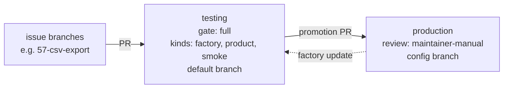

# Factory branches

Generated by `factory branches` from `factory/config.json` on the config branch `production`; do not edit by hand. Work flows from issue branches (`57-<issue title>` for work-order issue #57) through validation branches into production branches; after a promotion or a config PR, `factory update` brings the config branch back into every validation branch ([factory-cli.md](factory-cli.md#factory-branches)).

| Branch | Level | Gate or review | Kinds | Required checks |
|---|---|---|---|---|
| `testing` | validation, default branch | gate full | factory, product, smoke | factory/deterministic, factory/senior-review |
| `production` | production, config branch | review maintainer-manual | – | factory/deterministic, factory/production/production |
