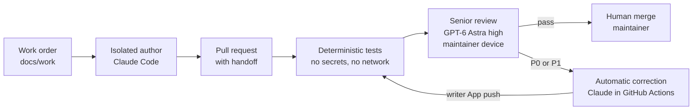

# The Aicepeak software factory

The factory turns an approved work order into a reviewed pull request. An isolated AI author writes the change, deterministic tests and an independent GPT-6 Astra reviewer check it, a bounded automatic correction loop fixes blocking findings, and a human decides the merge.

This file describes what the factory is and how it is built. How to work with it day to day is in [way-of-working.md](way-of-working.md); one-time device setup is in [dev-setup.md](dev-setup.md). The binding rules are [factory/policy.md](../factory/policy.md) and [factory/config.json](../factory/config.json); GitHub operation and the isolated clients are detailed in [factory/github.md](../factory/github.md) and [factory/clients.md](../factory/clients.md).

Only this repository, its work orders and review evidence, and official vendor documentation are project sources. Old projects, private chats, Workbrain content and personal agent memories are not.

## How the factory works



1. **Work order.** `docs/work/<ID>.md` states goal, non-goals, acceptance criteria and the allowed paths. It is merged in its own PR first, because the factory reads tasks only from the protected base.
2. **Author.** Claude Code works in a fresh [isolated author session](#the-isolated-author-session) with the four canonical skills `factory-start`, `factory-change`, `factory-review` and `factory-fix-review`, no personal configuration and only proxied provider access. `runners` allows only `claude`; the optional Codex author has only an API-key path and stays disabled for automatic corrections.
3. **Pull request.** `session.py submit` first runs a collision sweep (the candidate must contain current `main`; overlaps with other open PRs go into the PR body), then an advisory Astra preflight. It opens the PR with exactly one `factory-handoff` block and marks it ready only after a `pass`.
4. **Deterministic gate.** The trusted pipeline on `main` takes a snapshot bound to PR, head, base and policy, then runs syntax, contract, workflow, link and secret checks plus the regression suite without secrets or network. A head that does not contain current `main` fails, so a green check always describes the state a merge produces.
5. **Senior review.** GPT-6 Astra at effort `high` reviews the snapshot in a fresh, tool-less session on a maintainer device (`session.py watch`). GitHub assigns one owner per review; only the publisher App writes the required check.
6. **Correction.** P0/P1 findings on non-control paths start one automatic correction: Claude Sonnet 5.5 in GitHub Actions through Workload Identity Federation; the writer App pushes the verified patch, which starts fresh tests and a fresh review. Control paths (`.github/`, `factory/`, `tools/factory/`, `docs/work/`, README and others in `protected_paths`) are never auto-corrected.
7. **Merge.** With both required checks green and threads resolved, a maintainer decides and merges with `session.py merge`, one PR at a time. No second human approval is required; agents and bots never merge.

A typical PR needs 6 to 10 minutes from push to two green checks (tests 3 to 5, review 2 to 3), plus about 5 minutes per automatic correction, as long as a maintainer device runs the watcher.

## The isolated author session

An isolated author session is a Claude Code session that the factory starts in a disposable Docker container. You start it from your [control checkout](#the-control-checkout) (`--root .` is that folder), on a device set up as an author device ([dev-setup.md, step 4](dev-setup.md#4-configure-the-isolated-author-skip-on-reviewer-only-devices)):

```sh
python3 tools/factory/clients.py launch --root . --runner claude
```

You work with it like a normal Claude Code session; what makes it isolated is what it cannot reach:

- **Only a copy of the repository.** The launcher copies the control checkout into the container. The author never touches your checkout or your home directory.
- **No personal setup.** No personal configuration, memories, earlier sessions or other projects; only the repository's rules (`AGENTS.md`) and the four factory skills.
- **No credentials.** Your Anthropic and Context7 keys stay in a credential broker outside the container. The session gets only a temporary token for that broker, which is its only network destination and which enforces the cost limits. It never sees your GitHub login, so it cannot push, open PRs, comment or merge.
- **Read-only control files.** The factory's own rules and tools (`factory/`, `tools/factory/`, `.agents/`, `AGENTS.md`, …) cannot be changed, only proposed.
- **A patch as the only output.** When the session ends you get a patch file. Nothing reaches GitHub until you inspect, apply and push it yourself.

This lets an AI author write code without being able to misuse your keys, change the rules it is checked against, or publish anything on its own. Details: [factory/clients.md](../factory/clients.md).

## The control checkout

The control checkout is a clean clone of this repository on current `main`, from which maintainers run all factory commands. Changes are made in a separate candidate checkout.

The factory tools run with your credentials, so they must run only reviewed code from current `main`, never unreviewed PR changes that could misuse your keys or weaken the rules they are checked against. Review results are also bound to that `main` commit. `session.py` therefore refuses any checkout that differs from current `main` by even one file.

## Roles

| Role | Who | May | May not |
|---|---|---|---|
| Maintainer | The GitHub accounts listed in `maintainers` in [factory/config.json](../factory/config.json) | Write work orders, open PRs, run the reviewer, give feedback, merge | Push to `main`; approve their own work through a second own account |
| Author | Claude Code in the isolated container | Change files inside the work order's allowed paths and deliver a patch | Push, merge, see GitHub or provider credentials |
| Senior reviewer | GPT-6 Astra `high` on a maintainer device | Read the snapshot and return structured findings | Use tools, edit, approve a merge |
| Publisher App | GitHub App ID 5510081 (`publisher_app_id`) | Publish the required checks and summaries | Change code |
| Writer App | GitHub App ID 5510093 (`writer_app_id`) | Push a verified correction to the PR branch | Change `main` or merge |

When one person holds two maintainer accounts, an approval through the second account is not an independent human review. Maintainers have write access, are in CODEOWNERS and are bypass actors of both rulesets; repository settings, rulesets, environments and App keys stay with the repository owner.

## Limits

Per PR (from [factory/config.json](../factory/config.json)): at most 2 automatic correction rounds, 6 claimed reviews, USD 25 author budget (USD 12 per run), 40 changed files, about 800 KB of review material and a 15-minute timeout per run. Exhausted limits, conflicts and missing credentials always end in `needs-author-action`, never in a silent pass. What the status labels mean and how to react is in [way-of-working.md](way-of-working.md#status-labels).

## Costs

| Item | Cost |
|---|---|
| Senior reviews and preflights | ChatGPT Business Codex quota of the maintainer running them; no API billing |
| Automatic corrections | Anthropic API usage in the Console workspace of the WIF federation, capped per run and per PR; check balance and auto-reload in the Console |
| Local isolated author sessions | Anthropic API usage through `ANTHROPIC_API_KEY` |
| GitHub Actions | Watch usage and the plan; the repository is currently public |

No additional review platform or memory database is used. There is no promise of free use.

## Components

| Path | Content |
|---|---|
| [factory/policy.md](../factory/policy.md), [factory/config.json](../factory/config.json) | Binding policy, models, maintainers, limits, protected paths |
| [factory/github.md](../factory/github.md), [factory/clients.md](../factory/clients.md) | GitHub operation, rulesets, isolated clients and the local reviewer |
| [factory/evidence.md](../factory/evidence.md), [factory/review-2026-10-29.md](../factory/review-2026-10-29.md) | Real verification evidence and the start-readiness review |
| `.agents/`, `.claude/`, `.codex/` | Canonical skills and roles; generated native adapters (`clients.py sync`, checked by `clients.py check`) |
| `.github/` | Trusted pipeline, dispatcher, feedback ingress, CODEOWNERS, templates |
| `tools/factory/` | Factory tools (`clients.py`, `session.py`, `doctor.py`, `verify.py`, …) and their regression tests |
| [docs/work/](work/TEMPLATE.md) | Approved work orders |
