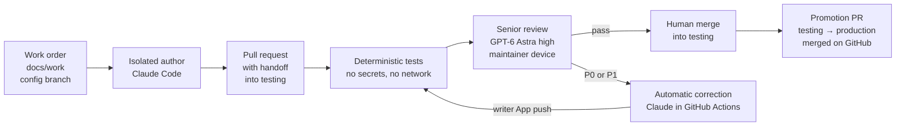

# The Aicepeak software factory

The factory turns an approved work order into a reviewed pull request. An isolated AI author writes the change, deterministic tests and an independent GPT-6 Astra reviewer check it, a bounded automatic correction loop fixes blocking findings, and a human decides the merge into a validation branch. Validated states reach production only by a deliberate promotion.

This file describes what the factory is and how it is built. How to work with it day to day is in [way-of-working.md](way-of-working.md), with every `factory` command in [factory-cli.md](factory-cli.md); one-time device setup is in [dev-setup.md](dev-setup.md). The binding rules are [factory/policy.md](../factory/policy.md) and [factory/config.json](../factory/config.json); GitHub operation and the isolated clients are detailed in [factory/github.md](../factory/github.md) and [factory/clients.md](../factory/clients.md).

Only this repository, its work orders and review evidence, and official vendor documentation are project sources. Old projects, private chats, Workbrain content and personal agent memories are not.

## How the factory works



1. **Work order.** `docs/work/<ID>.md` states goal, non-goals, acceptance criteria and the allowed paths. It is merged into the config branch in its own PR first (`factory issue`, then `factory submit workorders`; the required maintainer approvals (`work_order_approvals`, today 1)), because the factory reads work orders only from there, and then copied to the validation branches (`factory sync workorders`).
2. **Author.** Claude Code works in a fresh [isolated author session](#the-isolated-author-session) (`factory start workorder <n>`) with the four canonical skills `factory-start`, `factory-change`, `factory-review` and `factory-fix-review`, no personal configuration and only proxied provider access. `runners` allows only `claude`; the optional Codex author has only an API-key path and stays disabled for automatic corrections.
3. **Pull request.** `session.py submit` (run by `factory submit --finished`) targets the validation branch routed for the work order's kind (today `testing`). It first runs a collision sweep (the candidate must contain the target's current tip; overlaps with other open PRs into it go into the PR body), then an advisory Astra preflight. It opens the PR with exactly one `factory-handoff` block and marks it ready only after a `pass`.
4. **Deterministic gate.** The trusted pipeline always runs on the config branch, so its code, configuration, policy and work orders are the config branch tip. It takes a snapshot bound to repository, PR, head, config tip, target branch, run and attempt, then runs syntax, contract, workflow, link and secret checks plus the regression suite without secrets or network. The trusted tests run against the PR head, a config PR's changed `factory/config.json` included; they never take the branch list or the config branch from it, so a change of the branch list passes them. A head that does not contain the target's current tip fails, so a green check always describes the state a merge produces.
5. **Senior review.** For a target with gate `full`, GPT-6 Astra at effort `high` reviews the snapshot in a fresh, tool-less session on a maintainer device (`factory watch`, which runs `session.py watch`). GitHub assigns one owner per review; only the publisher App writes the required check. A target with gate `tests` stops after the deterministic gate.
6. **Correction.** P0/P1 findings on non-control paths of a PR into a `full` validation branch start one automatic correction: Claude Sonnet 5.5 in GitHub Actions through Workload Identity Federation; the writer App pushes the verified patch to the feature branch, which starts fresh tests and a fresh review. Control paths (`.github/`, `factory/`, `tools/factory/`, `docs/work/`, README and others in `protected_paths`) are never auto-corrected.
7. **Merge.** With the required checks of the gate green and threads resolved, a maintainer decides and merges into the validation branch with `factory merge` (`session.py merge`), one PR at a time. No second human approval is required; agents and bots never merge.
8. **Promotion.** `factory promote testing` opens the PR `testing` → `production`. Its deterministic tests run on every new commit, and the senior review starts only when a maintainer comments `/review`. The production check `factory/production/production` passes only for the current, up-to-date tip of `testing` as the only open promotion and, because `production` has review mode `maintainer-manual`, only after the senior review of exactly this PR's head passed; the reviewing maintainer device re-runs the check when the review finishes. A maintainer merges it on GitHub.

A typical PR needs 6 to 10 minutes from push to two green checks (tests 3 to 5, review 2 to 3), plus about 5 minutes per automatic correction, as long as a maintainer device runs the watcher.

## Branches

Changes travel in three levels: **feature branch → validation branch → production branch** ([diagram](factory-branches.md), [ADR-0008](decisions/0008-branch-model.md)).

- **Validation branches** are protected and gated automatically at their `gate`: `full` (deterministic tests, binding review, corrections), `tests` (deterministic tests only) or `none` (not gated). Each work-order kind is routed to exactly one of them. Today there is one, `testing` (gate `full`, every kind), the GitHub default branch. Maintainers may also push to them directly.
- **Production branches** are protected, and nobody pushes to them; their rulesets require `factory/deterministic` and the production check `factory/production/<branch>`. They take only promotions from a validation branch and work-order or config PRs approved by as many maintainer accounts as `work_order_approvals` in `factory/config.json` names (today 1); anything else fails their production check. Their `review` mode decides the AI review of promotions into them: `maintainer-manual` (required: started with `/review`, enforced by the production check for the promotion's own head), `initiated` (optional) or `no` (never offered). A PR whose head is a validation branch of this repository is a promotion, whatever its files. Work-order and config PRs never need an AI review, and `/review` is refused on them. Today there is one, `production`.
- **The config branch** (`config_branch`, today `production`) is the one production branch from which every rule comes: gate code, `factory/config.json` with the branch list, the policy and the work orders. Every factory job runs on it; the GitHub environments and the federation rule admit only it. A push to it re-runs the open PRs into the gated validation branches and the other production branches. `factory set config branch` moves this role with two config PRs; the dispatcher, the installer and the CLI follow a finished change once. It refuses while the new branch lags behind the current config branch (configuration or work orders) or the default branch still names an earlier config branch, and its last owner step re-runs the open PRs on the new branch.

`/bypass <reason>`, a maintainer comment, passes the required factory checks of the head that was current when it was posted, with login and reason; it counts only while its comment is unedited, is never repeated by a re-run, applies to every promotion and never applies to work-order or config PRs into a production branch. The branch list is changed with the `factory` CLI through config PRs into the config branch ([commands](factory-cli.md#factory-add-validation-branch)). Daily use is in [way-of-working.md](way-of-working.md#branches-and-promotion).

## The isolated author session

An isolated author session is a Claude Code session that the factory starts in a disposable Docker container, on a device set up as an author device ([dev-setup.md, step 4](dev-setup.md#4-configure-the-isolated-author-skip-on-reviewer-only-devices)). Day to day, `factory start workorder <n>`, `factory fix`, `factory hotfix` and `factory review` run it unattended through `clients.py run` and show its steps live ([command reference](factory-cli.md)). For an interactive session, start it from your [control checkout](#the-control-checkout) (`--root .` is that folder):

```sh
python3 tools/factory/clients.py launch --root . --runner claude
```

What makes it isolated is what it cannot reach:

- **Only a copy of the repository.** The launcher copies the checkout it is given into the container: the control checkout for `launch`, a snapshot of the work branch for factory runs, always with the control files of the trusted code (the control checkout locally, the config branch in GitHub Actions). The author never touches your checkouts or your home directory.
- **No personal setup.** No personal configuration, memories, earlier sessions or other projects; only the repository's rules (`AGENTS.md`) and the four factory skills.
- **No credentials.** Your Anthropic and Context7 keys stay in a credential broker outside the container. The session gets only a temporary token for that broker, which is its only network destination and which enforces the cost limits. It never sees your GitHub login, so it cannot push, open PRs, comment or merge.
- **Read-only control files.** The factory's own rules and tools (`factory/`, `tools/factory/`, `.agents/`, `AGENTS.md`, …) cannot be changed, only proposed.
- **A patch as the only output.** When the session ends you get a patch file; reviews (`--read-only`) return only a report. `factory` applies a patch unstaged to your candidate checkout; nothing reaches GitHub until you commit and push it (only `factory hotfix` pushes by itself, behind its [push gate](factory-cli.md#factory-fix-and-factory-hotfix)).

This lets an AI author write code without being able to misuse your keys, change the rules it is checked against, or publish anything on its own. Details: [factory/clients.md](../factory/clients.md).

## The control checkout

The control checkout is a clean clone of this repository on a listed branch, by default the config branch `production`, from which the trusted `factory` code runs. Changes are made in a separate candidate checkout. The global `factory` command manages both ([layout](factory-cli.md#layout)): before every command it verifies under a lock that the control checkout belongs to the configured repository, is on its branch and is clean including untracked and ignored files (only Finder's `.DS_Store` files are tolerated), then fetches and fast-forwards it. It never edits, resets or deletes files there. `factory use branch <n>` lets a device run the CLI code of another listed validation or production branch; the rules still come from the config branch.

The factory tools run with your credentials, so they must run only reviewed code, never unreviewed PR changes that could misuse your keys or weaken the rules they are checked against. Review results are bound to the config branch tip. `session.py` therefore refuses any checkout that differs from the current config branch tip by even one file. `factory` passes it only disposable checkouts written from Git objects of that commit, and background runs use a pinned export of the control commit, so a later update never changes a running job ([trust boundary](factory-cli.md#trust-boundary), [ADR-0007](decisions/0007-factory-cli.md), [ADR-0008](decisions/0008-branch-model.md)).

## Roles

| Role | Who | May | May not |
|---|---|---|---|
| Maintainer | The GitHub accounts listed in `maintainers` in [factory/config.json](../factory/config.json) | Write and approve work orders, open PRs, run the reviewer, give feedback, comment `/review` and `/bypass`, merge into validation branches, push to validation branches, promote and merge production PRs on GitHub | Push to a production branch; approve their own work through a second own account |
| Author | Claude Code in the isolated container | Change files inside the work order's allowed paths and deliver a patch | Push, merge, see GitHub or provider credentials |
| Senior reviewer | GPT-6 Astra `high` on a maintainer device | Read the snapshot and return structured findings | Use tools, edit, approve a merge |
| Publisher App | GitHub App ID 5510081 (`publisher_app_id`) | Publish the required checks and summaries | Change code |
| Writer App | GitHub App ID 5510093 (`writer_app_id`) | Push a verified correction to the PR's feature branch | Change a listed branch or merge |

When one person holds two maintainer accounts, an approval through the second account is not an independent human review; the production check counts accounts and cannot tell them apart (accepted in ADR-0008). Maintainers have write access, are in CODEOWNERS and are bypass actors of the validation rulesets; the production rulesets have no bypass actors. Repository settings, rulesets, environments and App keys stay with the repository owner.

## Limits

Per PR (from [factory/config.json](../factory/config.json)): at most 2 automatic correction rounds, 6 claimed reviews, USD 25 author budget (USD 12 per run), 40 changed files (for a PR into a production branch only when a review is requested), about 900 KB of review material and a 15-minute timeout per run. A local `factory start`, `fix` or `hotfix` run stays within the same USD 25 across all its model steps, USD 12 each ([runs](factory-cli.md#runs-steps-budget-and-logs)). Exhausted limits, conflicts and missing credentials always end in `needs-author-action`, never in a silent pass. What the status labels mean and how to react is in [way-of-working.md](way-of-working.md#status-labels).

## Costs

| Item | Cost |
|---|---|
| Senior reviews and preflights | ChatGPT Business Codex quota of the maintainer running them; no API billing |
| Automatic corrections | Anthropic API usage in the Console workspace of the WIF federation, capped per run and per PR; check balance and auto-reload in the Console |
| Local isolated author runs (`factory start`, `fix`, `hotfix`, `review`, `clients.py launch`) | Anthropic API usage through `ANTHROPIC_API_KEY` (keychain or environment); the run log shows Claude-reported estimates, the broker caps stay authoritative |
| GitHub Actions | Watch usage and the plan; the repository is currently public |

No additional review platform or memory database is used. There is no promise of free use.

## Components

| Path | Content |
|---|---|
| [factory/policy.md](../factory/policy.md), [factory/config.json](../factory/config.json) | Binding policy, models, maintainers, limits, protected paths |
| [factory/github.md](../factory/github.md), [factory/clients.md](../factory/clients.md) | GitHub operation, rulesets, isolated clients and the local reviewer |
| [factory/evidence.md](../factory/evidence.md), [factory/review-2026-10-29.md](../factory/review-2026-10-29.md) | Real verification evidence and the start-readiness review |
| `.agents/`, `.claude/`, `.codex/` | Canonical skills and roles; generated native adapters (`clients.py sync`, checked by `clients.py check`) |
| `.github/` | Trusted pipeline, production check, dispatcher, feedback ingress, CODEOWNERS, templates |
| `tools/factory/` | Factory tools (`clients.py`, `session.py`, `doctor.py`, `verify.py`, …) and their regression tests |
| `tools/factory/cli/` | The global `factory` command, its installer (`install-factory-cli.sh`) and help catalogue |
| [docs/factory-cli.md](factory-cli.md) | Command reference of `factory`: install, layout, commands, runs, trust boundary, troubleshooting |
| [docs/factory-branches.md](factory-branches.md) | Generated diagram and table of the validation and production branches (`factory branches`) |
| [docs/work/](work/TEMPLATE.md) | Approved work orders |
